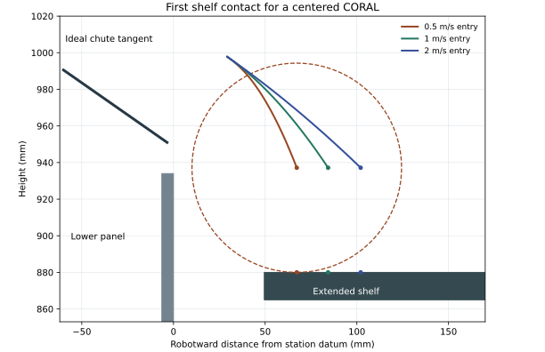

# Where does a station-fed CORAL first touch the receiver?

All three modeled feeds touch the top of the extended shelf. Retracting the shelf 220 mm puts it beyond the tube's entire cross-section at the same height crossing. The slowest feed lands only 17.7 mm beyond the extended shelf's leading edge, so a modest pose or trajectory change could move that case into a corner impact. These results apply to the centered, transverse tube and selected surfaces below. Rebound, capture and transport remain open.

The curves trace the center. The dashed circle shows the 0.5 m/s tube at first contact. Dots on the shelf mark contact positions. The outline and coordinates use equal horizontal and vertical scales.

| Assumed entry speed | Flight after separation | First contact X | Distance past shelf entrance | Downward speed at impact | Minimum gap to lower panel, conservative bound |
| ---: | ---: | ---: | ---: | ---: | ---: |
| 0.5 m/s | 68.3 ms | 67.2 mm | 17.7 mm | 1.119 m/s | 5.02 mm |
| 1.0 m/s | 67.2 ms | 84.3 mm | 34.8 mm | 1.232 m/s | 9.65 mm |
| 2.0 m/s | 44.4 ms | 102.1 mm | 52.6 mm | 1.583 m/s | 10.40 mm |

Run `python scripts/receiver_contact.py` to print the six cases as JSON. The calculation uses Python's standard library. To regenerate the figure with Matplotlib, run `python scripts/plot_receiver_contact.py cad/receiver-contact.svg`.

## Registration and inputs

Station X increases toward the robot and Z points upward. The January field STEP extraction maps station-local axes to this section as X = −station Z and Z = station Y. Its GE-25014 ramp witness places the sharp-edge model at (−3.486315, 950.980534) mm. GE-25008's lower front panel has a robotward face at X = 0 and a top at Z = 933.958 mm. Its solid lies entirely left of and below that corner. The archived STEP member SHA-256 is `19374bc5a48fda1b3ce0505ef604a47d227c904d1784b6514a2c7d654bf3d918`. The 35° local tangent and 57.15 mm tube radius come from the [preceding experiment](STATION-EDGE.md). The English manual §5.6.2 describes the station opening, while §5.7.1 gives pipe dimensions. Selected scalar witnesses are sufficient to reproduce this screen offline. [FIRST 2025 field STEP](https://firstfrc.blob.core.windows.net/frc2025/FieldAssets/2025Field-STEP.zip) · [FIRST 2025 game manual](https://firstfrc.blob.core.windows.net/frc2025/Manual/HTML/2025GameManual.htm)

The B4 receiving candidate places the robot center at X = 434.525 mm for a centered perpendicular approach. The original shelf box starts at −100 mm in robot-forward coordinates, is 265 mm long and extends 220 mm when receiving. Its robot-forward extremity is 385 mm, yielding a station-frame entrance of 49.525 mm. The 940 mm carriage height places the shelf top at 880 mm. The 420 mm shelf spans a centered 301.625 mm pipe. These robot dimensions are design hypotheses. The contract SHA-256 is `70b296d49ebb19c3ff718eef6a86ae2a0722f6ed86a34dc99a0a6475d5bd76e2`. An earlier shelf configuration can be tested simply by removing the 220 mm extension.

## What makes this a swept check?

From the initial lip tangent through separation, the slow tube follows the supported arc. Faster tubes depart immediately. After separation, the squared lip-to-center distance minus radius squared is

    (v² − g z₀) t² − g vz t³ + g² t⁴ / 4

Here z₀ is the center height above the lip at separation, and vz is its vertical velocity. The departure criterion gives a nonnegative quadratic coefficient, and vz is downward. The center therefore clears the sharp lip throughout free flight. The center advances beyond the end of the ideal ramp tangent, so the lip is its closest point on that ramp. Forcing immediate departure at 0.5 m/s instead produces 0.0425 mm penetration at 5 ms.

The center moves monotonically right and down. For every arc and flight subinterval the panel screen pairs the smallest X with the smallest Z to bound the distance to the entire panel. The minimum of those bounds covers the time between samples. The falling tube cannot touch the shelf while its lowest point is above the shelf top. The exact positive root for that height crossing gives first shelf contact when the center is inside the shelf span. An ambiguous corner case returns an unresolved result. With the retracted shelf, even the tube's rightmost point remains short through that crossing.

This interval starts at the initial lip tangent. The model screens the ideal ramp, one lower panel and the receiver floor. Station fasteners, side guides, receiver reserves, prior chute transit, lateral offset and yaw require additional geometry. The next test should vary stand-off around the slow case and resolve contact with the rounded or square shelf entrance before estimating rebound or retention.
