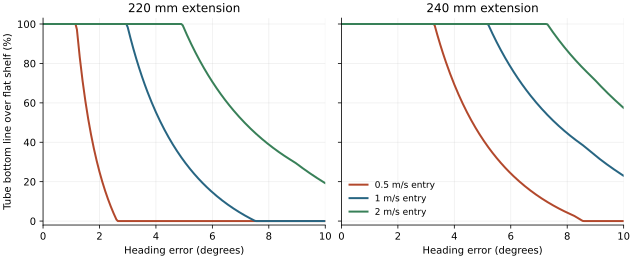

# How precisely must the robot dock at the CORAL station?

With an 850 mm square bumper envelope, turning just 2° at the nominal centered distance pushes one corner 5.05 mm across the modeled station plane. Moving the chassis back 14.57 mm restores the original 9.525 mm gap. That retreat changes how much of an incoming CORAL first touches flat shelf material. On the 6 mm rounded entrance at 0.5 m/s, a 220 mm slide extension then covers 75.38 mm of the 301.625 mm bottom line. A 240 mm extension covers all of it. At 5° even the longer extension covers only 125.76 mm.



The curves assume the robot has backed away enough to preserve the 9.525 mm bumper gap, its center remains laterally aligned, and the tube axis stays parallel to the station. The vertical axis measures the length of the tube's lowest straight line over the flat shelf the instant the tube bottom reaches shelf height. Partial contact can impart rotation. Zero means the flat top is missed at that instant; the tube may still strike a rounded edge. Actual capture requires subsequent contact and motion evidence.

| Heading error | Bumper clearance if chassis stays put (mm) | Retreat to preserve gap (mm) | Flat overlap, 220 mm extension (mm) | Flat overlap, 240 mm extension (mm) |
| ---: | ---: | ---: | ---: | ---: |
| 0° | +9.525 | 0.00 | 301.625 | 301.625 |
| 2° | −5.05 | 14.57 | 75.38 | 301.625 |
| 5° | −25.90 | 35.42 | 0 | 125.76 |
| 10° | −57.82 | 67.34 | 0 | 0 |

**Provisional alignment trial.** With the 240 mm, 6 mm-radius shelf, 0.5 m/s feed, 2° heading error and 10 mm extra stand-off after compensating for bumper projection, all three lateral offsets tested (−25, 0 and +25 mm) leave the whole bottom line over the shelf. At 3° and the same stand-off, the least-covered of those three offsets falls to 45.48%. This gives a concrete discrimination test for a docking controller and a repeatable nominal pose for the next loaded-retraction study. A measured tolerance for team hardware is still needed.

## Frame, mechanism and source

The [receipt for first impact](STATION-RECEIVER.md) identifies B4's provisional station-fed L1 cycle, shelf dimensions, nominal registered chassis distance and the two manufactured-shape alternatives modeled in STEP. The [chute separation model](STATION-EDGE.md) and [previous transverse-pipe study](RECEIVER-CONTACT.md) supply the trajectory and game-piece length. The centered B4 robot has an 850 mm square bumper envelope and a 434.525 mm chassis distance. The 220 and 240 mm receiving extensions put the leading edge 385 and 405 mm ahead of the chassis center. Shelf top is 880 mm above the station datum floor. No team selection of competition role or allowed error is implied.

For yaw θ the frontmost bumper projects 425 × (|cos θ| + |sin θ|) mm. Recenter the chassis to preserve the chosen wall gap, then place the complete finite shelf at that chassis pose. At first bottom/top height, clip the finite tube bottom line against the straight portion of the 265 × 420 mm shelf. Radius 6 mm removes the first 6 mm of flat top. The analytical calculation returns the actual station-Y interval in addition to the total length. The finite shelf width can cut this interval independently of front-edge reach.

Run the following from the POC root.

```sh
python scripts/receiver_dock.py --yaw-deg 0 2 3 5 10 --lateral-mm -25 0 25 --speeds 0.5 --extra-standoff-mm 0 5 10
python -m unittest discover -s tests -p test_receiver_dock.py
python cad/station-receiver/verify_docking.py
python scripts/plot_receiver_dock.py dock-coverage.svg
```

The first two commands use standard Python. The third uses OCP 8.0.1 to reopen both STEP solids, select the unique upper horizontal face, place that face in the station frame and measure its Boolean common edge with the full tube-bottom line. All twelve lengths matched the analytical interval within 0.00001 mm, including no overlap, full overlap, one-sided contact and mirrored/offset approaches. The [native receipt](cad/station-receiver/docking-receipt.json) binds each case to its source and STEP hashes. The optional chart command uses Matplotlib.

The station is represented by one conservative plane and the selected chute trajectory. These trials omit station wings, non-square bumper cuts, compression, changing feed orientation, pipe spin, dynamic robot motion and robot-to-station contact duration. A distance to this plane cannot establish G413.A compliance, field tolerances or impact survival. Compare actual yaw and station-relative pose during the full slide/withdrawal path, then use the same piece state for a retention/retraction experiment.
