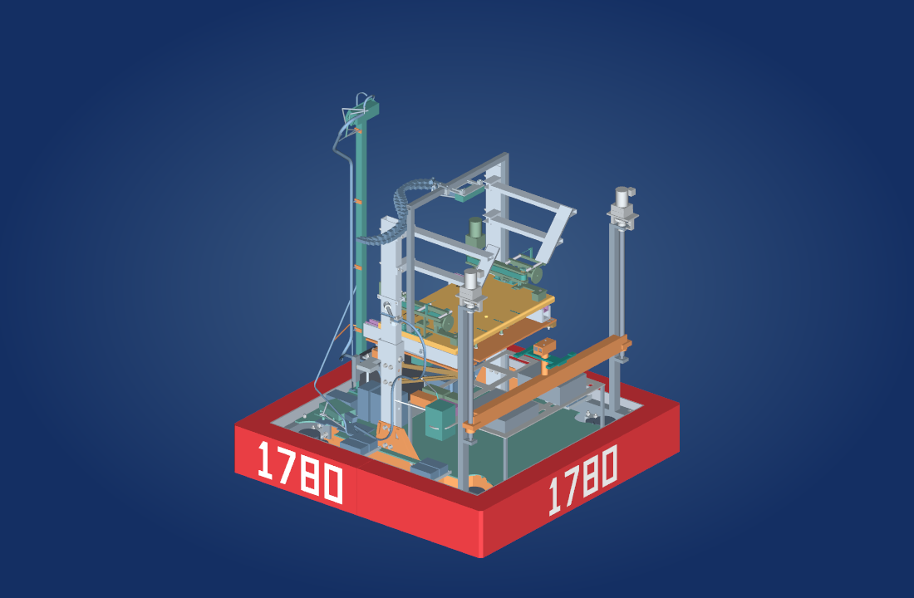

# Captive swerve and front shallow-cage engineering review

Start with the [receiver service issue](receiver-service/verification.md) for the current installed assembly and [six fabrication sheets](receiver-service/issue/assembly-drawings.pdf).

**Prior 1,183-part issue.** The [construction traveler](issue/drawing-traveler.md) and [1,183 installed body register](issue/material-register.csv) combine the two screw drives, integral module bearing lands, captive shoulder pins, damper locknuts, bolted battery stop feet and source-checked roboRIO and PDH mounts. The [engineering upper](issue/mass.json) is 52.044595 kg, including 5 kg of unresolved stock allowance, 118.527 g below the R103 limit. The earlier as-issued audit and separate fit/weight trials below retain their source scopes.

The selected chassis retains four MAXSwerve modules, its fixed-low captive receiver, both cameras, the numbered bumpers and the shallow-cage alternative. The original cage-jack archive used steel for all 1,031 leaf bodies. An independent Fusion reopen measured 412.380 kg of native bulk. Each 14,910.39 cm³ rear/front half of foam displayed 117.047 kg. The first material-assigned engineering archive returned 0.552 kg per half at 37 kg/m³. The geometric game piece, supplier enclosures and wiring allowances each have their own treatment in the physical bill. [Original Fusion measurements](as-issued-native.csv) · [Make stock and article ownership](material-register.csv) · [Purchased assemblies and allowances](article-register.csv)

## What the reopened file contains

[Download the 16.8 MB editable Fusion assembly](issue/Team-1780-engineering-shallow.f3d) or [rotate it in the browser](https://ehartye.github.io/frc-2025-poc/detailed-design/archive/draft-001/engineering-assembly.html). Its measured 48.046916 kg includes the demonstration CORAL and supplier display solids. On independent reopen, every one of 1,184 body identities, world bounds and BRep volumes matched the frozen drawings; 21 of 26 joints are movable and all 21 moved and returned. The other five are rigid. A steel-substitution trial on one foam core fails the portable checker. The bill carries 98 provisionally estimated installed items, so the checker leaves final inspection margin unresolved. A separate receiving-budget calculation retains 118.527 g of design headroom on this exact variant. The revised battery kit consumes 36.739 g of that headroom, leaving 81.788 g. [Per-body CAD comparison](issue/cold-reopen.json) · [Mass evidence and material differences](issue/mass-review.json)

## What to build from this issue

The [eight dimensioned sheets](issue/assembly-drawings.pdf) locate the manufactured interfaces. The full frozen assembly preserves a rejected battery fit. Each Ø5 tie rod crosses a stop foot by 58.905 mm³ and one foot crosses the main breaker by 168 mm³. The exact model drawing allows ±1 mm and the later North American family table allows ±2 mm. A 0.5 mm wider and longer case already strikes all four rigid stops. Use the [battery fit revision](battery-fit/fit.json) alongside the frozen assembly before machining.

## What the reopened file contains

[Download the 16.8 MB editable Fusion assembly](issue/Team-1780-engineering-shallow.f3d) or [rotate it in the browser](https://ehartye.github.io/frc-2025-poc/detailed-design/archive/draft-001/engineering-assembly.html). Its measured 48.046916 kg includes the demonstration CORAL and supplier display solids. On independent reopen, every one of 1,184 body identities, world bounds and BRep volumes matched the frozen drawings; 21 of 26 joints are movable and all 21 moved and returned. The other five are rigid. A steel-substitution trial on one foam core fails the portable checker. The bill carries 98 provisionally estimated installed items, so the checker leaves final inspection margin unresolved. A separate receiving-budget calculation retains 118.527 g of design headroom on this exact variant. The revised battery kit consumes 36.739 g of that headroom, leaving 81.788 g. [Per-body CAD comparison](issue/cold-reopen.json) · [Mass evidence and material differences](issue/mass-review.json)

## What to build from this issue

The [eight dimensioned sheets](issue/assembly-drawings.pdf) locate the manufactured interfaces. The full frozen assembly preserves a rejected battery fit. Each Ø5 tie rod crosses a stop foot by 58.905 mm³ and one foot crosses the main breaker by 168 mm³. The supplier allows a 1 mm tolerance on each case dimension. A 0.5 mm wider and longer case already strikes all four rigid stops. Use the [battery fit revision](battery-fit/fit.json) alongside the frozen assembly before machining.

## Shop sequence

| Stage | Make, assemble and inspect |
|---|---|
| Swerve | Mount the four REV-21-3005 modules with the selected 12-tooth low gearing and V2 plastic wheels. The outer and inboard saddles support the supplier's tab surfaces. Match the Ø5.30 two-hole pattern to the outer tab holes at 25.4 mm pitch. The two bored side-screw bosses require positive thread engagement. Use sixteen Bolt Depot 8232 ASTM A574 #10-32 × 2¾ in socket screws and sixteen 2623 zinc nylon-insert locknuts. The tight stack measures 58.74875 mm, leaving 4.77665 mm past the maximum catalog nut. Eight locations block the upper socket when installed. Tighten the removed, supported module and saddle on the bench. Verify clamp slip and fatigue where threads pass through the upper tab. Both bumpers and the corresponding outboard deck tie have to come off for module extraction. [Module, saddle, screw and removal drawings](../../experiments/swerve-drive/packaging/README.md) |
| Chassis and jack columns | Reference drill coordinates to the chassis center, +X forward, +Y left, +Z up. Match-drill the four saddle axes at X270 and 317, Y±341 mm. Use Ø10.10 bores through both 2 mm rail walls. Fit each Ø9.98 × Ø6.60 sleeve to its own measured rail height. The model uses 99.95 mm sleeves. The detachable 9 mm saddle takes a Ø6.60 through bore and a 90° countersink to Ø13.45. Install class 10.9 ISO 10642 M6×120 screws with the conical bearing face seated. Fit OD12×1.6 washers and prevailing nuts. Five millimetres of projected thread is available with the modeled stack. A 4 mm key with Ø4.8 shank approaches from above, a 10 mm socket with Ø15 exterior from below. Check all four seats with engineer's blue and gauge actual protrusion. [Hole coordinates and material tests](interfaces.json) · [Independent perturbation and battery-service controls](cold-check.json) |
| Upper deck | Use the keyed signal-light platform and four tapped 8 mm posts. At each end of each post center-drill Ø2.50 and tap M3×0.50. Fit the lower flat-head screws on the bench before lowering the deck onto the chassis. The two front drivers intersect the crossrail after assembly. Install the upper platform with the four M3×10 screws and the separate lamp spacer. The smooth major-thread envelopes intentionally enter the tap pilots. The real am-3583 solid clears the platform and spacer. [Supplier lamp fit, post coordinates and deck reliefs](interfaces.json) |
| Battery | Use the [matched-stop and insulating keeper traveler](battery-fit/traveler.md) for the revised bay. Eight M4 through fasteners clamp the stop feet, tray and structural deck. The two 197 mm M5 rods, 166.80 mm sleeves and FR-4 cover set the vertical limit without clamping the recessed lid. Isolate and unplug the pack. Remove both top nuts, washers, keeper and loose sleeves. Lift 250 mm, then carry through either side. The earlier 172 mm check stops short of the lateral exit. |
| Bumpers | Weld the eight Ø24×8 bosses before fitting foam. Tap M8×1.25 through the 12 mm completed boss/backer stack. Fit four M8×35 end screws, four M8×40 side screws, eight OD16×1.6 washers and the specified crush sleeves. Inventory which rail fixtures remain on the robot for inspection. [Bumper assembly and section drawings](../../experiments/six-wheel/design/bumper-kit/README.md) |
| Receiver and cameras | Retain both mechanical fixed-height locks and the Z395 backup holes. The shorter fixed-service variant loses its H670/H940 adjustments. Install the actual cam face, bearings, guide studs, fixed and moving optics and the two bore-pin capture yokes. Match the end-specific belts, 550 motor pinions and shafts to the drive drawing. Lock the slide and remove the game piece before preparing to climb. The pocketed support bridge requires a new deflection check before inheriting the earlier station-contact response. [Cam receiver handoff](../swerve-captive/study.md) · [Receiver motor and drive details](../../experiments/six-wheel/design/receiver-drives/README.md) |
| Electrical installation | Install the PDH, breaker and radio with the actual received mounting holes and service clearances or leave their locations provisional. A sealed product's enclosing solid can rest on the deck while its fasteners have no attachment. The separate controller tray drawings, wire cuts, 40 mm service space and supply protections identify the eight drive controllers. Verify circuit identity and device fastening on the assembled deck. [Controller housing and tray study](../../experiments/swerve-drive/power/README.md) |
| Front jack | The shop study compares two real Acme screw stacks, separate thrust faces, a 24-tooth ratchet, commercial motor and gearcase against the original empty actuator allowance. Read the mechanical limitations below before using the climb drawing. |

The individual pick list records article, installed quantity, material/finish when determined, source and access. A row with an unresolved grip or unspecified bought article still needs a receiving measurement or drawing. A CAD screw's solid volume can screen weight and clearances while its physical mass and thread runout remain open. [Threaded hardware pick list](fastener-pick-list.csv)

## What can hold the robot?

Roton 59285 is a 5/8–8 single-start right-hand Acme screw. The bronze 90234 nut has a 15/16–16 UN mounting thread, 28.575 mm flange, 25.4 mm total length and an 8.45 kN catalog operating load. Each of two screws drives through a REV NEO 550, a REV-41-1608 pinion, REV-41-1607 motor plate, REV-41-1603 stage and REV-41-1604 output. Two axial needle packs carry the reversing force through hardened AS1024 washers to a stationary bracket. The proposed 24-tooth catch has 0.132 mm theoretical one-tooth settle. At 74 kg and 1.5 g with a 65% heavy side, one screw sees 708 N. A 40 mm/s lift requires 1.117 N·m at that screw under the stated efficiency assumptions. The motor, thrust bearing, gearbox torque capacity, weld, coupling keys, pawl stop, spring, release cable and independent engagement sensing need separate checks. [Transmission shapes](jack-transmission.step) · [Load calculation and interferences](jack-transmission.json) · [Roton screw and 90234 nut](https://www.roton.com/family/acme-right-screws-and-nuts-7059285/) · [REV cartridge](https://www.revrobotics.com/rev-41-1603/)

Moving only the old shoe 36 mm leaves 17.5 mm of daylight between it and the 37 mm carrier. A driven slider joint alone cannot transfer the cage reaction across that gap. The original clamped arrangement also needs approximately 4.19 kN under the plate and 4.91 kN on its upper shoes in the previous whole-robot gravity calculation. The field CAD shows nominal material and contact area. It supplies no permissible local service load.

Moving the support nearer the assumed center of mass lowers the gravity moment. At X0 it drops to 52.3 N·m in the level-chassis CG envelope, but the native shallow cage intersects the installed camera/receiver even on entry and eleven bodies at the full stroke. A free swivel at the old X300 upper shoe makes the chassis tip into the carpet under the bottom-plate pivot. A second design puts four pads only on the top cage plate and lets the chassis rotate beneath a higher swivel. At X300 the raised receiver then hits the cage. The signed field registrations and finite negative witnesses remain available for comparison. [Centered support trials](support-choice.json) · [High pivot, actual interference and four contact patches](high-support.json)

**Competition decision.** Use the independently completed leave-and-park routine for the demonstrated endgame. The new mechanical and material studies grant zero match climb points. The complete build still requires cleared attachment and field load paths, battery terminal and device service clearances, a corrected fastener order sheet, an inspection-weight result including all installed articles, and successful same-revision mechanical and sensing trials. [Verified fallback](../../experiments/swerve-drive/motion/fallback.md)

