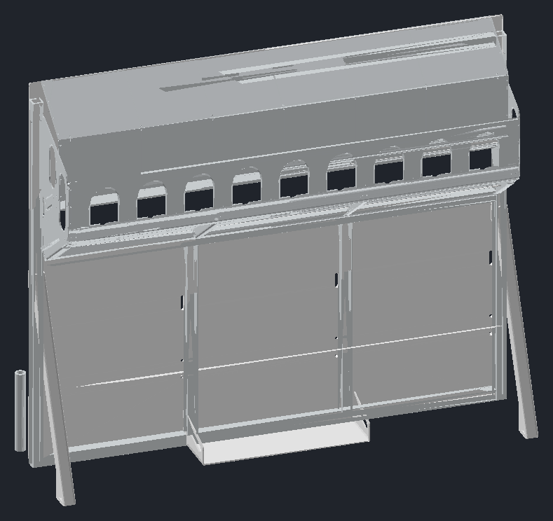
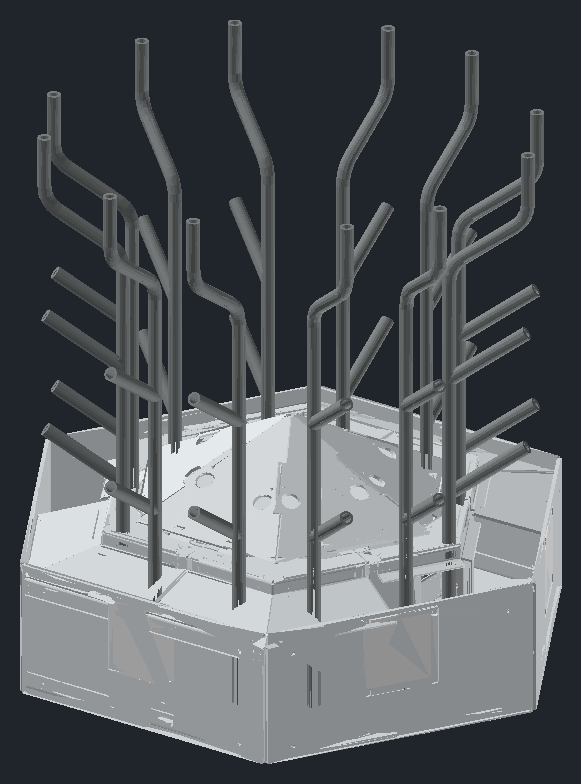

# Official 2025 field fixtures

<!-- cad-still -->
[](https://ehartye.github.io/frc-2025-poc/preliminary-design/)

**Project CAD · Fixed pocket 1.0, preliminary design · in-progress.** Whole-robot blockout on four-module swerve: fixed pocket, held two-roller nip and deploy-once exit lip. Parked pose at the end of the withdraw-park case, lip deployed and pocket empty; field parts, the delivered pipe and the two service hand gauges are hidden. It is not detailed CAD. [Open the design review](https://ehartye.github.io/frc-2025-poc/preliminary-design/)
<!-- /cad-still -->

FIRST's official field model, trimmed to the two fixtures the preliminary design's missions touch: the red coral station the robot receives from and the red REEF whose L1 trough it delivers into. The preliminary design is checked, trialled and shown against these parts: `checked_fixtures.py` writes the official solids the layout check uses to `cad/preliminary-design/releases/1.0/field-fixtures.step`.

| | |
| --- | --- |
| Source | <https://firstfrc.blob.core.windows.net/frc2025/FieldAssets/2025Field-STEP.zip> |
| Archive | `2025Field-STEP.zip`, 6,833,726 bytes, SHA-256 `085bb016261bdc850986427f571f646f7f562641a5c6f0f4f6ff32a511084bb1`, server Last-Modified 2025-01-10 |
| Member | `FE-2025.STEP`, 34,901,464 bytes, SHA-256 `19374bc5a48fda1b3ce0505ef604a47d227c904d1784b6514a2c7d654bf3d918` |
| Edition | SolidWorks 2022 STEP AP214 export stamped 2025-01-09T21:33:18. It predates the later field drawing revisions. |
| Retrieved | 2026-11-22 |

The whole-field file is not kept here. `official-field.json` is the record: source, hashes, products, placements, frames and mesh counts.

## Files

| Fixture | STEP | Official products | Leaf parts |
| --- | --- | --- | --- |
| Red coral station | `red-coral-station.step` (4.2 MB) | `GE-25000_Red 3 Corner` | 169 |
| Red REEF | `red-reef.step` (5.6 MB) | `GE-25300_Red` | 1,288 |




Each STEP holds the official root `FE-2025`, the one selected top-level occurrence and everything below it. `extract.py` copies the records from the official file as written, so product names, geometry, colours and the official field placement are unchanged. The file is in inches, Y up, origin at the field centre on the carpet, +X toward the red alliance wall.

- `<id>.parts.json` lists every placed leaf part with its bounds in the official frame, the project field frame and the layout's docked robot frame.
- `<id>.meshes.json` holds display meshes in the project field frame, as `fieldBodies` for a review replay set (`{name, category, color, mesh: {v, f}}`, millimetres). Fasteners and small parts are left out. The meshes are per-part closed surfaces merged by group. Thin sheet parts leave a few unshared edges.
- OpenCascade reads the PEM clinch nuts and the AprilTag base plate `FE-00082` as empty, in the official file too. They stay in the STEP and are absent from the part lists and meshes (17 in the station, 132 in the REEF).

## Frames

Project field frame, millimetres: `field = (8774.1125 + x, 4025.9 - z, y)` from official coordinates in millimetres.

The docked robot frames come from the registration the layout already uses (`experiments/six-wheel/mission/field-registration.json`). Each is a 3 x 4 matrix from official millimetres, in `official-field.json` under `dockFrames`.

| Frame | Registration |
| --- | --- |
| `receive-dock` | Robot -X faces the station. The station's upper-panel datum plane through the registered origin is at X = -455.5, 10 mm behind the rear bumper face. The origin, the middle of the 1,930 mm chute, is at Y = 0. |
| `delivery-dock` | Robot +X faces the REEF. The midfield-facing trough lip face is at X = 495.5, 50 mm ahead of the bumper face. Y = 0 is the centre of one of that face's two trough panels, so the other panel is the neighbouring sector toward -Y. |

## Parts the layout check uses

`checked-fixtures.json` picks 20 official solids: the station's lower barrier, two wall panels, chute plate, upper guard, two side plates and two frame uprights; the docked REEF face's trough lip, two floor panels, two risers and the two branches over the trough (column, L2 arm and L3 arm each). `checked_fixtures.py` places each solid as FIRST drew it at the robot's dock and records the official parts that touch each other and the section the planar trials use, measured on the solids.

```sh
python -I -B cad/field/official/checked_fixtures.py OUT.step OUT.json
```

The receive dock puts the lower barrier, the part the bumper meets, 10 mm behind the rear bumper face. The dock frame recorded in `official-field.json` is taken from the upper-panel datum 9.525 mm farther back, so the script moves the station parts by that difference.

## Against the earlier planning solids

The design first used project-drawn stand-ins. This table records how they compared, in the dock frames of `official-field.json`. All values are millimetres in the docked robot frame.

### Coral station, `receive-dock`

| Feature | Planning solid | Official | Difference that matters |
| --- | --- | --- | --- |
| Chute top surface, exit edge | (X -455.5, Z 952.5) | (X -459.0, Z 951.0), `GE-25014` | The pipe leaves 3.5 mm farther from the robot and 1.5 mm lower. The surface is 3.2 mm lower measured square to the chute. |
| Chute slope, length, plate | 35 deg, 419.1, 12.7 | 35.0 deg, 417.6 along the top surface, 12.7 | None beyond the edge offset. |
| Chute width | 340 (Y -170 to 170) | 1,930 (Y -965 to 965) | The stand-in is a slice. |
| Wall below the opening | One face at X -455.5, floor to Z 950 | Panel `GE-25008` at X -455.5, Z 305.3 to 934.0. Lower barrier `GE-25007` at X -446.0, Z 0 to 304.8. | The barrier stands 9.5 mm proud of the datum. At the 10 mm dock gap it is 0.5 mm from the rear bumper face. |
| Opening | Not drawn | Z 934.0 to 1,130.3 between `GE-25008` and `GE-25009`; upper panel to Z 1,695.5 | Robot parts above Z 1,130 within reach of X -455.5 meet the upper panel. |
| Upper guard over the chute | Not drawn | `GE-25017`, underside from (X -519.6, Z 1,144.6) to (X -679.0, Z 1,256.2) | The guard is 123.9 mm above the chute surface, measured square to it. A 114.3 mm pipe has 9.6 mm to spare, so a bounce on the lower ramp is capped. |
| Human-side guides | Not drawn | `GE-25020` at X -815.0 to -802.3, Z 1,191.4 to 1,394.6; `GE-25021` above it | Out of the robot's reach. They bound where a pipe can start. |

### REEF L1 trough, `delivery-dock`

| Feature | Planning solid | Official | Difference that matters |
| --- | --- | --- | --- |
| Lip | X 495.5 to 508.2, carpet to Z 457.2, Y -704.5 to 233.5 | `GE-25302`: X 495.5 to 508.2, Z 3.2 to 457.2, Y -706.2 to 234.7 | None. The lip is a full-height panel in the official model too. |
| Floor | Top surface Z = 404.91 + 0.268 (X - 495.5), to X 743.3, one piece | `GE-25313`: X 511.2 to 742.9, Z 403.0 to 470.8, two panels (Y -233.4 to 231.1 and -702.6 to -238.1) | A 4.7 mm slot between the two panels. No divider stands above the floor. |
| Inner riser | X 743.3 to 749.7, carpet to Z 517.5, full width | `GE-25315`: X 743.3 to 749.7, Z 468.9 to 517.5, Y -233.3 to 93.7 and -565.1 to -238.1 | The riser is 48.6 mm tall and covers 327 of each panel's 464.5 mm. Past Y 93.7 on the docked panel there is no riser. |
| Branches over the trough | Not drawn | `GE-25301`, 42.2 mm pipe, columns centred at Y -71.4 and -400.0. L2 arm tip at X 536.3 to 562.1, Z 774.6 to 809.6. L3 arm to Z 1,211.6. L4 top upright at X 525.4 to 567.6, ending at Z 1,828.7. | The L2 arm tip is 40.8 mm behind the lip face and 90.8 mm ahead of the bumper face, from Z 774.6 up. The L4 top is 29.9 mm behind the lip face. Anything the robot carries over the lip above Z 774 must miss them. |
| Neighbouring faces | Straight extension | The next lip panels turn back 60 deg at Y 234.7 and -706.2 | Lateral dock error beyond the face width meets an angled lip. |
| Structure under the floor | Plain walls to the carpet | `GE-25310` base sections behind the lip | Hidden behind the lip. No contact surface for the robot. |

## Regenerate

```sh
python -I -B cad/field/official/extract.py PATH/TO/FE-2025.STEP
python -I -B cad/field/official/tessellate.py
```

`extract.py` needs only the standard library and refuses any file but the pinned one. `tessellate.py` needs cadquery-ocp and reads the trimmed files in this folder. `selection.json` names the products, frames and display groups. Keep the downloaded file in its own folder outside the checkout.
