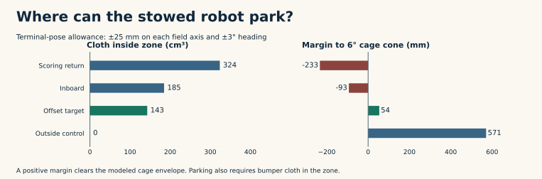

# White 1780 lettering on the fixed-height swerve robot

Team 1780 appears in white on all four sides of the actual red 2025 bumper. The project reuses its 2024 digit outlines at their original size. Each digit is 105 mm high, the major strokes measure 15 mm and digit origins are 80 mm apart. The rows sit between Z59.5 and Z164.5 mm, with 17 mm cloth margin above and below. The front and rear numbers sit at the midpoint of their covers. The left side number sits on the front half, centered at X+200 mm. The right side number sits on the rear half, centered at X-200 mm. Neither side marking crosses the removable joint. [Numbered model](full-robot.step) / [Ordered color and part register](appearances.json) / [Source outlines and placements](markings.py) · [Independent comparison of all four white glyph areas to the issued 2024 model](2024-reference.json)

The four outward normals and reading directions are registered in robot coordinates. From outside the chassis, each face reads **1780** left to right. Each digit is a separate, named, 0.05 mm display layer representing white print on the cloth. When the layer is shifted 0.05 mm inward, the underlying 2025 cover backs its entire area. The original nominal layers have zero material overlap. This gives 16 separate contact witnesses, including both holes in the 8 and the hole in the 0. The labels are appearance geometry and carry no independent fabricated-part or mass credit. Fabric printing, inspection and real-world wear remain open. [Per-digit fit](lettering.json) / [Project palette](../component-palette.json)

The R4 exchange contains 975 solids. The public version includes 24 project-drawn module representations and three supplier envelopes. The straight-guide pose, physical bumper and other registered component bounds carry forward from R3. Its 352 previously positioned STEP leaves have been baked into robot coordinates to keep each physical solid connected to its identifier and appearance when imported in other CAD tools. [Previous assembly and sources](../full-swerve-r3/design.md) / [Student Fusion handoff](../FUSION.md)

```sh
python cad/full-swerve-r4/markings.py <installed-agent-frc> <ignored-project-output>
```

The command rebuilds the public STEP and its ordered appearance register, checks all sixteen text solids against the native cover shapes, and writes the locally importable project-only geometry and resolved appearance palette to the output directory. Manufacturer module geometry stays in the authorized local Fusion assembly.


Fusion reopened the complete stowed robot with the original supplier module assemblies and verified the exact colors and placed bounds of all 948 project solids, including the 16 white numerals. [Native archive and inspection record](native-reopen.json)

## End-of-match park target

Aim the stowed red robot at field **X 9.6000 m, Y 2.4272875 m, heading 180°** for the next drive replay. Shifting the previous inboard target 151.2 mm toward the red end preserves bumper overlap while giving the adjacent hanging cage more space.



| Terminal target | Bumper cloth guaranteed inside zone | Static hardware clearance, lower bound | Margin to six-degree cage cone |
|---|---:|---:|---:|
| Previous scoring return | 323.8 cm³ | 0 mm | −233.3 mm |
| Previous inboard | 184.9 cm³ | 100.3 mm | −93.1 mm |
| Offset toward red end | 142.8 cm³ | 251.5 mm | +53.8 mm |
| Outside control | 0 cm³ | ≥350 mm | +570.7 mm |

The study reopens the two physical bumper covers from the numbered 975-solid R4 STEP. It intersects them with the red zone after eroding its edges enough to cover any combination of ±25 mm field-X, ±25 mm field-Y and ±3° yaw. The enlarged whole-robot box also includes the registered supplier module bounds. A zero static gap or negative cone margin leaves clearance unresolved. The cone uses all six registered hanging axes, the widest cage section and the highest eye. Six degrees is a design stress case. The match replay still has to drive there with the mechanism stowed, account for other robots and displaced pieces, brake and hold through assessment. This screen earns no match points.

[Reopen and recompute](../../experiments/swerve-drive/motion/park_endpoint.py) with the registered official field STEP and an output JSON path. [Machine-readable measurements and source hashes](../../experiments/swerve-drive/motion/park-endpoint.json) · [Redraw the chart](../../scripts/plot-park-endpoint.py)
