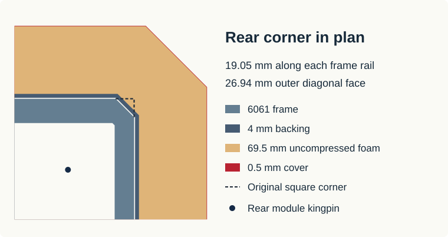

# Rear frame corners for a new swerve chassis

**Keep the square rear frame on the issued receiver-service robot. For a new welded frame using the same module centers, start with a 19.05 mm setback at each rear corner.** This changes the aluminum chassis perimeter and the bumper backing, padding and cloth together. The existing 8 mm fabric and foam corner trim leaves the underlying square frame intact. The new straight diagonal has a 26.94 mm face and makes a 135° inside angle with each adjacent rail. [Five-part neutral construction](rear-facet-construction.step) · [Reopened shape and dimensions](construction.json)

| Setback on each original frame rail | Gap to both fixed module plates | Effect on the installed MAXSwerve module |
| --- | ---: | --- |
| 19.05 mm | 4.685 mm | A 0.25 mm shift inward preserves separation. |
| 25.40 mm | 0.195 mm | A 0.25 mm inward shift intersects each fixed plate by 0.551 mm³. |
| 50.80 mm | Contact | Tube enters the lower plate by 833.745 mm³ and the upper plate by 610.930 mm³. |
| 76.20 mm | Contact | Lower and upper plate intersections reach 1,235.122 and 1,501.172 mm³. |

Both rear modules give the same result using the two actual P01/P02 supplier solids. A wider corner at these stations calls for a different module mount, location or frame section. A changed kingpin location also changes swerve kinematics, load transfer and the achieved trajectories. [Signed supplier-geometry checks](fit.json) · [REV configuration and source identity](../../experiments/swerve-drive/packaging/module.json)

## Frame and bumper construction

Use robot X forward, Y left and Z up. The original rear plane is X−350 mm and the sides are Y±350 mm. Mark the two new outer face endpoints at X−350, |Y|330.95 and X−330.95, |Y|350 mm. The proposed 6061 rectangular tube spans Z50–150 mm with a 20 mm normal depth and 2 mm walls. Keep the existing 20 mm rear and 25 mm side rails in the adjacent straight runs. The original rear crossmember ends at |Y|325, **5.95 mm short** of the new outer miter tip. The original groove, fillet and top/bottom closure at each square joint need replacement, together with the relevant side-rail ends and three seating strips on the backer. A shop cannot obtain this assembly by trimming cloth or making two cuts on the original frame. Fixture both rear kingpins at X−282, Y±277 throughout welding. Compare post-weld flatness, end preparation, heat-affected strength and diagonal brace load capacity before releasing cut lengths for production.

The cold Fusion survey screens all 1,269 recorded bodies, including the demonstration pipe. Eleven parked body bounds on each side reach the proposed tube. These comprise the neighboring chassis rails, the four original joint articles and the existing bumper parts. [Source-bound neighbors at both corners](neighbors.json)

Form the complete rear U from 138 mm-high backing, 69.5 mm nominal uncompressed PE foam and a continuous 0.5 mm cover. The model offsets the diagonal faces by their thickness measured **normal to the face**. It preserves the existing straight-wall anchor bores and boss pockets. Carry the backed zone through the new corners between Z43 and 181 mm. One continuous rear cover keeps the original white right-side digits on the flat with 27.016 mm to the start of the chamfer. Keep separate red and blue covers and verify the installed contours, number visibility and tool-access sequence on the eventual complete rebuild. [Existing rear U attachment and change procedure](../../experiments/six-wheel/design/bumper-kit/README.md)

The kickoff V0 requirements cover perimeter protection, foam depth and backing, fastening, height, corner fill, removal and number legibility in R401–R412. The later V11 section and Team Updates refine those provisions. Both allow a continuously filled angled corner. The shape keeps a constant vertical cross section. It requires a formed or cut corner block under the continuous cover, with no exposed void or fabric seam through the foam. Use the season edition selected by the project at inspection. [Kickoff V0, pp. 82–87](https://manuals.plus/m/e98a748723b248f34e890accab1c49c809276fe44de713321834e30736d1e04a.pdf) · [Official revision V11, §8.4](https://firstfrc.blob.core.windows.net/frc2025/Manual/Sections/2025GameManual-08ROBOTConstruction.pdf)

## Service and scoring scope

The cartridge check sweeps a rear module 195 mm downward relative to the new tube, using fixed supplier bodies, continuous turning envelopes and conservative reservations for the later official module options. Remove both bumpers and the matching removable deck tie first. The original disassembly still requires bench access to the module nuts and screws. At the selected setback, all 75 registered supplier groups clear the new tube by at least 4.685 mm through the full pull at either rear corner. Eighteen detachable mounting pieces on each side have at least 8.691 mm separation using their bounding boxes. The bare battery case clears the rear tubes by at least 77.666 mm in X while it rises 250 mm. During its lateral exit the bare case bottom is at Z405 mm, 223.5 mm above the new cloth top. The issued 23-link carrier has at least 407 mm vertical separation from the new bumper and 40.019 mm of plan-view protection at the rear diagonal under its registered envelope. The independently documented cable-to-jack interference near full receiver stroke still applies. [Cartridge service, battery and carrier checks](fit.json) · [Installed battery and harness holds](../assembly-engineering/receiver-service/verification.md)

This is an offline design comparison. The five-part STEP reopens as two individual hollow tubes, backing, foam and continuous cloth. It carries no new robot inspection mass, welded-strength rating, field-pose clearance or points. The public complete Fusion archive and match evidence refer to the production-study square frame. Reopen the future full welded assembly, verify the four rear anchors, the four retained front anchors and joint load paths, and replay the actual bumper interactions at LEAVE and PARK before adopting the changed footprint. [Issued robot, material map and motion](../assembly-engineering/receiver-service/verification.md)

Run `python cad/rear-frame-facets/proposal.py OUTPUT` to reconstruct the original parts. Run `python cad/rear-frame-facets/fit.py SUPPLIER_CACHE` for the module checks with the registered purchase cache from the [swerve package](../../experiments/swerve-drive/packaging/README.md).
