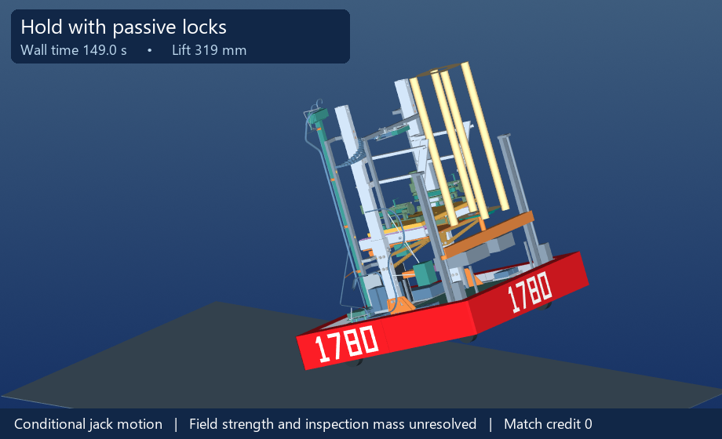

# A shallow-cage jack for the captive swerve robot

Historical engineering study. CAD publication is on hold after both signed placement checks found a collision.

[Compare all six matches](../../kickoff/series.md)

**Decision.** Keep the verified empty leave-and-park routine for competition planning. The forward jack reaches both shallow-cage bearing faces in the geometry study and lifts the empty chassis in a rigid-cage calculation. The project robot earns zero climb points in its continuous match evidence. Its existing receiver, four swerve modules and numbered bumpers remain installed in this CAD alternative.

## Try the assembly

Open the downloadable Fusion archive and hide the demonstration CORAL. With the rack stowed, drive **Lift crosshead** to 328 mm, **Spread left cage shoe** to +36 mm and **Spread right cage shoe** to −36 mm. Lower the crosshead to 319.4 mm and drive **Preload cage plate** to +13.584 mm. A restrained cage now supports the two shoes while four lower pads oppose tipping. Retracting toward zero raises the chassis relative to the cage. Keep the receiver empty and stowed throughout. The independent reopen actuated the actual crosshead, shoes and lower clamp and restored their neutral pose. The orbit and film combine the reopened kit shapes with the matching project-owned chassis mesh and a reconstructed cage illustration. [Native reopen](reopen.json) · [Fusion construction](fusion_build.py) · [Appearance assignment](fusion_color.py) · [Interactive model register](orbit.json) · [Film source](film.py)

The four added moving groups and fixed frame contain 29 bodies. Motor, reduction and passive pawl volumes are installation reservations. The screw model shows the root cylinder. Editable sketches and extrusions describe the saddle, columns, crosshead, shoes, lower spider and pad faces. The hardware-sizing calculation assumes a pair of independently supported screw drives with an 8 mm lead, 16:1 reductions and synchronized sensing. Through-bolts, thrust bearings, anti-rotation carriages, jaw actuators, climbing-thread details and a load-rated catch still require selection and attachment design. [Installed body and mass ledger](installed.json)

## Approach and hold

The January field STEP places the red and blue center shallow cages at field Y ≈74.125 and 242.875 in. The lower plate is 3.416 mm thick with its top at 787.4 mm. Its central opening measures 76.2 mm. These are the selected field model’s actual surfaces. The kickoff manual’s nominal dimensions describe field setup; the measurement point and revision matter. The bottom plate is permitted cage material under V0 §5.4.1. Its central opening differs from the forbidden interiors of the four vertical cage pipes. Each team selects its cage depth before play. [Kickoff manual, Figs. 5-10 and 5-11](https://manuals.plus/m/e98a748723b248f34e890accab1c49c809276fe44de713321834e30736d1e04a.pdf) · [Official field STEP](https://firstfrc.blob.core.windows.net/frc2025/FieldAssets/2025Field-STEP.zip)

The first layout, 218 mm aft of chassis center, struck the fixed camera and its lead on side entry. At the upper stroke, its two travelling nuts each swept 3,402 mm³ into a bearing bridge. The forward layout moves the latch to X+300 mm, uses 16 mm travelling nuts and shortens the rear crosshead web. A straight 650 mm forward approach to each actual shallow cage clears the original 1,001-body stowed robot. A sideways approach still strikes a receiver guide. Make a straight approach or hold. The separate installed-solid check compared all 29 added bodies against the original robot and the fixed frame across the vertical service stroke. Its 29,233 comparisons found zero material intrusions. Normal receiver operation still needs a moving harness and rack check on this revision. [Rear field control](rear-clearance.json) · [Rear travel failure](rear-stroke.json) · [Forward field check](front-clearance.json) · [Corrected travel](installed.json)

After the closed head passes the bore, the shoes spread and settle onto the upper face. Each shoe has about 494 mm² of modeled bearing. The four lower pads each cover approximately 252 mm². Rounding the clamp setpoint to 0.001 mm accounts for 0.0003 mm nominal lower-face compression. Opening early drives either shoe more than 1,180 mm³ into the plate. The control sequence requires independent bore alignment, two shoe confirmations, lower clamp engagement and two passive catches before drive power is removed. Their states are prescribed in the simulation. [Native material contacts and early-open control](contact.json)

An independent 74 kg fixture uses CG ranges ±60 mm in chassis X, ±40 mm in Y and 150–450 mm above the carpet. The calculation rotates the joined cage and robot around the field eye, limits tilt while a floor reaction remains, and applies gravity through the crosshead. Across the eight tested corners, the smallest final clearance of the entire conservative bottom hull is **102.9 mm**, the largest tilt is **26.12°**, and the tallest swept hull reaches **1,467.1 mm**. Quasi-static motion assumes a rigid clamped cage and adequate damping. Swing impact, other robots, actual robot accelerations and clearance to the complete fixed BARGE require further qualification. [Gravity and clock calculation](lift.py) · [Eight-corner fixture](lift.json)

At a 1.5× load case with 65% on one screw, that jack needs 2.82 N·m at the screw and 25.6 A phase. The nominal 40 mm/s loaded lift requests 8.24 V against a 9.5 V controller-terminal assumption. The two drives together require about 47.2 A at that supply point. A passive lock on either screw must resist at least 0.901 N·m even if its drive backdrives freely. A drive rating alone cannot establish passive retention. The worst predicted static cage moment, **230 N·m**, demands about **4.19 kN** compression at a lower stop and **4.91 kN** spread across the upper shoes. Field-plate bending, welds, clamp stiffness and robot-side attachment strength remain unqualified. The upper shoes alone could support only 7.98 N·m around the fore-aft tipping axis. [Load-path and signed controls](lift.json) · [Manufacturer motor data](https://www.revrobotics.com/rev-21-1651/)

The reserved case starts at wall time 130 s from a supplied empty approach stance. It finishes its passive-catch check at 148.68 s, **4.32 s before** powered cutoff at 153 s. A 140 s start runs out of powered time. Missing bore registration, one unconfirmed shoe or a missing pawl inhibit the lift or its score. The model holds the unpowered geometry through 156 s. The prior two full leave-and-park routes start independently and retain their five modeled points. [Timed service and fault cases](lift.json) · [Proven park fallback](../../experiments/swerve-drive/motion/fallback.md)

## Inspection and strategy

Native material accounts for 3.323 kg under the documented density assumptions. The two motor/reduction/lock packages and completion hardware add up to a further 2.350 kg allowance. The full **5.673 kg** increment consumes far more than the roughly 0.011 kg left after the R4 cam and yokes at the prior upper weight estimate. Retain existing allocations until weighed or explicitly replaced. No six-wheel drive, receiver, spare allocation or purchased motor gets credited twice. A shallow climb earns four more match points than PARK, equivalent to two TELEOP trough deliveries. A deep climb earns ten more, equivalent to five. This hardware only addresses the shallow cage. [Existing inspection ledger](../../experiments/swerve-drive/mass-closure/README.md) · [Rehearsal opportunity cost](../../kickoff/series.md)

To reproduce, run the Fusion build, color and reopen entry points with one local manifest containing project and output directories. Run `installed.py . installed.json` from this directory using the issued STEP group exports, `clearance.py FE-2025.STEP front-clearance.json --center-x 300`, `contact.py FE-2025.STEP`, then `lift.py`. The rear study uses the same construction with the manifest field `mount` set to `rear`. Competition intake and release evidence is registered against the separate [original captive robot](../swerve-captive/study.md).
