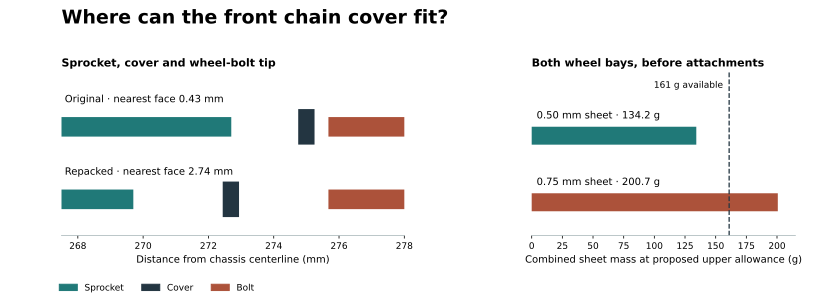

# Make room for a removable drive-chain cover

The first 0.5 mm side panel cleared the tire, yet came within **0.425 mm of a rotating wheel-bolt tip**. Moving the front chain and both of its sprockets 3 mm inboard, then centering the panel between the new sprocket position and the bolt tips, gives **2.738 mm** to each. The resulting covers have a feasible rigid-body position. The light sheet leaves only **26.8 g** at the upper estimate for all attachments and outstanding equipment. Keep the guard out of the selected shop build until its retention, deflection, access and mass are established.



## Change the spacer pairs

The front chain center moves from |Y|268 to 265 mm. On both sides, move the center and front sprocket of this loop by the same amount. The axle axes, wheel track, pitch centers, rear loop and chain length stay at the issued datums. Finish each of the following matched spacer pairs from stock with the same 18 mm OD and 14.2 mm bore. Equal removed and added lengths preserve nominal installed material volume. The longer pieces need new blanks.

| Axle | Inboard adjacent sleeve, old → new | Outboard adjacent sleeve, old → new |
|---|---:|---:|
| Center | 6.90 → 3.90 mm | 12.45 → 15.45 mm |
| Front | 20.51 → 17.51 mm | 12.45 → 15.45 mm |

Both faces of each relocated sprocket retain their nominal 0.050 mm gap to the adjacent tube. The two sprocket hub envelopes at the center axle are now 4.0 mm apart. Reopening all 14 changed solids and checking all 98 neighboring body pairs returned no added native interference. Check the actual bearing/shim stack, lateral tracking and sprocket alignment before ordering spacers. [Revised loop and spacer STEP](front-loop-repack.step) · [Original axial retention](../axle-retention/README.md)

## Fit the cover around the actual drive

Each bay has a perimeter strip around both chain runs, an inner lower skirt and two outer faces split at axle height. The 24 mm openings around the 18 mm spacers extend ±4 mm longitudinally at both end axles. The underside is at Z34 and the top is at Z120. The strip has a 6 mm outside corner radius. The revised side panel center is at |Y|272.6876. The full width between the outer front sprocket hub and the inner wheel-bolt tips is 5.9752 mm.

Both gauges reopened as eight named solids. The 843-body drive scene includes the wheel fasteners, axles, bearing keepers, welded frame and removable rail joints. The fit study evaluates travel from −4 to +4 mm in 2 mm steps. Allowing 1.001 mm between samples gives a conservative bound for each rigid translating drive envelope. The chain still uses ideal straight runs and end wraps. A 4 mm inward panel displacement penetrates the front-chain envelope and a 4 mm outward displacement penetrates the rotating bolt envelope on both sides. [Native fit receipts](study.json) · [0.5 mm cover STEP](repacked-light.step) · [0.75 mm cover STEP](repacked-thick.step)

The smallest clearances to other chassis parts are **0.2 mm** at the skirt and **0.4 mm** at the perimeter near the inner rail. These require relief or designed seating as the attachment is developed. The skirt ends, closure seams and shaft apertures still need access-probe review. The split faces permit a separate upper and lower panel concept. Tool clearance and continuous withdrawal with the finished brackets have yet to be demonstrated. Measure wheel and bolt runout, loaded carrier travel, panel deflection, worn-chain slack and formed-edge tolerances together. [Rail-load sensitivity](../drive-side-attachment/RAIL-FLEX.md)

## Weigh the entire installation

| Candidate | Nominal skins, both bays | Upper skin allowance | Remaining represented robot allowance |
|---|---:|---:|---:|
| 0.50 mm uncoated polycarbonate | 127.8 g | 134.2 g | +26.8 g |
| 0.75 mm uncoated polycarbonate | 191.1 g | 200.7 g | −39.7 g |

The calculation uses the manufacturer's typical density of 1.20 g/cm³. The ±5% interval is a proposed receiving condition. Weigh the formed set, including seam material. The regional product sheet lists gauges starting at 0.5 mm. Grade, availability, thickness tolerance and suitability for chain contact require separate verification. The manufacturer distinguishes brake forming from cold curving and warns that bends affect properties. [Material sheet](https://plaskolite.com/docs/default-source/pds/pds416_tuf_eu.pdf) · [Product range](https://plaskolite.com/catalog/tuffak-monogal) · [Fabrication guide](https://plaskolite.com/docs/default-source/fab/fab015_tuf_en.pdf)

The installed Agent FRC assembly accountant replaces eight sleeve identities, keeps the same two purchased chains and four sprockets in this revision, and adds eight skins to the camera-plus-draw-wire build. It leaves the physical margin unknown. Even if the light skins meet the allowance, an eight-point mounting layout would have only **3.35 g per point** for every support, fastener, washer and seam combined if nothing else consumes the remaining mass. [Installed accounting results](accounting.json) · [Prior selected mass](../sp1-mount/optics-mass.json)

To reproduce, use the native CAD environment and original shop artifacts described in the [drive joint study](../drive-side-attachment/README.md). Run the accounting step with the installed plugin and the camera-inclusive SP1 map.

```sh
python chain-covers/study.py "$POC_ARTIFACTS"
python chain-covers/account_skins.py "$AGENT_FRC_PLUGIN_ROOT" "$POC_ARTIFACTS/sp1-mount/optics-maps/sp1-install.json" "$POC_ARTIFACTS/chain-cover-maps"
python chain-covers/plot.py
```
