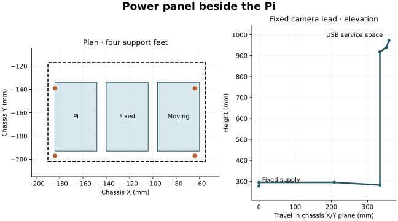

# Power-panel fit and fixed camera wiring

The three converters fit in a reserved **135 × 85 × 156 mm** space beside the existing Pi. The smallest gap from that space to the robot is **3.65 mm** at the common shaft in both the pickup and placement STEP assemblies. The fixed camera needs approximately **1.05 m** of wire routing before connector tails and service slack. The electrical model now allows 1.30 m of 14 AWG wire, giving a conditional 5.022 V at that camera. [Complete two-camera electrical design](../../fixed-low-power/dual-camera.md) · [Native geometry results](converter-panel.json)



## Chassis installation

Remove the two original 5 V board placeholders. The other 591 bodies remain in the two reference poses. The panel reserves chassis X −190 to −55, Y −202 to −117 and Z 164 to 320 mm. A vertical mounting plate would carry the horizontal DIN rail. Place the converter inputs down and outputs up. Each body receives a 36 × 59 × 91 mm envelope for the drawing dimensions, rail-side projection and tolerance. The layout leaves 8 mm between bodies, at least 5 mm at either outside edge, 22 mm below and 43 mm above. MEAN WELL calls for 5 mm lateral clearance, 20 mm below and 40 mm above. Preserve those air paths when locating fuse holders, rail clips and wire terminations. The 3.65 mm gap is outside the entire reserved panel. A 2 mm installation error toward the shaft consumes more than half of it. [Installation manual](https://www.meanwell.com/Upload/PDF/DDR%20DIN%20rail%20power%20supply.pdf) · [Dimensioned drawing, page 4](https://www.meanwell.com/Upload/PDF/DDR-30/DDR-30-SPEC.PDF)

The panel has four proposed 8 mm diameter support feet. Three meet the main deck at Z 154 mm. The fourth meets the existing observer backplate at Z 157 mm. Each entire circular projection overlaps the first 0.5 mm of support material. An earlier foot location touched the battery tray. Shifting it 9 mm leaves 4 mm to the tray. The minimum distance from any foot to a body other than its own bearing surface is 3 mm. Bolt holes, underside access, bracket bending, fuse-holder access and loaded vibration still need detailed design. These native checks cover the two issued poses. They do not measure a built robot or its moving harness.

## Cable route

A straight 8 mm diameter route up the existing mast reserve penetrates the camera cradle by **132.35 mm³**. The revised route leaves the trunk at Z 918 mm, bends outboard and reaches the USB service space at Z 972 mm. Native distances include 4 mm radius at the bends and at the route end. The closest approach to another retained body is **10.0 mm** at the cradle. The 1.30 m wire allocation leaves about 250 mm beyond this centerline for bends, connector tails and service. The existing trunk is a space reservation. Verify its actual fill and attachment with both data and power conductors, the bend radius of the selected flexible cable, and the final plug geometry. The roof-mounted head still requires an independent full-travel flex and strain-relief check.

Reopen both verified STEP files from the complete-robot exporter. The panel script checks each exchange against its published digest, then tests the native solids and four support contacts.

```sh
python design/fixed-no-air/converter_panel.py artifacts/fixed-no-air design/fixed-no-air/converter-panel.json
python design/fixed-no-air/plot_panel.py
```
