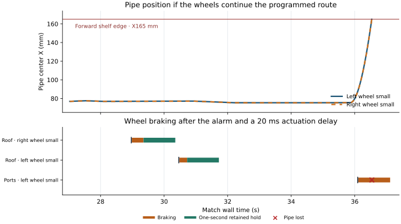

# How far can the machined shelf carry the first pipe?

**The shop robot has a modeled way to stop with the pipe aboard. The existing zero-belt policy loses it if the drive continues toward the reef.** On the slower powered route, both wheel calibrations roll the center of coral-A past the front edge at X165 mm, 9.504 seconds after the final station check. The simulation places this loss at match wall 36.536 s, before either robot reaches the reef. [Loaded motion](drive.json) · [Upstream powered station](../conditioned-match/README.md) · [Machined shelf](../shelf-structure/README.md)



## What the robot can observe

| Event on the same carry | Left wheel small | Right wheel small |
| --- | ---: | ---: |
| Last admitted station check, wall clock | 27.032 s | 27.032 s |
| First field-independent fixed stereo service | 27.047 s, outside vertical bound | 27.047 s, outside vertical bound |
| First nominal roof alarm, including delivery and service | 30.462 s, axis unqualified | 28.967 s, interval outside |
| Latest roof alarm across the three registered pupil locations | 30.512 s | 29.902 s |
| First 20 ms sample missing a required port return | 36.092 s | 36.092 s |
| Forward loss if driving continues, 62.5 µs plant | 36.53586 s | 36.53605 s |

The source is the installed two-absorber shelf at H560 and zero slide. Both powered station replays reproduce the complete previously recorded pipe trajectories byte for byte at 31.25 µs. The handoff keeps the same pipe position, axis, linear velocity and angular momentum, all 13 plate-mode displacements and velocities, and both plunger positions. Both plungers have returned to zero, while the loaded shelf retains a small elastic displacement. The continued six-degree-of-freedom plant applies chassis acceleration, yaw rate and angular acceleration in the robot frame. The 125 and 62.5 µs follow-on runs agree on the forward loss within one coarse step. The local roller cartridge travels less than 0.018 mm during transit. [Departure states](departure.json) · [Modal basis](mode-frame.json) · [Chassis route](route.json) · [Port transitions](ports.json)

The five preceding seated frames include the native field station and guide pair. During driving, objects in the field can disappear behind the robot. The fixed stereo fallback therefore uses only its own visible robot/guide backing. The first sample at Java 5,457 ms still sees a pipe, but the nominal fixed contour's vertical interval extends to −13.65 mm against the −12 mm lower gate on the left arrival. Applying the actual marks to the fixed background also fails. Matching the shelf brightness to the pipe removes the contour. The roof can still bound the pipe on the nominal scene. Across the first 202 left and 114 right nominal exposures the last sample in each group first fails its observer. The assumed exposure period is 17 ms, with 15 ms delivery and five-millisecond service. [Nominal roof](roof.json) · [Near pupil](roof-front.json) · [Far pupil](roof-rear.json) · [Marked fixed camera](fixed-marked.json) · [Changed backing controls](fixed-dark.json)

All 12 mark rectangles stay fully backed by the reopened machined polymer. The study renders 998 physical and reserved parts, the full 370 mm slide sweep and 629 fixed-lead bounds. In the bilateral support model the upper bound on the absolute plate displacement is 0.0474 mm over the modeled span at the archived 1 ms sample times. A separate conservative image test discards every eligible depth or shade edge that might move by one pixel within a 0.05 mm Z envelope. Both opening end arcs become unresolved. The wider ±2 mm trial and brightness-matched shelf likewise withhold custody at the first service. Removing all such boundary pixels simultaneously is a conservative masking experiment. The nominal observation needs a calibrated physical camera/reference and contrast test. An unresolved opening image keeps travel inhibited. [New registered native scenes](native.json) · [Verified mark backing](finish.json) · [Deflection bound](deflection.json) · [One-pixel control](roof-050.json) · [Two-millimetre control](roof-guard.json) · [Matching finish](roof-same.json)

## Brake while the robot is still turning

The candidate brake retains both wheel signs and reduces their speeds proportionally at a maximum 0.85 m/s², the wheel acceleration in the issued terminal approach. It begins after the first serviced camera alarm and a separate 20 or 60 ms actuation allowance. Each case resumes the original pipe, plate and plunger state on that exact millisecond, then runs the chassis stop and one second of stationary hold. The slower-pupil control uses the latest of the three observed camera alarms plus 60 ms. These are modeled wheel decelerations. Measure actual braking response and slip before using them as limits. [Brake model](stop.py) · [Alarm and latency trials](stop.json) · [Latest pupil](stop-late.json)

Both wheel signs are still turning at the early roof alarm. The wheel speeds have opposite signs. In the four nominal latency cases the chassis center moves less than 0.12 mm while the corners sweep through the rest of the turn. Both physics resolutions retain the pipe through the hold, with both optical ports returned at the end. The latest-pupil trials also retain it. The six early-arrest paths clear the modeled barriers by at least 39.1 mm, installed stock by 265.7 mm and moving peers by 3.24 m. Holding the reached chassis pose through the remaining peer program leaves 2.27 m. The 66.6496 kg one-pipe electrical case remains above 9.594 V on the 11.8 V, 32 mΩ pack. At the end of the one-second hold, all three roof pupil locations and the field-independent fixed camera still withhold the position witness in all four tested stop cases. Keep the drive inhibited. A confirmed physical arrest and two port returns alone cannot authorize a restart. [Independent stopped images](stopped-images.json) [Stopped path, peers and supply](stop-route.json)

Waiting for the dual-port loss lets the robot reach about 0.852 m/s forward. With a 20 ms actuation allowance the wheels need 1.003 s and about 427 mm to stop. The pipe leaves the shelf near 36.539 s, about 0.575 s before the forecast wheel stop. This timing identifies a practical test for the robot cart. Log roof frames, wheel speeds, both aperture returns and continuous pipe motion together. Check that the camera alarm arrives while the wheels are still turning in opposite directions, that both wheel speeds reach zero within the observed bound and that the pipe is retained after braking. A late or untrusted camera keeps this carry strategy unqualified.

## What happens at the prescribed placement pose?

The independent placed-pose diagnostic uses the earlier, identified coral-A and coral-B trajectories. On the new backgrounds and marked receiver, all 28 packet/HAL scenarios preserve the original event sequence. The nominal B fixture commands withdrawal at 98.375 s and completes stow at 100.845 s. It still has the three preceding paired exposures at 26,180, 26,197 and 26,214 ms and the last moving-camera interval at 26,231 ms. The later roof sample loses end curvature. The 28 scenarios test the observer at those supplied poses. The powered carry above terminates before that part of the field, so the fixture cannot supply a scored outcome. [Placement image and packet results](placement.json) · [Field-backed ray checks](field.json)

## Reproduce

Use the same registered private geometry, route, desktop Java, vision and CAD environments as the [receiver](../shelf-structure/README.md) and [conditioned match](../conditioned-match/README.md). Set the numerical backend to one thread for the modal-state checksum. The binary states and supplier/field imagery live under the project artifact directory. All scripts below run from the repository root.

```text
python elastic-carry/checkpoint.py conditioned-match <jdk> <artifacts>/elastic-carry/checkpoints elastic-carry/departure.json
python elastic-carry/chassis.py conditioned-match <artifacts> <artifacts>/elastic-carry/routes elastic-carry/route.json
python elastic-carry/drive.py <artifacts>/elastic-carry elastic-carry/drive.json
python elastic-carry/deflection.py <artifacts>/elastic-carry elastic-carry/deflection.json
python elastic-carry/port_watch.py <artifacts>/elastic-carry elastic-carry/ports.json
python elastic-carry/native_views.py <artifacts> <lamp.step> <field.step> <artifacts>/elastic-carry/native elastic-carry/native.json
python elastic-carry/finish.py <artifacts> <artifacts>/elastic-carry elastic-carry/finish.json
python elastic-carry/carry_images.py <artifacts> <artifacts>/elastic-carry elastic-carry/drive.json elastic-carry/<head>.json <head>
python elastic-carry/stop.py <artifacts>/elastic-carry elastic-carry/stop.json
python elastic-carry/stop.py <artifacts>/elastic-carry elastic-carry/stop-late.json --latest-pupil
python elastic-carry/stop_route.py <artifacts> elastic-carry/stop-route.json
python elastic-carry/stop.py <artifacts>/elastic-carry elastic-carry/stop-observations.json --final-optics
python elastic-carry/stopped_images.py <artifacts> <artifacts>/elastic-carry elastic-carry/stop-observations.json elastic-carry/stopped-images.json
python integrated-slide/expose.py <artifacts>/elastic-carry <artifacts>/relieved-match central
python integrated-slide/observations.py field <artifacts>/elastic-carry <artifacts>/relieved-match <field.step> <jdk> <gradle-cache>
python integrated-slide/observations.py packets <artifacts>/elastic-carry <artifacts>/relieved-match <field.step> <jdk> <gradle-cache>
python elastic-carry/placement.py <artifacts>/elastic-carry elastic-carry/placement.json
python elastic-carry/plot.py <artifacts>/elastic-carry elastic-carry/carry.svg
```

The field command writes the full ray check to <artifacts>/elastic-carry/roof-field.json. The issued field.json is a copy of that original receipt. The camera choices include `roof`, `roof-front`, `roof-rear`, `roof-guard`, `roof-050`, `roof-same`, `fixed-native`, `fixed-marked`, `fixed-dark` and `fixed-same`. Each run uses the matching camera's source raster. Real wheel loading, cartridge force curves, mast/rail compliance, installed mass and station lighting remain receiving gates. The separate stationary-hoist and mast-splice inventory leaves 278.06 g after the example guide faces on the matched-stock upper model. The actual guide mounting and physical scale are still open. [Combined receiving account](../fixed-hoist/combined.json)
