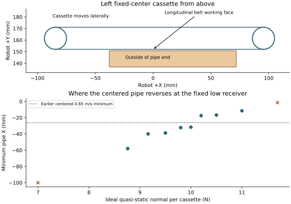

# Pipe length on the fixed-height end grips

**A gauged pair of jaw stops can receive three centered practice cuts. The mechanism still fails the mixed-length, off-axis and scoring requirements.** With the 295.275, 301.625 and 307.975 mm cuts each matched to its own stop set, the actual low-pose Java gate indicates a seat and the sampled finite pipe clears the rigid receiver. All six combinations of a cut with the wrong gauge fail. Both identified mission handoffs recontact the receiver on the historical and shaped releases. Keep the existing low receiver as the issued configuration. [Prior end-grip modification](../station-relief/README.md) · [Centered fixed-height baseline](../design/fixed-height/README.md) · [Body-supported alternative](../cradle-receiver/README.md)



## Which travel can this hardware provide?

The previous jaw guarantees 1.40 mm outward and permits 0.30–0.40 mm inward from nominal. A ±6.35 mm cut-length change alone moves each end by 3.175 mm. The project's stock research treats this as a practice stress, separate from FIRST's stated nominal 11⅞ in length. The fixed-height baseline has a 500 mm shelf, zero intake extension, 10 mm station dock and a 0.65 m/s pre-entry counterfeed. The study reproduces its archived centered Java result before changing the mechanical plant. [Rules and stock basis](../cradle-receiver/README.md) · [Baseline compiled source and 40 runs](../design/fixed-height/ports-065.json)

1. **Working strand on a spring-backed shoe.** Four equal 20T pitch circles allow a central 131 mm working strand to shift laterally; both powered end-pulley positions cannot stay fixed with the original 420 mm belt. From −6 to +6 mm shoe travel the end idler must move 3.94 mm to maintain the pitch length, despite 8.35–9.74 teeth remaining on the driven sprocket. At the short-pipe extreme the two angled belt spans reduce one candidate's effective normal to 4.36 N. A dynamic spring idler also changes from slack to tight when the drive reverses. Reject this tensioning method. Eight of 24 ideal corner cases indicate a seat. [Routing equations](shoe.py) · [Gates precision drive manual, section V.C–D](https://www.gates.com/content/dam/documents-library/catalogs/light-power-and-precision-manual.pdf)
2. **Translate the entire fixed-center cassette.** Keep the 180 mm pulley spacing, 420 mm belt, two electric drives, bearings, bevel-free pulley roots and 1:1 reversing spur sets. Extend four 3 mm rods from 34 to 46 mm, move each stop pair to ±6 mm, remove the four short compression springs and lateral viscous units, relieve the fixed riser/feet and add rear-mounted spring reels. At +2 mm the old outboard stop intersects each moving lug by 14 mm³. The replacement clears its fixed surroundings at −6, −2, 0, +2 and +6 mm in the checked low intake. The STEP reopens with 34 named replacement/addition bodies. The 577-body registered model includes reused components. [Original editable parts](cassette.py) · [Native cassette layer](fixed-center-cassette.step) · [Interference results](mechanics.json)
3. **Index the available stroke to the actual cut.** Per side, fix the inward limit at half the cut change minus 0.35 mm and the outward limit at half the change plus 1.40 mm. The short/nominal/long inboard spacers add 2.475/5.650/8.825 mm, with 7.775/4.600/1.425 mm outboard. All 12 reopened stop faces meet their lug at the intended endpoint. The smallest supported stop footprint is 12.15 mm². The original support and proposed detachable-stop fastening still need an actual attachment and vibration check. The STEP lays out the three sets 400 mm apart in X for inspection. A gauge swap is a practice or pit setup and cannot adapt to the next unknown piece during a match. [Stop sets](gauge-stops.step) · [Lug contacts and support areas](gauges.json)

## Spring cartridges, response and mass

One 1.97 lbf Lee LCF 025 06 050S and one 0.32 lbf LCF 130 04 025S supply 10.19 N nominal per side. Their separate 13.28 and 13.54 mm drums share an axle. The loaded straight ribbon length is 33–45 mm across travel, exceeding the two catalog initial-deflection lengths of 19.81 and 20.32 mm. Primary and trim rings reserve coiled material. The end clamp, guards, axle retention, factory spring ends and attachment to the structure require fabrication detail. A 2.63 lbf single spring reaches 11.70 N and faults the tested centered optical sequence. Seven newtons loses the piece, as does the 0.08 friction case. Nominal force, catalog life and clean geometry do not establish installed grip or ribbon fatigue. [Manufacturer spring tables](https://www.leespring.com/sites/default/files/2021-02/constant-force-lee-spring-us.pdf) · [Force trials and Java source hash](replay.json)

The inherited moving hardware is 0.422–0.659 kg per side before new parts. The nominal moving-jaw calculation uses 0.50 kg with 10 N·s/m damping. The centered gauged case still indicates a seat at 0.42 and 0.70 kg and at 37.52 N·s/m. Positive native aluminum/steel additions plus two complete spring strips per jaw total 0.072 kg before a 0.120 kg allocation for clips, guards, hardware, leads and finishing. With maximum 0.0103 kg for steel gauge spacers, the conditional upper addition is **0.2024 kg**, leaving 0.4384 kg of the existing *represented* low-red mass margin. No removal credit or complete inspection margin is assumed. A pre-opening actuator and its latch remain unselected and unweighed. [Mass calculation and native identities](package.json) · [Fixed-low accounting](../design/fixed-height/review.json)

The centered matched cases demand 5.59 N of peak longitudinal traction at each belt. Applying the issued per-motor model at each contact step yields 6.856 phase A, 4.402 V and 3.512 bus A maximum at the 9.5 V bus case and 3×10⁻⁶ kg m² input inertia. The 7×10⁻⁶ sensitivity demands 12.702 phase A and exceeds the 8 A limit. A misaligned long piece loads one belt up to 15.81 N and the other zero; motor current alone cannot establish dual contact. The current receipt covers acquisition after lip release and uses the earlier 0.4 N parasitic force and 80% drive efficiency. Measure rotor/load inertia, belt speed, current limiting and hot PVC traction before commanding this mechanism. [Coincident drive measurements](traction.json) · [Drive calculation](traction.py)

## What happens on entry?

The finite annular contact patches carry the issued pipe spin and split tangential force between longitudinal and vertical slip. For the cassette, each area contributes an elastic normal from local penetration with a 0.67 N/mm² pressure cap. Spring, area stiffness, damping and pressure-cap values require a coupon test. In the quasi-static study the jaw instantaneously solves for force balance. In the finite-mass replay it integrates the independent force and speed of each jaw and spends finite time opening or closing. The simulation holds lateral position and yaw during the incoming disturbance. Free lateral translation, yaw, real elastic limits and deformation could change the result. [Contact model](grip_study.py)

| Study | Observation |
| --- | --- |
| Free, quasi-static jaws | All 24 combinations of three cuts, ±5 mm dock depth, ±1 mm lateral and ±0.25° yaw indicate a seat. The closed long-pipe case first overlaps the upper idler hardware at about 200 ms, before the working belt reaches it. With 10 ms jaw lag the idler overlap reaches 704 mm³. |
| Initially open, 0.50 kg jaws | Releasing at 170, 180, 190, 200, 210 or 220 ms fails all 18 length/time trials. The nominal 200 ms case requires −6.43 N of shelf support, indicating loss of contact. The tested long-pipe early path also encounters the installed observer pad. A software delay cannot establish successful entry. |
| Gauged finite-mass jaws | All three centered matched cuts seat. Each reverses near −24.8 mm and the sampled actual hollow pipe has no unwanted solid contact. Raising the trial area stiffness from 0.5 to 1 or 2 N/mm³ at the same 0.35 mm inward setting loses support. At 0.1 N/mm³ the piece escapes over the rear. An overall ±0.5 mm length-gauge error also fails on the nominal modeled piece. |
| Combined errors | All 24 finite-mass gauged corner cases lose custody in this imposed-pose model. The left riser intersects the short positive-side stress by 1,548 mm³ and the right riser intersects the long negative-side stress by 2,019 mm³. Once rigid contact occurs, subsequent positions quantify discrepancy rather than physical motion. |

Native samples include the actual rigid pulleys, shafts, bearing races, cheeks, idler boards, full low-pose robot and added spring/hardware envelopes. The working rubber belts and supporting shelf are deliberate contacts. The sweep samples approach at 5 ms, later capture at 40 ms and includes the calculated most-rearward position. Off-axis optical results continue to use the existing centered two-port signal, so no independent position/custody observation follows from them. [Finite-wall witnesses](witness.json) · [All 168 replay cases](replay.json)

## Can the accepted centered seats score?

The short and long centered, appropriately gauged seats transfer their actual Java-indicated position, longitudinal velocity, spin, cassette position/speed, piece identity and lip-relative time to the two registered fixed-low routes. The two previously recorded release profiles both return `receiver-recontact` for each piece before paired trough contact. These cases use the original nominal pipe mass, radial inertia and mission yaw inertia, the varied end-face length, and independently moving jaws. This prevents either positive custody or scoring credit from the earlier receiver being transferred. [Two identified handoffs](delivery.json)

A bench decision needs measured raw piece length and ovality, belt force versus backing compression, free jaw inertia and rate-dependent closure, stop registration and actual clearances at the front idler. Independently inspect the two spring attachments, retained belt tracking and full-height pipe approach. A successor must demonstrate both capture under the declared pose error and release through the low target before selection.

## Reproduce

Use the project's OpenCascade Python environment for native checks and JDK 17 for the actual Java port controller. The scripts below read the issued project sources. Use the same required JDK path for all three replay commands.

```sh
python -B end-grip-length/grip_study.py --jdk /path/to/jdk17 --output artifacts/end-grip-replay.json
python -B end-grip-length/cassette.py
python -B end-grip-length/package.py
python -B end-grip-length/gauges.py
python -B end-grip-length/witness.py --jdk /path/to/jdk17 --output artifacts/end-grip-witness.json
python -B end-grip-length/traction.py --jdk /path/to/jdk17 --output artifacts/end-grip-traction.json
python -B end-grip-length/delivery.py --jdk /path/to/jdk17 --output artifacts/end-grip-delivery.json
python -B -m unittest discover -s tests -p test_end_grip_length.py
```
