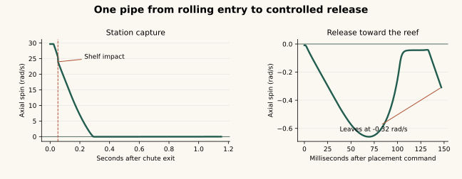

# What happens to the spin from the station?

<!-- cad-still -->
[](https://ehartye.github.io/frc-2025-poc/preliminary-design/)

**Preliminary design · in progress · layout-002.** Red 2 B′x fixed pocket, held roller nip and exit lip on four-module swerve. Parked pose at the end of the withdraw-park case, with the exit lip deployed and the pocket empty. Whole-robot block-level layout from the layout-checked review scene: 67 representative solids, with the three field fixtures, the delivered pipe and two service hand gauges hidden. It is not detailed CAD. [Open the review](https://ehartye.github.io/frc-2025-poc/preliminary-design/) · [Layout-checked receipt · 14649626c7](../../../docs/preliminary-design/releases/layout-002/receipt.json)
<!-- /cad-still -->

A pipe rolling out of the chute reaches **+29.69 rad/s**. The modeled belts and shelf can bring it to **−0.013 rad/s** at seating and **−0.318 rad/s** at reef contact. On the 545-body design a 0.90 m/s release-belt limit gives sustained modeled trough support at TELEOP **32.056 s and 82.145 s**. Both pipes remain through the three-second assessment. The two original human releases still fit the field program and the partner-cleared park finishes at **94.016 s**. Actual behavior depends on friction, preload, docking and the controller delivering the tested belt speeds. [Coupled cases](study.json) · [Wheelbase, parking and native contact checks](geometry.json)



| Stage | Modeled observation | Evidence students could collect |
| --- | --- | --- |
| Station source | Centered drop from 1.55 m. At ramp friction 0.40 the pipe rolls off at 1.697 m/s. At 0.15 it slides, reaching 2.173 m/s with only 11.58 rad/s of spin. | Film an identified pipe with an axial mark and a scale in view. Extract center and angle on the ramp and at the lip. |
| First catch | At the 10 mm bumper stand-off and 240 mm stroke, the falling end rims reach the stationary belts about 22.5 ms after chute exit. The shelf impulse arrives at 52.45 ms and reduces spin from 25.55 to 24.10 rad/s. | Synchronize both belt encoders and marked-pipe video. Record first belt and first shelf contacts separately. |
| Seat and carry | The velocity-command candidate reaches u=78.51 mm against the 80±8 mm criterion at 1.1 s after touchdown. Its 6.9 mm/s residual longitudinal speed and axial spin carry into retraction. | Measure left/right cartridge force, seated center, sliding and axial spin throughout the turn. |
| Placement | At the 0.90 m/s limit the model reaches the target moving forward at 0.884 m/s. A and B have −0.3184 rad/s at first trough contact. The model uses each actual state for impact and post-contact settling. | Measure pipe speed and angular speed together immediately before reef contact. Independently capture the release and withdrawal clock. |

## Which alternatives change the decision?

- With the modeled force-following motor law and finite acceleration, the pipe ends at **70.89 mm**, 1.11 mm outside the accepted seated window. Allowing an instantaneous belt-speed change in that controller sends it past the **−100 mm rear edge**. Low grip (2 N/side and belt friction 0.08) also loses custody.
- With velocity commands and a **1.05 m/s** release limit, the incoming rotation is mostly removed, but both pipes hit the inner riser after trough contact. At a **0.75 m/s** limit both recontact the receiver. Changing the exit speed changes the translation and the spin together.
- Both pipes retain support at the selected **0.90 m/s** limit with the tested 0.25, 0.5 and 1 ms steps, 5 and 11 belt-height quadrature slices, alternate slip-regularization speeds and shelf friction 0.02, 0.10 and 0.25. Only the named centered nominal case received the full native, observation and match checks. The three station rebound alternatives retain their earlier positive-contact witnesses. [Station supply study](../station-supply/README.md)

## Mechanics and measurement limits

The source starts at rest. The ramp impact is perfectly inelastic along its normal. The tangential impulse is capped by Coulomb friction and the impulse required to roll. The pipe can slide the remaining ramp length or transition to rolling. A uniform annulus with outer radius 57.15 mm, inner radius 50.8 mm and mass 0.81647 kg gives the same polar inertia at ramp, shelf, free flight and trough. Positive spin is counterclockwise in the robot-forward/up drawing. This points opposite the incoming horizontal station velocity and is registered to the red target coordinate frame before settling.

The centered 420-3M-15 belts have a straight working range −84.5 to +95.5 mm and a 15 mm vertical contact band. The model intersects horizontal strips of that band with the finite annular end walls. It distributes each end’s assumed 10 N nominal preload over the available area, reaching full load at 15 mm². Longitudinal feed and vertical spin braking share one friction circle at each patch. The vertical belt force changes the required shelf reaction. When the pipe touches the shelf the normal constraint and a capped bottom friction impulse update its velocity and spin together. Free flight preserves axial momentum. The nominal angular momentum residual through release is below 10⁻¹² N·m·s. [Contact law](pipe_axial_contact.py) · [Route integration](pipe_spin_route.py)

Both motor laws use the same issued position/velocity feedback demands. One maps demanded traction back through the regularized contact slope; the candidate instead maps acceleration demand to belt speed with the existing 20 s⁻¹ velocity gain. The candidate caps belt acceleration at 26.25 m/s², including the transition from stationary belts during entry. The combined load/speed/acceleration envelope gives **7.02 A and 5.91 V per grip motor** under the existing gearbox, 80% efficiency and assumed 3×10⁻⁶ kg·m² equivalent motor inertia. Actual contact patch stiffness, available preload at a just-tangent end face, angular-axis precession reactions, pressure distribution, actuation, tube ovality, friction and release legality remain unmeasured. The trace uses issued dock alignment. The alternative 40 mm stand-off has separate geometry and contact evidence. [Receiver drives](../design/receiver-drives/README.md) · [Docking tolerance](../station-supply/DOCKING.md)

The native study reopens all 545 robot solids. Along the centered catch it sweeps the finite pipe enclosure against the station and receiving assembly, retaining the starting ramp and ending shelf tangencies. At each registered target it checks the eight stereo sightlines and withdrawal sweep, including the two physically inward compliant cartridges. All 17 tight-pixel image phases give a visible, time-bracketed observation for each pipe. Every tested tight-budget integer withdrawal onset sustained support (48 for A and 49 for B). The carried pipes clear all 24 stationary January pieces by at least 33.79 and 52.99 mm. B clears the settled A by at least 77.85 mm. The full-field program still depends on fixed stock and scripted partners. No hardware permission or official score follows from this model. [Carried-stock bounds and tested onsets](field-timing.json)

An instantaneous reset from chute-exit spin to zero would remove **0.07087 N·m·s and 1.052 J** without a declared impulse. The installed Agent FRC planar transition helper rejects that reset, accepts the modeled shelf impulse and rejects omission of its angular component. It checks an instantaneous declared momentum balance. It does not integrate this project’s contacts. [Executable controls](check_impulse.mjs)

## Reproduce

From the project root with the existing Python CAD/science environment, use a separately obtained copy of the exact January field STEP for the native sweep.

```powershell
python axial-spin/spin_cases.py --workers 4
python axial-spin/native_check.py --field 'path/to/FE-2025.STEP'
python axial-spin/field_timing.py
python axial-spin/plot_spin.py
$env:AGENT_FRC_PLUGIN_ROOT = 'path/to/installed/agent-frc'
node axial-spin/check_impulse.mjs
python -m unittest discover -s tests -p test_axial_custody.py
```
