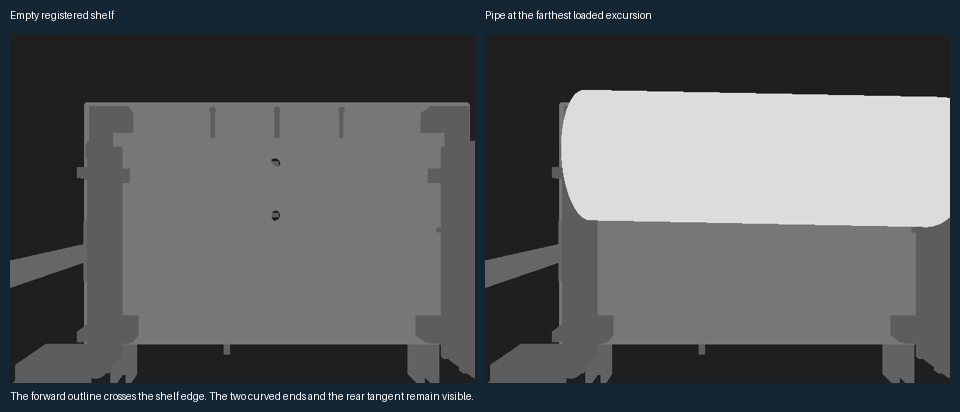

# Leave room for a ball already on the reef

<!-- cad-still -->
[](https://ehartye.github.io/frc-2025-poc/)

**Project CAD · Full swerve robot · stowed, red alliance.** The R3 model brings together the four steerable wheels, fixed-height receiver, electronics and red bumpers. Purchased parts use project-created representations in this public CAD. [Source STEP · 0f96394e6c](../../../cad/full-swerve-r3/full-robot.step) · [Rotate the model](https://ehartye.github.io/frc-2025-poc/)
<!-- /cad-still -->

Moving the shelf camera and its bridge **50 mm toward the back of the robot** gives the 593-body fixed-height, no-air robot at least **16.48 mm at sector A and 24.89 mm at sector B** against the occupied reef ball throughout placement. Those lower bounds include the full slide stroke, position and heading error, mount registration and an ideal bridge-flex allowance. The original assembly cuts into the actual field ball at both sectors within the same error budget. [Explore the placement tolerances](explore.html) · [Native field and robot results](field.json) · [No-air robot](../design/fixed-no-air/README.md)

| What the field check allows | Sector A, −180 mm | Sector B, +220 mm |
|---|---:|---:|
| Original bridge, nominal minimum vs. enclosing ball | 5.22 mm | 5.58 mm |
| Original crossbar, exact intersection with installed ball at +15 mm slide and +10 mm forward chassis | 4,019.34 mm³ | 2,068.44 mm³ |
| Revised bridge, nominal minimum vs. enclosing ball | 45.09 mm | 55.07 mm |
| Revised bridge, 10 mm planar error and ±1° heading, with slide/registration/flex | 16.71 mm | 24.98 mm |
| Revised bridge with a 20 mm planar error | 6.97 mm | 15.08 mm |
| Revised bridge with a 35 mm planar error | −7.61 mm | 0.24 mm |

The complete-robot check above gives slightly smaller clearance than the fourth table row because it applies all remaining allowances radially. A negative lower bound calls for a closer check. The original crossbar counterexample separately measures real intersecting CAD volume. The field model contains 24 starting game pieces. For an occupied ball the study expands the native 16.25-inch diameter to the project's 16.5-inch bounding diameter. Any additional center shift or enlargement consumes the remaining margin. [Installed-stock methodology](../full-match/installed_stock.py)

## Where the tolerances came from

The earlier route comparison used a 10 mm translation disk and a 1° heading bound. These are acceptance targets requiring a target-area tracking measurement. The motion inventory allowed ±15 mm outer-stage tracking and ±1.5 mm independent lateral grip motion. The check sweeps the continuous heading interval around the chassis center, encloses all 0–370 mm slide positions with endpoint error, and includes the rotation envelopes, full extension of the draw wire and fixed-height return lines. It then subtracts the camera's 1 mm registration allowance and 0.526 mm two-gravity static bend. Translational drift and yaw are applied to the actual body coordinates at both targets. [Route assumptions](../leave-park/README.md) · [Motion contract](../mission/COMBINED-DEPARTURE.md) · [Bridge stiffness](../moving-observer/checks.py)

The new bridge has at least 63.23 mm to the native reef structure during the target sweep and 352.04 mm to the native station at pickup under those allocations. The incoming finite pipe clears the new members by at least 39.18 mm on the two modeled feeds. The complete robot clears the first settled pipe by 16.09 mm when it visits the second sector, including the source's independent 2 mm expansion around that pipe. The loaded route's closest retracted bridge member remains over 388 mm from a reef ball on the first trip. These tests cover the project field, two sectors, known stock and stated motions. Ball displacement, other robots, loom movement, field damage and a different approach require their own evidence. [Field proof](field.py) · [First placed pipe](../fixed-height-match/native.json)

## Change the shelf and aim the camera

Use the same 21 bridge components, fixed-focus head, USB system and brackets. On the replacement shelf, drill four Ø4.5 mm vertical holes at **X −21 and +26 mm, Y ±200 mm**. The optical datum is now **(48, 0, 842) mm** at zero slide, with the 75 mm stereo baseline along Y and the optical axis straight down. Component labels retain the original bolt IDs for traceability. The CAD check verifies four full-depth 15 mm bores, reopens all 22 named solids in the kit and checks the complete stroke against the moving and stationary robot parts. [Reopened engineering STEP](moving-bridge.step) · [Material and interference record](mount.json)

Use a fresh blank or an independently qualified repair. The proposed +26 mm bores are only 3 mm from the original +29 mm bores. At this spacing, each pair of Ø4.5 mm holes shares 52.27 mm³ through a 15 mm shelf. Redrilling the installed shelf would leave a merged hole. The four new holes remove the same volume, and the translated articles retain their individual masses. The no-air robot's represented inspection upper headroom is still 1.811 kg, with a paired range margin of 2.611 kg. The complete build requires a new weight, loading and cable check. [Inspection record](../design/fixed-no-air/inspection.json)

The [whole-robot export](export_assembly.py) rebuilds any of the three no-air poses from the matching signal-light source. The selected placement STEP reopened in independent readers with 593 named solids and 571 unchanged native bodies. The largest independent material-volume error was 0.00262 mm³. The local STEP includes source-owned light geometry. Its SHA-256 is `74656e040965df4dc6d5aafcedb58ae6f1442828eac5bec015c3a3ace15b578b`. [Placement verification](native-place.json)

## Measure the pipe after the move



At maximum loaded excursion, the forward silhouette extends past the shelf in the image. A neutral field pixel beyond that edge cannot bound a pipe. The alternative fit measures the nearest curved end of the pipe with each eye and the backed rear tangent in both eyes. The known pipe length and stereo baseline constrain camera-to-center depth. Opposite end measurements bound lateral position, and the rear tangent bounds fore-aft position. Only visible, robot-backed edges constrain the fit. The projected end has a convex outline; observed secants bound the greatest possible extent across gaps between supported rows. The fit also bounds transverse-axis yaw and demands matching signed gradients across two separated patches in each eye. The synthetic brightness requirement is a measurable bench prerequisite. [Bounded geometry and reference-patch check](bridge_fit.py)

For a 359.5 mm cantilever, the ideal tip slope is 1.5 times tip displacement divided by length. A 0.526 mm bend therefore gives about **0.126°**. Forty-eight stereo pairs tested three pipe states across sixteen registration cases using displaced lens centers, directions and native shelf surfaces. The cases include ±0.25 mm bolt radial clearance combined with bend, diagonal bends and a separate ±1 mm vertical/±0.1° yaw challenge. Each admitted interval contained its source center. The 5 mm/2° control lost the registered shelf patches and withheld all three observations. These cases sample the proposed bounds. Welds, shelf twist, USB loads, illumination, blur, focus and in-service calibration still require physical measurement. [Perturbed-image results](calibration.json)

## What the controller could still observe

Both original trajectories remained inside their decoded position intervals in all **2,924 exposures**. The 20 ms desktop command scheduler admitted all 1,049 drive-to-release ticks for A and all 1,034 for B. At 15 ms delivery every tested release exposure and command tick agreed with the issued control study. The 5 ms service loop retained all camera and scheduler alignments through 18 ms of constant delivery. At 19 ms, one of 170 alignments missed. At 24 ms, all were held. The rerun exercised 1,428 desktop HAL trials and 59,364 additional cases on the same packet consumer. At 21, 22 and 23 ms delivery, A gained one of the 85 alignments at each delay on the 5 ms loop. Eleven A counts also changed on the 20 ms sweep. B retained its original counts throughout. The controller's 15 ms evidence and the actuator-feedback qualification remain separate. [Travel supervision](travel-hal.json) · [Latency profiles and faults](timing.json) · [Source and configuration comparison](register.json)

The unbacked forward edge, a dark pipe, an empty shelf, one missing camera, a flat bright patch, excessive yaw and the wrong camera pose each withhold the appropriate observation. The reported controller results use the two existing modeled trajectories and nominal optical calibration. The 48 displaced stereo pairs exercise selected physical conditions. They do not substitute for an entire match run with a moving, miscalibrated camera or establish real actuator timing.

## Replay

Use the existing [low-camera trajectory cache](../low-observation/README.md), JDK 17 with the cached desktop Gradle dependencies, the original field STEP and the original signal-light STEP matching the no-air source register. The local source models stay with their owners.

```shell
python bridge-tolerance/design.py
python bridge-tolerance/field.py --field "$FIELD_STEP" --lamp "$SIGNAL_LIGHT_STEP" --scratch artifacts/fixed-height-observation
python bridge-tolerance/calibration.py
python bridge-tolerance/replay_candidate.py --scratch artifacts/fixed-height-observation --lamp "$SIGNAL_LIGHT_STEP" --jdk "$JAVA_HOME" --gradle "$GRADLE_USER_HOME"
python bridge-tolerance/view.py
python bridge-tolerance/export_assembly.py --lamp "$SIGNAL_LIGHT_STEP" --output artifacts/bridge-tolerance/place.step
python bridge-tolerance/register.py
python -m unittest discover -s tests -p test_bridge_tolerance.py
```
