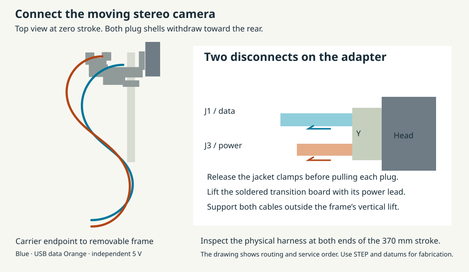

# Unplug the moving stereo head

<!-- cad-still -->
[](https://ehartye.github.io/frc-2025-poc/)

**Project CAD · Team 1780 · captive swerve receiver.** The public Fusion capture candidate at rest, with 1,001 robot solids and the hollow practice CORAL. Project-drawn representations occupy the supplier interfaces. [Source STEP · 0dad9e862e](../../../cad/swerve-captive/public-robot.step) · [Rotate the model](https://ehartye.github.io/frc-2025-poc/)
<!-- /cad-still -->

The fixed-height receiver can retain the camera's data and power leads independently. The proposed frame carries two releasable cable clamps, a rest for the Luxonis Y adapter and a removable power transition board. A 14 mm rearward withdrawal clears the modeled hardware for either plug. The power taper removes the previous voltage guarantee. A narrower converter setting and a measured hot connection-resistance limit restore it in the design calculation. The hardware, streams and rail voltages still need bench qualification. [Original 25-solid STEP](service-support.step) · [Electrical comparisons](power/corners.json) · [Baseline removable bridge](../camera-datum-shop/README.md)



## Locate the hardware

All dimensions below are robot-frame millimetres at zero extension. Add the actual stroke to X. The carrier delivers both leads toward +X. Power arrives at (−72.5, −329, 800) and data at (−72.5, −317, 800). The registered right post occupies X−5…10 and Y−207.5…−192.5, so a straight diagonal to the head is a poor guide for routing. The route source includes exact three-dimensional control points in the shelf frame. [Carrier geometry](../moving-harness/geometry.json) · [Control points](route-controls.json)

| Interface | Proposed article or fabrication | Installation datum and acceptance |
|---|---|---|
| Camera | Existing fixed-focus Luxonis OAK-D Lite A00532, enclosure DM9095 and R3M2E4 PCBA | Register both rear M4 axes and the rear case face against the #76 plate. USB-C exits toward −X at (32.16, −15.55, 847.78). The native window centers are 0.54 mm forward of the mounting-bolt line. The 2021 drawing gives 6.5 mm tapped depth. Measure the actual pupil transform, depth and focus after installation. |
| Splitter | Luxonis DM6010 R2M2E2, nominal 5 g | Data J1 at (19.757, −23.5505, 847.78), external 5 V J3 at (19.757, −7.5505, 847.78), normal −X for both. The two ports' long axes run vertically. The board placement file identifies the ports. Mark them on the fitted assembly. |
| Data | Newnex U3HLA01C12-020, factory 2.00 ±0.03 m Type-A to C, 6.3 mm jacket, continuously flexing | Replaces the earlier bulk USB cable. A measured tip-to-tip length of at least **2,017.73 mm** fits the geometric budget before human service slack. A 1,970 mm conforming lead falls short. Accommodate measured excess at the fixed side. Back out the unused M2 locking studs and gauge exposure ≤5.2 mm and radial envelope ≤1.25 mm. The housing has no matching locking threads. |
| Independent power | LAPP 1028952 2 × 2.5 mm² bulk pair, trimmed Tensility 10-03675 molded C donor, local transition board | The 8.6 mm bulk jacket ends before the board. Dress the two insulated cores to their separate pads. The copper calculation allows **1.7801 m** per heavy conductor and **70 mm** per 26 AWG tail including the boot and breakout. The data plug uses the factory high-flex lead all the way to the Pi. |
| Split clamps | Two aluminum saddles and caps, two M3 screws each, fitted replaceable liners, rail collar at Y−59 | Bore axes and screw access normals are explicit in the part receipt. The unclamped bores are jacket OD +0.60 mm. Fit approximately 0.45 mm liners to measured stock, close both halves evenly, and verify 10 N retention without crushing insulation or damaging the high-speed pairs. Four Ø3.6 × 34 mm driver gauges clear the installed frame. |
| Transition | Original 18 × 16 × 1.6 mm insulated FR4 board on two M2s | Board spans X−53…−35, Y−15.55…0.45, top Z845.6. Two Ø2.3 heavy holes at X−49 and two Ø1.1 light holes at X−40 use Y−10.55 (return) and −4.55 (positive). Join each like-polarity pair with a separately insulated ≥2.4 mm wide, nominal 70 µm copper trace. Confirm lot fit, solder wicking, shielding, wire clearance, pad temperature and resistance. Insulate the unused cut ends individually. |

The camera and adapter STEPs come from the manufacturer. The vendor’s adapter case, its opened soldered assembly and the separate PCBA model represent source revisions with finite detail. The Tensility native plug supplies a directly reopened stock gauge. The Newnex source supplies a dimensioned external envelope. Actual plug contact force, active VBUS switching and the rigid-body clamp's grip need separate measurement. [Luxonis datasheet](https://raw.githubusercontent.com/luxonis/oak-hardware/master/DM9095_OAK-D-LITE_DepthAI_USB3C/Datasheet/OAK-D-Lite_Datasheet.pdf) · [Adapter model and parts](https://github.com/luxonis/oak-hardware/tree/master/DM6010_Y-adapter) · [Tensility plug](https://www.tensility.com/products/10-03675) · [Newnex cable](https://newnex.com/documents/U3HLA01C12-020.PDF)

## Verify the fit before cutting a housing

The supplied enclosure and board put the receptacle behind the outer camera face. In the 6.20 mm insertion trial, 86 sampled points lie inside both factory housings. The 6.00 mm control still has 55 such witnesses. The 5.00 mm trial yielded zero sampled witnesses. A hard collision at a speculative depth cannot establish the depth at which the real contacts, latch and shield actually mate. Measure effective seating on the particular camera and adapter first. USB-IF gives 6.20 ±0.20 mm as an effective receptacle shell design reference. [Native material witnesses](interfaces.json) · [USB Type-C Release 2.0, §3.2.1](https://www.usb.org/sites/default/files/USB%20Type-C%20Spec%20R2.0%20-%20August%202019.pdf)

The alternative faces **only the two disassembled adapter housing pieces**, from local Z−4.00 to Z−2.65. It removes 92.29 and 275.20 mm³. Across the reference insertion range the two modified case pieces clear the entire camera case by at least 0.393 mm. The cut ends only **0.193 mm** from the nearest modeled separate electronic component. Confirm actual component height, residual shell thickness, insulation, containment, production revision and whether disassembly is permitted. If ordinary stock mates successfully and passes the latch, seating and resistance checks, retain it. The source geometry supplies no unconditional machining release.

Install the support collar outside the camera plate at Y−59. Fit the independent adapter rest and bench strap, with a liner sized from the measured housing. Its central lip reacts unplugging force between the two C inputs. Two stud reliefs leave both extraction paths clear. The first rest brace produced 1.203 mm³ of data-boot interference during withdrawal. The revised brace lands at (24, −30.1, 840.5). The modeled 25 bodies clear the original 603 through the 370 mm operating stroke. The nearest route-to-robot bounds are **1.53 mm** for data and **2.65 mm** for power; the inter-cable bound is **0.94 mm**. Real jacket diameter, sag, overshoot or installation offset can consume these gaps. Confirm the physical guide positions throughout travel. The two existing occupied-ball sector limits remain 16.48 and 24.89 mm under the inherited original pose assumptions. [Native service checks](service.json) · [Cable-to-support checks](support-routes.json) · [Curve bounds](route-proof.json) · [Two-sector stock check](target-stock.json)

With the robot unpowered, support the loom and open both split caps. Hold the Y adapter against its rest and withdraw each plug toward −X. The soldered board stays with the loom. Undo both board screws, lift it 12 mm, then park both leads and the board outside the full bridge outline. The freed support can lift 535 mm with the frame. Its two case-strap screws are bench-service fasteners. Finger access, retention while parked, 10 N pull in each direction, screw recovery, heat, repeated flex, clamp position and removal under actual shop access remain physical checks. [Clamp datums](support.json) · [Editable support](support.py)

## Power, identity and camera evidence

Use J1 for the Pi's data connection and host VBUS sense. J3 supplies the camera's load from its independent 5 V converter. The 2021 R2M2E2 schematic shows J1 VBUS driving Q2's enable network, with J3 power routed through Q1 to J2 VBUSOUT. Preserve the host's VBUS conductor and common return. Joining the two positive rails or substituting a charging-only cord would change this circuit. Measure the assembled OAK-side output and reverse feed with each source off in turn. [Manufacturer schematic](https://raw.githubusercontent.com/luxonis/oak-hardware/master/DM6010_Y-adapter/Docs/Schematic%20PDF/Production.PDF)

| Modeled condition at 1.20 A | Loaded lower bound | No-load upper bound |
|---|---:|---:|
| Earlier 5.13–5.20 V setting, 55 mΩ interfaces and actual taper | 4.982 V | 5.210 V |
| Earlier setting with ≤38 mΩ total non-wire path | 5.002 V | 5.210 V |
| **Selected 5.16–5.20 V setting, ≤50 mΩ total non-wire path** | **5.018 V** | **5.210 V** |
| Selected setting with worn 100 mΩ interfaces | 4.958 V | 5.210 V |
| Trimmed to 5.20–5.25 V, 50 mΩ | 5.058 V | **5.260 V** |

The original project limits are 5.00–5.25 V. The earlier 4.98346 V straight-centerline result falls to 4.98163 V when both conductor breakouts and the full 70 mm taper are allowed. Each calculation includes the 10 mV instrument error. The 50 mΩ ceiling is for the complete remaining loop, including the fuse, splices, board, USB contacts, adapter switch and return. Characterize it using a four-wire hot loaded test. Scope the actual low and high converter terminals across startup, load release and carriage motion. The selected band is an acceptance test for an individual regulator. The catalog regulation/ripple limits alone do not establish it. The installed Agent FRC 0.22.0 power review evaluated four paired comparisons against the 5.00 V lower limit. The project separately checks every upper limit. No dropout or successful hardware stream has been observed. [Installed inputs and reviews](power) · [Both voltage limits](power/corners.json)

For each power state, log both OAK serials, actual SuperSpeed negotiation, monotonic exposure and delivery timestamps, lost frames and a same-source imagery check through the entire motion. Two 640 × 480 × 8-bit stereo pairs every 17 ms exceed 578 Mbit/s of raw payload before framing. USB 2 high speed is insufficient for that uncompressed configuration. Reproduce both cameras running simultaneously under CPU and bus load. The selected lead is slightly longer than the vendor's 2 m passive-link caution. Replay actual packet ages and losses with the controller. Retain the old late, stale, swapped and absent-sensor controls. [Luxonis deployment guidance](https://docs.luxonis.com/hardware/platform/deploy/usb-deployment-guide) · [Existing timing and missed-frame controls](../moving-frame-timing/README.md)

## Reconcile weight and reproduce

The support solids represent 51.70 g by material and volume. The complete selected map replaces the old 55–100 g moving loom and 30–65 g fixed power provisions once. It carries the full 750 g fixed panel, 280.6 g of carrier, a 170 g maximum for the complete Newnex article, 220 g for the LAPP cut, the 5 g Y adapter, up to 32.25 g for the power donor, separate local finish/liners and 120 g for unqualified carrier guides and parking hardware. These unweighed maxima are installed acceptance budgets. The 0.22.0 mass checker reports just **85.1 g represented headroom** at these maxima. Weigh the finished robot and estimate its moving share and drag before reusing the slide timing. [Selected groups](mass-conditions.json) · [Installed accounting](accounting.json)

Keep vendor assets outside git. Supply the exact four source files and the #76 whole-robot place STEP, using the SHA-256 values in the receipts. The public STEP contains only this project’s support. Run the following from the project root after regenerating the #76 source map. The support, terminal board and route are candidates for a student-built fixture and measured calibration.

```shell
python camera-disconnects/connector_fit.py "$CONNECTOR_VENDOR_FILES"
python camera-disconnects/host_bounds.py "$SHOP_PLACE_STEP" "$SCRATCH/boxes.json"
python camera-disconnects/routes.py "$SCRATCH/boxes.json"
python camera-disconnects/support.py
python camera-disconnects/service.py "$SCRATCH/boxes.json"
python camera-disconnects/support_routes.py
python camera-disconnects/target_stock.py
python camera-disconnects/power.py "$AGENT_FRC_PLUGIN_ROOT"
python camera-disconnects/account.py "$AGENT_FRC_PLUGIN_ROOT" "$SHOP_ROOF_MAP" "$SCRATCH/maps"
python camera-disconnects/drawing.py
python -m unittest discover -s tests -p test_camera_disconnects.py
```
