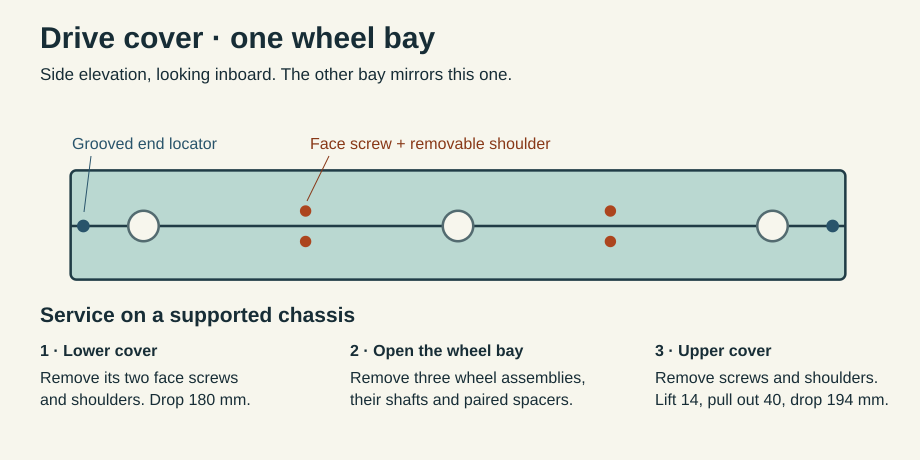

# Drive-chain cover retention and service

<!-- cad-still -->

**Project CAD · Shop-duplex assembly in its stowed pose.** Historical six-wheel CAD reference. The four-module swerve candidate is under development. [Source STEP · 193c7976d1](../design/competition-package/shop-duplex/red/stowed.step) · [Rotate the model](../../../docs/robot/cad/index.html)
<!-- /cad-still -->

Four formed polycarbonate trays replace the eight loose skins in the [wheel-bay study](../chain-covers/README.md). Each tray has two removable face screws and two shared end locators. The lower tray comes off with the wheels installed. The upper one needs wheel service first. The 0.5 mm sheet still needs a physical deflection test before moving use.

## Make and assemble one bay

Dimensions are in millimetres. The two bays mirror across the chassis centerline. The [46-body STEP](supported-covers.step) defines the shape and the [fit receipt](fit.json) pins the source exchange files.

* Form two halves with continuous rounded corners, 4.5 outside and 4 inside. Use a releasable split tool for the straight-sided return. Trim at Z76.2. Measure the finished corner thickness and springback. The inboard ends shorten to clear the welded rail ears.
* Machine six one-flat keyed pilot pockets per rail, with Ø3.4 through holes. Seat the keyed posts against the rail and install six M3×12 socket screws from the inboard face. Confirm thread depth, tapped engagement and seating on the selected stock. The CAD reserves the major diameter.
* At X±295 the Ø6 locator neck and Ø10 lip engage the split Ø6.8 face relief. At X±120, Z64 and Z88, an M3×8 screw clamps a removable shouldered retainer against the post. Its Ø4 sleeve passes through the Ø4.6 hole. The Ø9 flange captures the sheet. The clamp load closes through metal. Check each shoulder seats, both ends capture and the panel can float without binding.
* On a supported, unpowered chassis, remove both screws and collars from the lower tray. Drop the tray 180. Follow the established shaft and wheel service order on that side, retaining and identifying the loose spacers. Remove both upper screws and collars, lift the tray 14, move outboard 40 and lower 194. The chains, sprockets and keyed posts stay installed. Verify tool fit, hand access and support on the built chassis.

## Clearance and flex

The static exchange check found zero material penetration for all 44 added parts against the drive scene and each other. Across the ±4 mm adjustment the rigid minimum clearance bound is 1.7366 mm. Both sides passed continuous translation checks for the specified service route. The adverse sequence crosses an installed wheel. [Service evidence](service.json)

The proposed fixture budget reserves 0.30 mm for forming and assembly error, 0.25 mm for relative runout and 0.30 mm for axial float. That leaves **0.8866 mm** for panel deflection. At the candidate 5 N central load on a 20 × 20 mm pad, the formed assembly must provide at least 5.64 N/mm. Test the actual formed panel and measure near the screws, at midspan and at the trimmed ends. Record unloaded and loaded gaps, residual set and whether a loosened retainer frees an edge. Measure the actual runout and float before accepting the budget.

A linear, simply supported flat-panel model predicts 4.65 mm at 0.5 mm gauge. The deflection exceeds the gauge, and the formed returns and discrete attachments alter the boundary conditions. This flags the need for the fixture trial. It cannot establish an impact rating or predict actual formed-shell travel. [Model and assumptions](compliance.json)

## Mass and configuration

The complete guard adds **173.8–199.3 g**, including all four shells, turned parts and twenty screws. The rail stock stays fully charged. The receiving mass ranges require verification by weighing the parts. [Guard bill](accounting.json)

| Selected build | Margin at the upper represented mass |
| --- | ---: |
| Supported guards on the issued drive configuration | −38.3 g |
| Also fit the fixed-camera harness | −222.9 g |
| Also omit the lift motor and fit its cap, with zero motor credit | −276.9 g |
| Same omission with a verified 400 g credit for the previously counted motor | +123.1 g |

These estimates exclude unresolved equipment and guide attachments. Physical mass margin remains unknown. [Joined accounting receipts](configurations.json)

## Reproduce the checks

Run `python mounts.py <private-artifacts>` and `python cover_service.py <private-artifacts>` with the native CAD dependencies and the original drive artifacts present. Run `python compliance.py` for the fixture screen. Run `python account_mounts.py <plugin-root> <selected-map> <output-directory> <report-file>` on each source-verified map. For the last two rows use the respective no-credit and matched-article maps from the [fixed-lift omission](../fixed-lift-omission/README.md). Check the issued STEP hash in both native receipts before comparing revisions.
