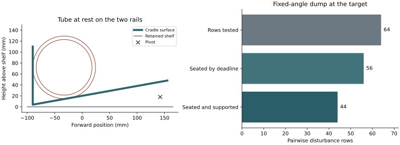

# Receiving CORAL on its outside diameter

<!-- cad-still -->
[](https://ehartye.github.io/frc-2025-poc/preliminary-design/)

**Preliminary design · in progress · layout-002.** Red 2 B′x fixed pocket, held roller nip and exit lip on four-module swerve. Parked pose at the end of the withdraw-park case, with the exit lip deployed and the pocket empty. Whole-robot block-level layout from the layout-checked review scene: 67 representative solids, with the three field fixtures, the delivered pipe and two service hand gauges hidden. It is not detailed CAD. [Open the review](https://ehartye.github.io/frc-2025-poc/preliminary-design/) · [Layout-checked receipt · 14649626c7](../../../docs/preliminary-design/releases/layout-002/receipt.json)
<!-- /cad-still -->

**Reject this cradle as a replacement for the issued receiver.** Two support rails let a short or long pipe seat against its curved surface. The centered geometry carries it and tips it into both modeled low troughs. However, at 4° relative yaw a rail still intersects the pipe after the calculated release, 20 of 64 disturbance cases miss the combined capture/target criterion, and the conservative selected mass estimate exceeds its represented allowance by 58 g before adding an impact latch. These are independent reasons to keep withdrawal, operation and scoring unqualified.



## What changed

The earlier opposing drives squeeze the cut ends. Adding 6.35 mm to the pipe asks each carriage for another 3.175 mm. Its demanding entry case then needs 4.548 mm outward against 1.40 mm guaranteed. Removing 6.35 mm creates a 3.175 mm inward demand per side against 0.30–0.40 mm available. The cradle instead bears on the cylindrical body along two 30 mm strips centered at ±85 mm. A rear wall arrests the incoming roll. The rails incline 44 mm over 245 mm and rotate about a cross-shaft at (142,18) mm, measured forward and upward from the shelf origin. Guards at ±180 mm bound lateral motion. The existing six-wheel robot, telescoping shelf, lower optical ports and dock are retained. The old sensor sequence and calibration do not describe the new seat. [Prior receiver and measurements](../station-relief/README.md) · [Editable geometry and dimensions](native.py) · [16-body STEP](cradle.step)

The manual gives a nominal cut of 11⅞ in (301.625 mm), approximately 4 in inside and 4½ in outside diameter, and an event-piece mass range of 1.1–1.8 lb (0.499–0.816 kg). The reviewed section supplies no numerical cut-length tolerance. Ordinary four-inch foam-core Schedule 40 stock is cataloged at 4.500 in OD and at least 0.237 in wall. The ±6.35 mm practice cut, 112.8/115.8 mm outside diameters and 5.5/6.6 mm walls are deliberate stress cases for imperfect cuts, wear and stock variation. The thin case also challenges the catalog minimum. No event batch was measured. [FIRST manual §5.7.1](https://firstfrc.blob.core.windows.net/frc2025/Manual/HTML/2025GameManual.htm) · [Charlotte stock submittal](https://www.charlottepipe.com/Documents/Submittal/FO-SUB-PVC-FC.pdf)

## Capture, carry and delivery

| Candidate or disturbance | Modeled result |
| --- | --- |
| Bare flat shelf | Pipe escapes before delivery. |
| Open V-pocket | Escapes at zero rolling resistance. At 0.04 rolling resistance it eventually reaches paired target support but misses the existing seat deadline. At 0.10 it passes the centered screen. Rolling resistance is unmeasured. |
| Inclined rails and rear wall | Centered 18° dump reaches both sectors. The nominal pipe seats at 0.563 s from the lip, leaves the cradle at −8.87 rad/s and eventually remains supported by floor and lip for 1.2 s. The centered outcome repeats at 0.500, 0.250 and 0.125 ms steps and with rolling resistance 0 or 0.10. |
| Fixed shelf after discharge | Pipe recontacts the shelf. A 40° dump reaches the inner riser. A 14° dump with high rolling loss times out without release. |
| Registered carriage and field | Six 10 ms route screens cover the two actual corrected routes with 0/±1° rail lean. Their minimum front/rear share is 3.74%, minimum side-rail share 42.66%, and maximum sufficient static-friction coefficient 0.0308 for the planar load allocation. Whole-body collisions, defense, platform flex and lateral impacts are outside that calculation. |

The issuing station pose is a 40 mm dock, 270 mm stroke and 880 mm shelf height. At the low target the shelf is at 500 mm and 370 mm extension. The project’s source-bound ordinary ramp scenario supplies the lip velocity and rolling direction. The planar solver propagates mass and annular axial inertia through gravity, contact stiffness, normal damping, friction and rolling loss, then carries angular velocity into the two trough contacts. The two longitudinal ±1.5 m/s² carry disturbances and 0.35 s dump are synthetic segments between poses. The nominal withdrawal assumes the shelf moves 0.15 m/s starting 100 ms after model-only 1 mm clearance. No live observation or match-clock approval supports that trigger. [Feed and source scope](../sourced-match/source-545.json) · [Contact equations](model.py) · [Actual route load cases](route.json)

Each pair of independent two-level disturbances occurs in all four sign combinations across 64 cases. Cases include ±10 mm normal and lateral dock errors, ±3° chassis heading, ±1° pipe in the chute, ±2 mm rail-to-shelf lateral setup, ±1.5 mm vertical setup, ±1° rail lean, 16/20° dump, ±15 mm target position, both target sectors, friction/damping/loss variation and the piece range above. Tube coverage beyond both working rail edges remains at least 31.24 mm and lateral guard margin at least 10.35 mm. The worst native slot half-margin is only 0.42 mm. A separate 3° in-chute pipe example fails that entrance check. Of 64 rows, 56 meet the 1.1 s seat deadline and 48 reach paired support, with **44 meeting both**. Eight hit the riser and eight time out. The pairwise design neither encloses every combination nor estimates reliability. [Factor definitions](study.py) · [All outcomes, motion, torque and source hashes](study.json)

## What the solids disprove

The receiving export reopens with 16 named solids. The replacement removes 96 original grip bodies. In six pose/angle checks the added bodies have no tested overlap with the retained robot or each other. Against the 47 registered station solids, the conservative swept bound for the additions is 15.24 mm. The 41 requested pipe snapshots per trajectory check the actual hollow finite tube. After the centered-slice exit the left rail intersects the long +4° pipe by 334.35 mm³, and the right rail intersects the short −4° pipe by the same amount. A symmetric longitudinal section cannot authorize withdrawal when the two ends release at different times. Resulting off-axis contact loads and final resting placement are unknown. The centered snapshots find only the intended rail contact. [Assembly comparisons](native.json) · [Registered station and finite-pipe witnesses](installed.json)

## Drive, shock and mass decisions

- Repurposing a single grip motor and its 68:13 reducer takes an estimated 97.24 phase A and 11.75 V for the 3.45 Nm dump budget. This fails the 8 A phase allocation and 9.5 V supply case. A candidate 68:13 × 68:13 × 76:21 stack models 6.98 phase A, 2.36 V and 1.93 bus A. This combines a bounded rail mass/inertia and 0.25 Nm friction allowance with the sampled pipe torque, a 70% drivetrain efficiency and 3×10⁻⁶ kg m² assumed rotor inertia. Additional cartridge inertia, force control, fasteners, output coupling, hard limits, an independently measured angle and loaded timing need engineering. The STEP body reserves 130×40×44 mm for the drive. No supplier-verified assembly fit or shock rating is claimed. [Drive calculation](engineering.py) · [Manufacturer ratios](https://docs.revrobotics.com/rev-crossover-products/ultraplanetary/cartridge-details)
- Sampled capture torques span **−55.62 to +7.80 Nm**. The large negative impact seats the rails against two fixed wedges. Applying a 2× allowance with one wedge taking the full load at 206 mm gives 540 N. The positive rebound can lift the cradle off both wedges. A positive lock to the shelf and its opposed load path would have to be designed and measured before relying on the pivot. REV gives 40 Nm as a cartridge-stage failure reference and warns that shock can break the system below the steady figure. Reject a gearbox-only impact reaction and unrestricted motor stall. [Load receipt](engineering.json) · [Manufacturer test basis](https://docs.revrobotics.com/rev-crossover-products/ultraplanetary/load-ratings)
- Native aluminum parts and steel shaft account for 0.872 kg. With one retained motor, candidate gearbox, bearings and hardware/liner/wiring allowance the replacement weighs an estimated 1.263–1.604 kg, versus 1.120–1.693 kg for the retired assemblies. Maximum addition is 0.483 kg. The red light-carrier/bridge/mounted-stop configuration has only 0.426 kg represented upper margin, leaving **−0.058 kg** before unselected latch, variable materials and unresolved stock. The inspection estimate has no complete configuration margin. The placement does not earn purchase or build credit. [Existing accounting configuration](../design/terminal-mounts/accounting.json) · [Mass calculation](engineering.json)

A successor would need a full-body release witness, off-axis contact dynamics, weighed hardware and a positive impact load path. A fixture should measure the actual cut, both diameters, ovality, contact friction, rebound, yaw and loaded pivot timing. Verify the positive lock holds both torque directions, and check the whole pipe clears the working rail and shelf before any commanded retreat. Until those checks and rule-governed contact/timing evidence exist, the earned competition score remains unknown.

## Reproduce

Run from the checkout. The contact and engineering studies use standard Python. Native checks require the project's OpenCascade Python environment and the separately acquired official January field file described in the station registration. The generator verifies the field digest. The plot requires Matplotlib.

```sh
python -B cradle-receiver/study.py --workers 4 --output artifacts/cradle-study.json
python -B cradle-receiver/route_loads.py --output artifacts/cradle-route.json
python -B cradle-receiver/native.py --step artifacts/cradle.step --output artifacts/cradle-native.json
python -B cradle-receiver/installed.py --field /path/to/FE-2025.STEP --output artifacts/cradle-installed.json
python -B cradle-receiver/engineering.py
python -B cradle-receiver/figure.py
python -B -m unittest discover -s tests -p test_cradle_receiver.py
```

The [end-grip length study](../end-grip-length/README.md) compares a fixed-center cassette and indexed jaw stops on the low receiver.
