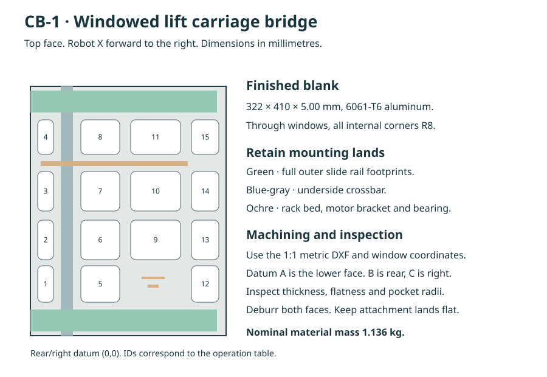

# CB-1 · Windowed receiver carriage bridge

<!-- cad-still -->

**Preliminary design · in progress · layout-002.** Red 2 B′x fixed pocket, held roller nip and exit lip on four-module swerve. Parked pose at the end of the withdraw-park case, with the exit lip deployed and the pocket empty. Whole-robot block-level layout from the layout-checked review scene: 67 representative solids, with the three field fixtures, the delivered pipe and two service hand gauges hidden. It is not detailed CAD. [Open the review](https://ehartye.github.io/frc-2025-poc/preliminary-design/) · [Layout-checked receipt · 14649626c7](../../../../docs/preliminary-design/releases/layout-002/receipt.json)
<!-- /cad-still -->

The 322 × 410 × 5 mm slide-base bridge is the heaviest individually identified part that travels with the lift. Its original 1.7823 kg budget exceeds the ported shelf's 1.578 kg. A 2–5 kg whole-robot miscellaneous allowance and a 1.8–3.9 kg grouped lift-drive allowance still have too little item-level evidence to reduce. CB-1 replaces a single verifiable body while keeping the overall outline and mating lands. The [545-body source assembly](../competition-package/shop-duplex/README.md) remains the registered field model.

**Shop deliverables** · [Editable native source](bridge.py) · [Placement STEP](bridge-place.step) · [Metric DXF](bridge.dxf) · [Window coordinates](windows.csv) · [Native comparison](native.json)

## Mounting and workmanship

Start with 6061-T6 sheet and register its rear edge, robot-right edge and lower face. The part sits between X −147 and +175, Y −205 and +205 mm. Its lower face is 127 mm below the carriage-height datum. The 15 numbered rounded rectangles are through cuts with R8 corners. Retain the full-width crossbar land and both outer rail tracks. The uncut area directly below window 9 retains the motor support and extended stop. The drawing table reports finished window limits from the rear/right corner. Keep any existing build-specific holes, fasteners or weld toes clear of the cut areas. The baseline plate models no attachment holes.

The geometry study preserves eleven nominal material contacts, including the rails, lift shoes, rack bed, motor bracket, bearing, sensor saddle, both end stops and drilled crossbar. Reopening all four complete red STEP files gives the same contact topology. For each contact, a 0.05 mm translation into its mate tests whether the locally occupied material has changed. A trial window through the rack removed **64.0 mm³** from a **96.76 mm³** witness. The registered candidate retains the entire witness and is contained within the original plate at each pose. This gives a clearance argument at intermediate heights because it moves rigidly with the same lift frame. Direct measuring, real hole registration and load transfer through the as-built attachments are still required.

The [later mounted-stop accounting](../terminal-mounts/README.md) combines this bridge and the light carriers with modeled mast drilling and all proposed mounting hardware.

## Mass reconciliation

| Configuration | Calculated value |
|---|---:|
| Original booked bridge | 1.782300 kg |
| Windowed plate at nominal geometry and 2,700 kg/m³ | 1.136228 kg |
| New plate with specified stock and machining allowance | 1.085391–1.188516 kg |
| R103 inspection configuration with CB-1 | 36.693870–50.677175 kg |
| R408 inspection configuration with CB-1 | 42.593870–58.177175 kg |
| Upper seated whole robot with CB-1 | 65.163641 kg |
| Light-to-loaded lift cases | 7.254471–11.610243 kg |

The interval assumes density 2,650–2,750 kg/m³, outer length/width ±0.25 mm, stock thickness ±0.10 mm, window widths/heights ±0.20 mm and radius ±0.25 mm. These are first-article acceptance assumptions. Record actual density or lot, material condition, trimmed dimensions, burr removal and scale readings. Kaiser lists nominal density 0.098 lb/in³ and typical T6/T651 modulus 68.3 GPa. The structural model uses that modulus. The density band and design tolerances belong to this project. [Kaiser 6061 sheet, coil and plate, May 2006, pp. 1–2](https://online.kaiseraluminum.com/depot/PublicProductInformation/Document/1015/Kaiser_Aluminum_6061_Sheet_Coil_and_Plate.pdf)

The original whole-robot BOM and the moving-lift subset both contain the same `slide-base-bridge` at exactly 1.782300 kg. Each view retires that row once and adds the corresponding new interval. Adding the whole-robot and lift savings together double-counts one plate. Material removal changes the lift frame throughout the stroke; it adds no fixed chassis ballast. All unrelated allowances are retained. [Bound calculations and source hashes](review.json)

**Combined selection.** CB-1 provides 1.48595 kg of upper R103 margin. Adding the light [inner carrier kit](../installed-procurement/CLAMPS.md) and both [end-stop reserves](../lift-arrest/README.md) leaves **0.60028 kg** before stop bolts and the outstanding build items, versus 0.00650 kg with the original bridge. In the separate [twin-screw replacement scenario](../lift-screw/README.md), the light clamps and CB-1 leave **1.02818–3.12818 kg** for the still-outstanding replacement items, depending on how much of the retired drive was actually present. That scenario keeps the bridge out of the retired screw-drive list. The two scenarios have separate baselines and neither records a weighed robot.

## Structural and fault limits

The flat-panel calculation uses two-dimensional plane-stress triangles, the entire crossbar contact band fixed in plane, and a 1,000 N distributed force on the forward left rail land. On the 3 mm mesh, mean displacement at the load along robot X is 0.00775 mm for the blank and 0.01129 mm for CB-1. The transverse figures are 0.01149 and **0.07376 mm**. The 4 mm windowed mesh gives 0.01160 and 0.07669 mm. The crossbar fixity, uniform stock, elastic behavior and nominal contact do not establish a particular bolt or weld stiffness. The transverse compliance increases roughly 6.4 times. This limits how accurately the real rack mesh and track parallelism can be inferred from shape alone. [Mesh study](panel.json) · [Solver, supports and load](panel.py)

At an assumed 2 g and 11.61 kg loaded, a conservative single rail taking the complete 227.7 N at its outer end deflects 0.313 mm in the fixed-root beam model. Matching the moment of the whole load at the fully extended shelf tip gives an equivalent 588 N front reaction, 0.808 mm rail deflection and 70.6 MPa nominal root stress. This measures the outer channel over the 237 mm span. The inner/middle stages, joints, rail torsion and tip displacement need separate assessment. With rail restraint lost, the remaining 43 mm plate edge strip alone reaches **33.0 mm and 301 MPa**. A separate 80 N transverse load on the 28 mm rack web gives 0.046 mm assuming both end webs support it, rising to 0.738 mm with one end unavailable. The stock's typical tensile yield is 276 MPa. No fastener, fatigue or event safety rating follows from these comparisons.

**Lighter can worsen an arrest.** Replaying the earlier motor-coupled 0.8 ratio screw at thread friction 0.10 increases worst-phase low-mass coast from 396.26 to 434.87 mm, with the margin to the lower arm decreasing from −165.93 to **−203.03 mm**. At 18:21, adding 1.5 kg of provisional moving screw hardware to the upper case gives 13.11024 kg. Applying the source's ±20% drag tolerance leaves an empty torque-setting window for friction 0–0.20 (−0.05456 N·m) and a positive conditional window of 0.12892 N·m for friction 0.10–0.15. Physical drag, actual moving mass, coupling and low-end coast remain gates. [Original screw assumptions and replay](../lift-screw/README.md)

Before installing, establish actual fastener/load paths and access, inspect the undamaged sheet under each mating land, weigh the finished component, then fixture-test combined rail, rack and bridge stiffness at full extension. Measure both rail alignment and angular twist under the applicable loads. Repeat the independent arrest verification with actual light and loaded carriages. The STEP is a review candidate.

From the repository root run `python design/carriage-bridge/bridge.py`, `python design/carriage-bridge/reconcile.py` and `python design/carriage-bridge/panel.py`. Native qualification requires the project OpenCascade bindings and the panel solver uses NumPy.
