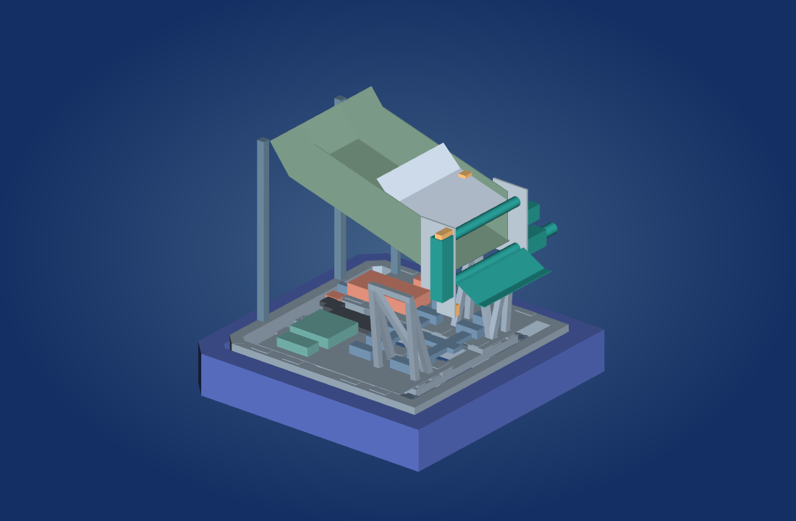

# Fastened chassis and duplex receiver lift

<!-- cad-still -->
[](https://ehartye.github.io/frc-2025-poc/preliminary-design/)

**Preliminary design · in progress · layout-002.** Red 2 B′x fixed pocket, held roller nip and exit lip on four-module swerve. Parked pose at the end of the withdraw-park case, with the exit lip deployed and the pocket empty. Whole-robot block-level layout from the layout-checked review scene: 67 representative solids, with the three field fixtures, the delivered pipe and two service hand gauges hidden. It is not detailed CAD. [Open the review](https://ehartye.github.io/frc-2025-poc/preliminary-design/) · [Layout-checked receipt · 83b3b9c7fe](../../../../../docs/preliminary-design/releases/layout-002/receipt.json)
<!-- /cad-still -->

Explore the [blue robot](blue/robot.html) or the [red robot](red/robot.html) offline. Choose **Shop joints** to inspect the carrier clamps and pinned slide blocks. Choose **Lift retention** to follow each secondary line from its drum, over its sheave, to the carriage. Select a part to see its name and position in four poses.

| Pose | Carriage / extension | Complete blue STEP | Complete red STEP |
|---|---:|---|---|
| Stowed | 940 / 0 mm | [Blue stowed](blue/stowed.step) | [Red stowed](red/stowed.step) |
| Receive | 940 / 240 mm | [Blue receive](blue/receive.step) | [Red receive](red/receive.step) |
| Carry | 670 / 0 mm | [Blue transport](blue/transport.step) | [Red transport](red/transport.step) |
| Place | 560 / 370 mm | [Blue place](blue/place.step) | [Red place](red/place.step) |

The [installed procurement and shop review](../../installed-procurement/README.md) maps each of the 545 bodies to a make, buy or unresolved article and includes a separately checked fastening proposal for the inner wheel carriers.

## What changed

Each pose contains 545 named solids. Six of the 401 earlier bodies were superseded by the 68-body [shop joint package](../../shop-package/JOINTS.md). Four others were superseded by the 86-body [duplex lift package](../../receiver-lift/RETENTION.md). The model includes six threaded outer carrier saddles with 24 screws and washers, four pinned receiver blocks, two drilled inner channels, the longer common shaft, two backup drum and line systems and the pit support rails. Removable pit pins are withdrawn for the match. The historical [401-body model and source register](../README.md) remain available for studies bound to that edition.

## Installation and travel

Each complete STEP was reopened and checked for named solid volume. The red and blue exports have identical native boundary representations for all 545 bodies at each corresponding pose after alliance part-name mapping. Five service corridors in each parked pose cover battery removal, fuse access, disconnect access and the two lift service pins. Each pose checks 124,374 pairs across installation families. Within-family dimensions and intentional joints have their own subsystem reviews. [Blue installation](blue/review.json) · [Red installation](red/review.json) · [Independent alliance comparison and exact SHA-256 digests](alliance-comparison.json)

The normal command sequence retracts the slide before moving the lift. Station and target extension each clear 123,405 pairs by disjoint swept boxes, 928 by constant relative pose and 41 by native sweep. The retracted lift clears 122,646 by swept boxes, 1,708 by constant relative pose and 20 by native comparisons and conservative envelopes. The two changing-length return lines have fixed upper endpoints and lower endpoints tied to carriage height. Their maximum occupied cylinders bound intermediate positions. All three legs finish with zero unresolved pairs. [Continuous travel receipt](travel.json) · [Method](motion.py)

**Hold for power-loss and one-sided capture.** At the 560 mm place height both backup carriage plates reach the lower service-rail arms after only 5.00 mm of extra downward travel. At 10 mm each plate overlaps its arm by approximately 234.16 mm³. A separate native pivot about the intact opposite line gives 16.38 mm³ overlap at 5.679 mm of one-sided drop and 56.52 mm³ at 6.568 mm. A mast fastener also begins to interfere after approximately 9.51 mm. The independent arrest follow-on must resolve the lower stop, one-sided loading and energy absorption before the robot can rely on the backup lines through a power loss. The three nominal motion legs end at their commanded limits.

## Mass, balance and inspection

The [CB-1 bridge proposal](../../carriage-bridge/README.md) reopens these four poses and preserves eleven mounting interfaces. It compares a lighter moving plate against these original weight and fault baselines.

| Engineering estimate | Low | High |
|---|---:|---:|
| Added vs. previous robot | 2.738 kg | 3.338 kg |
| Robot with battery and bumpers | 49.461 kg | 64.941 kg |
| With seated pipe | 50.277 kg | 65.757 kg |
| R103 inspection configuration | 37.391 kg | 51.271 kg |
| R408 inspection configuration | 43.291 kg | 58.771 kg |

The upper inspection estimates leave 0.892 kg and 2.464 kg respectively. The loaded moving lift allowance is 12.204 kg. The seated robot has 1.243 kg headroom against the 67 kg field-motion assumption. The mass model retains the earlier estimated mass of drilled original stock and carries up to 0.600 kg for loose lift hardware and terminations. Component mass, receiver mass and wheel loads still require physical measurement. [Mass, per-pose CG and wheel loads](mass.json) · [Prior balance and inspection assumptions](../../stability/README.md)

In the carry pose the broad load-position assumptions can demand 34.22 A per drive motor and a friction coefficient of 1.315 for a turn. The design’s 0.9 friction assumption cannot cover that condition. With the earlier balance targets met (CG radius at most 50 mm, at least 44% of dynamic load on the lighter side and at most 75% on the outer axles), the same calculation gives 26.71 A and 0.678. Corner scales, fitted wheel and carpet tests and an instrumented turn remain necessary.

## Qualification and reproduction

The historical match and controller records identify their own native inputs. Bind new field, optical, control or physical evidence to the relevant pose digest above. An independent companion screen on the exact red revision cleared 24 initial objects on 13 nominal stages. The near-ball lower bounds on the two target extensions were 154.069 and 157.456 mm. Nominal station clearance was 10 mm. At 1° yaw plus 5 mm toward the station, bumper foam intersects the lower station structure by 11,759.47 mm³ and the cover by 8,091.25 mm³. Docking tolerance or an independently verified revision remains open. These checks cover the stated stock and station geometry only. [Historical field scope](../../../full-match/README.md)

The editable source entry point is `assembly.pose_shapes(height_mm, stroke_mm, alliance)`, with `pose_layers` providing family, color and frame registers. The [frame register](red/part-frames.json) identifies fixed, carriage, slide and variable-rope geometry. The [rotation register](red/rotation-bounds.json) identifies remaining transmission envelopes. Production drawings and as-built approvals still require the outstanding dispositions in the shop and lift source packages.

From the repository root, run the following with the same OpenCascade Python environment used by the competition package. Write fresh export sets to a scratch directory. Use the registered hashes to reference the published bytes, and the native comparison to establish solid equivalence across independently generated exports.

```sh
python design/competition-package/shop-duplex/build_successor.py artifacts/review-red --alliance red
python design/competition-package/shop-duplex/build_successor.py artifacts/review-blue --alliance blue
python full-match/compare_kits.py --body-count 545 --red artifacts/review-red --blue artifacts/review-blue --output artifacts/review-alliance.json
python design/competition-package/shop-duplex/motion.py
python design/competition-package/shop-duplex/mass.py
```
