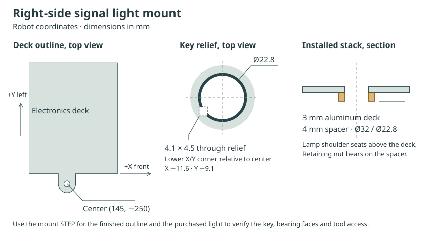

# Signal light for the fixed-height robot

<!-- cad-still -->
[](https://ehartye.github.io/frc-2025-poc/)

**Project CAD · Team 1780 · stowed swerve robot.** Red alliance R4 with numbered bumper covers. Purchased parts use project-created representations in this public assembly. [Source STEP · abbd8ab838](../../../../cad/full-swerve-r4/full-robot.step) · [Rotate the model](https://ehartye.github.io/frc-2025-poc/)
<!-- /cad-still -->

Select the **AndyMark am-3583 on the right edge of the front electronics deck** for the high parking and low receiving configurations. The old Ø22 × 39 mm cylinder above the left mast reserved too little space. Seating the actual lamp at that mast face puts its dome at Z 1,072.7 mm, **5.9 mm above** the 1,066.8 mm starting height. Its stem also runs into the mast and existing hanger bolts. [AndyMark product, STEP and drawing](https://andymark.com/products/robot-signal-light) · [Competition manual §8 V11, R101–105 and R709](https://firstfrc.blob.core.windows.net/frc2025/Manual/2025GameManual.pdf)

## Fit the supplied product to the deck



Robot +X points forward, +Y left and +Z up. Make the replacement as one 3 mm aluminum plate using the registered platform as the base outline. Its right tab is 66 mm wide, from X 112 to 178 mm, with a 33 mm radius end centered at **X 145, Y −250 mm**. The shoulder seats at Z 293 mm. The complete original panel and spacer geometry are in the [two-part mount STEP](deck-mount.step).

1. Open a Ø22.8 mm through-bore at the tab center. Relieve the locating lug with the STEP's 4.1 × 4.5 mm rectangular cut. Its lower X/Y corner is 11.6 mm behind and 9.1 mm to the right of the bore center. A plain round hole leaves 3.35 mm³ of interference in the native model. Check the cut against the purchased lamp and deburr the accessible edges.
2. Seat the keyed lamp from above, fit the Ø32 × Ø22.8 × 4 mm spacer under the plate and secure the supplied M22 × 1.5 retaining nut. The 3 mm deck and 4 mm spacer fill the 7 mm gap between the vendor STEP's bearing faces. The exchange model combines the product into one solid. Assembly order, real nut adjustment, grip and service-tool fit need a physical check.
3. Fit insulated connectors to the two spade terminals and route the leads to the roboRIO RSL terminals. The 32 mm diameter design clearance beneath the connector end covers a proposed lead turn. Confirm actual bend radius, strain relief, routing and electrical indication on the assembled robot.

## Check the assembled configuration

With the real lamp installed, the high configuration measures **1,038.5 mm** tall at its grip motors. The low configuration measures **1,020 mm** at the fixed masts. Their nominal starting-height margins are 28.3 and 46.8 mm. With the removable bumper modules off and chassis sleeves retained, both starts fit within the fixed 700 mm square. The low robot at placement reaches X 535 mm, 185 mm forward of the frame. Four small material samples place the structural rail corners in the bumper zone. These checks use rigid nominal parts and the registered floor. Measure all flexible and attached items in the built starting configuration.

The visibility study traces rays to the vendor dome from standing positions 914.4 mm outside the right bumper, at eye heights from 1.2 to 1.8 m and three fore/aft positions. All 81 rays reach the dome in each of the three registered poses. The same 81 rays clear the conservative swept boxes of all 157 moving low-slide bodies through the 370 mm stroke. An earlier inboard spot at X 215, Y −4 mm loses the front view when the low shelf extends. Read the [pose, hardware and sight-line results](review.json) for the actual samples. From the field, check the lamp's brightness and recognizable flashing, the real wiring and obstructions with a pipe and covers installed.

The bare lamp weighs a nominal 49.22 g. The new mass calculation conservatively adds up to 125 g for the lamp, net deck change, spacer, terminals and leads to each prior inspection estimate. At 2,700 kg/m³ the net deck addition and spacer total 35.58 g. The baseline already holds an aggregate electrical allowance. It takes no mass credit for replacing the old light. The [installed-plugin accounting](accounting.json) leaves 0.490 kg high and 0.516 kg low at the represented upper endpoints. The final inspection margin stays open pending scale weights.

## Replay

Use the [manufacturer's light STEP](https://documents.andymark.com/6dc6d4c850e6cf5798d3b2082ffc15527ad5cdd0869b641439cf62905ee074ca/am-3583%20Generic%20RSL.step) and the project CAD environment. The [manufacturer's rev. 1 drawing](https://documents.andymark.com/f80675b8fd3f67805b70baa97b963cbc7cfbea3c112879e4332bdc96640c6094/am-3583%20Robot%20Signal%20Light.PDF) gives the dome and threaded mounting dimensions.

```sh
python design/signal-light/inspect_light.py SUPPLIED_STEP --mount-step design/signal-light/deck-mount.step
python design/signal-light/accounting.py PLUGIN_ROOT artifacts/signal-light/maps
python design/signal-light/view_light.py SUPPLIED_STEP artifacts/signal-light/robot.html
```
