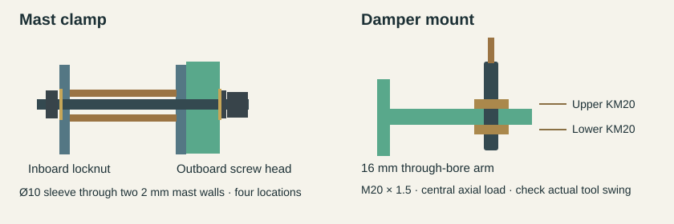

# Lower lift stop mounts

<!-- cad-still -->
[](../../../../docs/robot/cad/index.html)

**Project CAD · Four-module swerve frame and mounting hardware.** Original robot structure for the swerve candidate. The project-local Fusion assembly adds four manufacturer module occurrences. [Source STEP · f8b75f2df4](../../../swerve-drive/packaging/swerve-frame.step) · [Rotate the model](../../../../docs/robot/cad/index.html)
<!-- /cad-still -->

**Retain the two-locknut bracket for a captive fixture. The proposed dampers fail two fault cases.** A single MC225EUM would absorb 43.92 J from the upper CB-1 load case, above its 41 J rating. At the normal 0.253 m/s approach, the balanced full-stroke calculation gives 28.40 kg effective mass per damper, above the 25 kg catalog limit. Placement also uses 10.2 mm of the 12.7 mm stroke before a fault starts. The robot still needs an independently qualified midtravel arrest and supported service. [Terminal cases](study.json) · [Earlier failure and service analysis](../lift-arrest/README.md)



## What fits

The [32-body placement STEP](mounted-place.step) contains two machined masts, two one-piece bracket candidates, four damper body/rod solids, four KM20 nuts, four sleeved M6 screws, eight washers and four prevailing-torque nuts. Both alliances’ four independently reopened 545-body poses clear the added solids. An inboard socket, a short outboard hex key and an AF23 open-ended tool clear the checked approaches. The previous lower washers and heads intersected their brackets by 34.64 and 67.09 mm³ per side. A 50 mm driver also hit the damper locknuts. These failures remain in the native receipt. The reopened 86-body light-carrier set and CB-1 bridge also clear the mounted detail, including the extended damper rods. [Combined native comparison](compatibility.json) · [Editable geometry](native.py) · [Pose, tool and original interference checks](native.json)

| Feature | Design datum and shop check |
|---|---|
| Damper retention | Axis X −60, Y ±298 mm. Use a Ø20.2 through bore in the 16 mm arm and one KM20 on each face. ACE permits this arrangement. Its threaded-hole option needs ≥30 mm engagement at M20. Its KM20 torque range is 27–29.8 N·m. Confirm actual wrench fit, locking, central alignment and lot-specific instructions. |
| Mast stack | Two screws per side at X −46, Z 344 and 373 mm. The 50 × 25 mm aluminum mast has 2 mm walls. Line-bore both walls Ø10.1 for four steel sleeves Ø10 OD × Ø6.6 ID, fitted to the measured 25 mm outside width. Sleeves carry clamp compression across the hollow section. Register the assembly in the existing mast datum before drilling. |
| M6 retention | Outside to inside: M6 × 45 socket-head screw, 1.6 mm washer, 8 mm bracket flange, sleeved mast, 1.6 mm washer, 6.5 mm prevailing-torque nut. The project nominal leaves 2.3 mm of thread past the nut. Verify unthreaded grip, head seating, external thread protrusion, washer classification, nut temperature/locking performance and support under the washer with the actual hardware. |
| Bracket relief | Machine a cylindrical R6.5 exterior relief coaxial with the lower screw, from the outer face at absolute Y 243 to 251 mm. Preserve the 8 mm flange and check the blended root for fatigue. A misplaced or omitted relief produces positive-volume overlap. The model represents the bracket as one piece. |
| Tool access | The M6 screw has a modeled 5 mm-AF socket 4 mm deep. The modeled driver has a 4.9 mm AF engaged tip and 30 mm projecting shaft. The inboard socket has a 10.2 mm AF mouth, Ø16 exterior and through-clearance for the screw tail. The AF23 wrench uses a 23.2 mm jaw opening, 38 mm outer width and 6 mm thickness. It approaches from +X at −15°, 0° and +15°. These samples bound neither continuous swing nor the space needed for a hand, handle or a purchased torque wrench. Confirm them in a supported fixture. |

The closest projected gap from a new sleeve bore to the existing crosswise spacer envelope is 0.95 mm. Establish the remaining net section and stress concentration at the as-drilled walls. Select a screw material and matching locknut with lot evidence; M6 class 8.8 has an 11.6 kN axial proof load under the standardized screw test. At the 70/30 share, the ideal full-stroke mean pad force is 2.42 kN. Its 63 mm moment arm produces 152.5 N·m, about 5.26 kN on a 29 mm bolt couple plus approximately 1.21 kN direct shear per screw. Equal bearing on both mast walls would give 30.3 MPa projected bearing pressure. A gross 32 × 16 mm cantilever section gives 111.7 MPa nominal bending stress. The relief, holes, torsion, unequal load sharing, stiffness, prying and impact peaks require separate allowable-load evidence. A 2.21 ratio of screw proof load to the mean axial couple cannot qualify this joint. [Supplier sources and revisions](sources.json) · [ACE MC225 mounting instructions](https://www.ace-ace.com/media/msimages/pdf/ACE_MC150-MC600_Operating-Mounting_EN_21_22_0019.pdf) · [Bossard screw proof loads](https://www.bossard.com/ch-en/knowledge-hub/resources/technical-information/screws-property-class-04-to-12/)

## What it weighs

The terminal package adds **0.593105–0.682799 kg** to the issued 545-body robot, including removed aluminum and all proposed hardware. Four new Ø10.1 through-bores remove 1,281.90 mm³ across both masts. The nominal increment is 0.628094 kg if the catalog damper weight already includes one KM20 per damper. The lower estimate credits those two nuts. The upper estimate budgets all four separately. The project applies ±5% to bracket and removed aluminum, ±10% to simple steel volumes, and ±5 g per catalog damper. These allowances are estimates pending supplier and shop measurements. The STEP uses smooth thread envelopes, simplified nuts and solid threaded shanks.

With the [CB-1 moving bridge](../carriage-bridge/README.md), [light carriers](../installed-procurement/CLAMPS.md) and these mounts, the upper represented R103 mass is 51.737595 kg, leaving **0.425528 kg** against the historical V11 limit. Agent FRC 0.20.1 checked both colors independently, covered 2,180 pose occurrences per color and rejected selecting the old and new stops together. Both configurations retain an unknown final inspection margin and purchase quantity. Qualify the damper force history, mast and bracket loads, stiffness, service wrench swing, low-end motion and independent midtravel catch before a powered installation. [Signed group masses](study.json) · [Both alliance accounting results](accounting.json)

## Reproduce

Use Python with OpenCascade and the Agent FRC 0.20.1 plugin. The native check requires the existing fully registered robot poses. From the repository root run the following in PowerShell.

```powershell
$out = 'artifacts/terminal-mounts'
New-Item -ItemType Directory -Force $out | Out-Null
foreach ($color in 'red','blue') {
  foreach ($pose in 'place','receive','transport','stowed') {
    $export = @()
    if ($color -eq 'red' -and $pose -eq 'place') { $export = @('--step', 'design/terminal-mounts/mounted-place.step') }
    python design/terminal-mounts/native.py $color $pose "$out/$color-$pose.json" @export
  }
}
python design/terminal-mounts/native.py red place "$out/original.json" --original
python design/terminal-mounts/account.py --native-folder $out --plugin-root "$env:AGENT_FRC_PLUGIN_ROOT"
python design/terminal-mounts/compatibility.py
```

The accounting runner writes independently replayable red and blue maps under `artifacts/terminal-mounts`. The checked-in native receipts can also drive the mass replay by omitting `--native-folder`. [Accounting script](account.py)
