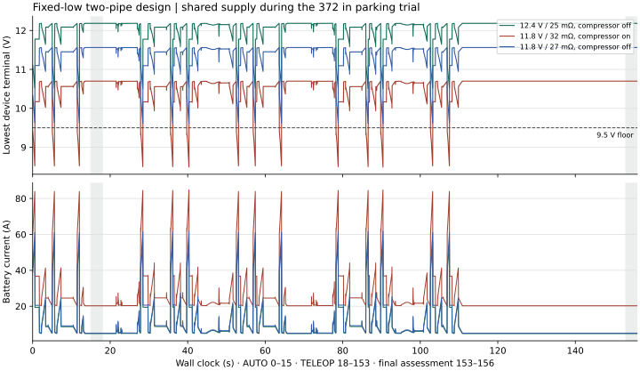

# Can the fixed carriage finish its match on one battery?

<!-- cad-still -->
[](../../../docs/robot/cad/index.html)

**Project CAD · Shop-duplex assembly in its stowed pose.** Historical six-wheel CAD reference. The four-module swerve candidate is under development. [Source STEP · 193c7976d1](../design/competition-package/shop-duplex/red/stowed.step) · [Rotate the model](../../../docs/robot/cad/index.html)
<!-- /cad-still -->

The [two-camera supply design](dual-camera.md) extends this single-camera baseline to the fixed-low robot with both optical heads, their wiring losses and the desktop controller's actual rack withdrawals.

The 67 kg two-pipe trajectory to the 372 in parking stop has **10.50 V minimum at the weakest modeled device** on a 12.4 V source with 25 mΩ total pack and trunk resistance. Its 56.54 A peak occurs while carrying the second pipe. With an 11.8 V source and 32 mΩ, removing the unused compressor still leaves 2.54 s below the project's 9.5 V terminal floor. The model supports a lower-resistance source and an independently qualified camera supply. The issued observer continues to authorize zero L1 deliveries. [Fixed-low match](../fixed-height-match/README.md) · [Electrical results](results.json)



| Registered 156 s case | Pack and common resistance | Compressor | Peak pack A | Min PDH / device V | Time below device floor |
|---|---|---:|---:|---:|---:|
| Hold at station after the indicated seat | 12.4 V / 25 mΩ | Off | 55.93 | 11.00 / 10.52 | 0 s |
| Two pieces and 372 in park | 12.4 V / 25 mΩ | Off | 56.54 | 10.99 / 10.50 | 0 s |
| Same route with continuous compressor stress | 12.4 V / 25 mΩ | 15 A | 74.12 | 10.55 / 10.04 | 0 s |
| Weak pack and trunk | 11.8 V / 32 mΩ | 15 A | 84.79 | 9.09 / 8.49 | 8.22 s |
| Same weak source, fixed carriage | 11.8 V / 32 mΩ | Off | 64.60 | 9.73 / 9.18 | 2.54 s |
| Lower-resistance acceptance case | 11.8 V / 27 mΩ | Off | 61.78 | 10.13 / 9.60 | 0 s |

The weakest nominal sample is 90.38 wall-clock seconds, or TELEOP 72.38 s. The voltage headroom at the most demanding motor is 3.56 V. The nominal run uses 0.414 Ah and dissipates 746 J in the pack and trunk model. It includes 15 s AUTO, 3 s transition, 135 s TELEOP and 3 s stationary assessment with electronics awake. The deteriorated 10.9 V / 40 mΩ stress has 1.96 s without a stable supply solution. Its partial current and energy totals cannot describe a completed route. Any brownout, loss of camera evidence or saturated actuator invalidates the timeline.

## Electrical changes and remaining measurements

- **Fixed-height configuration.** The two independent mast pins remove the powered lift's vertical duty. The separate pneumatic device released the lift pawl; the proposed fixed role isolates lift actuation and leaves the compressor and valve inactive. Retain PH, motor-controller standby on the active branches, RIO, sensors and radio. Confirm stored energy, as-built wiring and the absence of other pneumatic functions before making this configuration permanent. There is no mass credit. Suppressing the unused 15 A stress changes the total-resistance limit at 11.8 V from **22.81 to 28.29 mΩ**. A 27 mΩ case leaves only 0.105 V at the worst terminal. Pack state, source temperature and connection drops must meet the assumptions throughout the match. [Electrical and pneumatic inventory](../design/electrical-inspection/README.md)
- **Observer harness.** The two Pololu D24V50F5 converters feed a Raspberry Pi 4B and an externally powered OAK-D-LITE through the Luxonis Y adapter. The converter's nominal 5 V ±4% can give 4.80 V before cable loss. The project camera inlet budget is 5.00–5.25 V; the general-purpose converter specification alone cannot establish it. A build candidate retains the two separate supplies, selects boards that actually maintain **5.12–5.18 V** over the required workload and temperature, limits each complete output loop to **25 mΩ**, and reserves **15 mV** for remaining error. At 3.0 A host and 1.2 A camera the calculated terminal intervals are 5.030–5.195 V and 5.075–5.195 V respectively. Include both ends, converter ripple, Y-adapter, cable, possible host backfeed, transient load and thermal drift in inlet measurements. Boards that cannot meet the selected range fail this candidate. The larger fixed 5 V D24V60F5 also has ±4% tolerance and its documented external adjustment lowers the voltage. [Pololu D24V50F5](https://www.pololu.com/product/2851) · [D24V60F5](https://www.pololu.com/product/2865) · [Luxonis USB guide](https://docs.luxonis.com/hardware/platform/deploy/usb-deployment-guide) · [Y adapter](https://docs.luxonis.com/hardware/products/Y-Adapter) · [Raspberry Pi power](https://www.raspberrypi.com/documentation/hardware/raspberrypi/power.html)
- **Controller and radio.** The budget retains 15 W for the roboRIO and control interfaces, 12 W for the VH-109 V1 in its original single-DC-input, AUX PoE-off topology and 26.24 W for the observer (15.3 W host, 6 W camera, 1 W sensor allowance, 85% converter efficiency). Those are provisions, not measured currents. The 9.5 V design floor is separate from the configurable roboRIO 2 Stage 2 brownout default of 6.75 V. The VH-109 wiring guidance supports its intended direct-battery robot-client topology. Radio reset voltage, regulator dropout under installation heat, transient duty and as-built firmware remain unmeasured. [VH-109 wiring](https://frc-radio.vivid-hosting.net/overview/wiring-your-radio) · [2025 WPILib brownout stages](https://docs.wpilib.org/en/2025/docs/software/roborio-info/roborio-brownouts.html)

## Actuator and protection evidence

Replaying both Java station cases gives peak grip phases of 7.008 and 7.020 A with an 8 A model cap. The two-pipe run uses the actual wheel acceleration/cruise/braking schedule, the attained low counterfeed and transport force history, the held release commands, slide holding and wire drops, and 67 kg with the registered balance assumptions. The model takes absolute motor-power demand without regeneration credit. An 8 A zero-speed jam held for approximately 130 s gives nearly **999 J** of copper heat per left grip winding over the run even though the highest modeled left supply draw anywhere in that case is only **3.17 A** on a 20 A branch. A sustained commanded hold therefore needs time/freshness/current and temperature supervision. Winding heat alone cannot establish case temperature, allowable duty or cooldown. [Branch I²t, RMS and heat terms](results.json)

The issued withdrawal instantaneously requests 150 mm/s. A trapezoid with 200 ms acceleration and deceleration uses **163.24 mm/s cruise, 0.816 m/s² acceleration** and the same 370 mm stroke in 2.4667 s. It keeps the tested 110 ms onset after modeled shelf clearance and preserves the original final-retraction time. Both identities retain paired trough support for three seconds in the separate contact replay; minimum shelf gaps exceed 37.37 mm. The nominal 25 N slide drag requires at most 6.49 A phase, and 80 N gives 14.93 A. At 140 N the demand reaches **24.14 A** against a 20 A phase limit. The 30 A supply breaker can remain below half rating during that failed trajectory. Real torque tracking, backlash, shaft inertia, hold torque and continuous independent identity still need qualification. [Contact replay and ramp alternatives](retreat.json)

The published branch inventory selects the 10/20/30/40 A REV ATO families. All nominal branch peaks remain below their respective marked ratings. REV's 2022 datasheet gives 1,800 s minimum hold at 100% rating and a **5–60 s** trip band at 200%. For RIO and radio, the study specifies Eaton ATM-10 as a concrete candidate for the existing 10 A mini fuse positions. Its 2021 table gives a **0.15–5 s** opening band at 200% at 23 °C. The selected 120 A main is Eaton CB185-120. Its rating alone gives no trip time for the modeled history. A branch can remain energized while a motor overheats or a mechanism stalls. The pack and connectors are proposed, with no recorded robot-side pin voltages, actual pack resistance, lot/temperature, current or trip trials. The main-off control produces zero branch supply and no observer data; mechanical stored energy remains unknown. [Protection and inlet checks](protection.json) · [REV breaker datasheet](https://www.revrobotics.com/content/docs/REV-11-1860-1863-DS.pdf) · [REV PH limits](https://docs.revrobotics.com/ion-control/ph/specs) · [Eaton fuse tables](https://www.eaton.com/content/dam/eaton/products/electrical-circuit-protection/fuses/data-sheets/bus-ele-ds-2048-atm-series.pdf) · [Eaton main](https://www.eaton.com/us/en-us/skuPage.CB185-120.html)

## Reproduce

The project scripts run offline. The grip trace records each side's force, speed and acceleration as a conservative maximum phase and terminal demand per 20 ms bin. The route solver includes both ends of every rigid drivetrain acceleration interval. The source uses the project hot-copper and contact allowances with fixed open-circuit voltage and series resistance. Battery electrochemistry, inrush and breaker/reset transients need separate measured data. The conditional two-pipe role uses the original 577-body model. Later optics, the revised RSL and alternative receiver hardware require their own branch inventory and replay.

```powershell
python fixed-low-power/grips.py "$env:JAVA_HOME" artifacts/fixed-low-power/grips.json
python fixed-low-power/retreat.py
python fixed-low-power/power.py artifacts/fixed-low-power/grips.json artifacts/fixed-low-power
python fixed-low-power/protection.py
python fixed-low-power/plot.py artifacts/fixed-low-power
```
