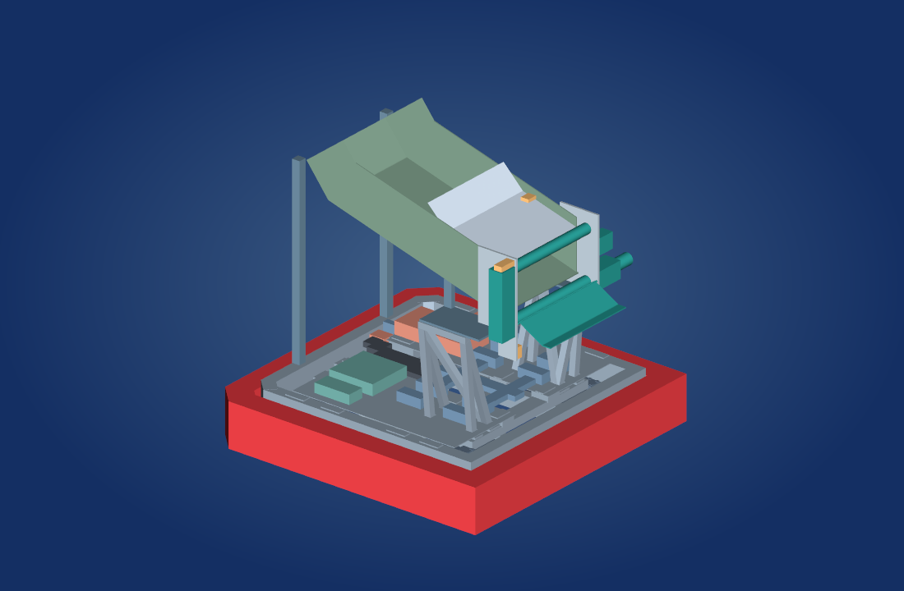

# A station-fed CORAL cycle on the provisional L1 robot

<!-- cad-still -->
[](https://ehartye.github.io/frc-2025-poc/preliminary-design/)

**Project CAD · Fixed pocket 1.0, preliminary design · in-progress.** Whole-robot blockout on four-module swerve: fixed pocket, held two-roller nip and deploy-once exit lip. Parked pose at the end of the withdraw-park case, lip deployed and pocket empty; field parts, the delivered pipe and the two service hand gauges are hidden. It is not detailed CAD. [Open the design review](https://ehartye.github.io/frc-2025-poc/preliminary-design/)
<!-- /cad-still -->

The reference run carries one identified CORAL from a chute to a first contact on both panels of a source-registered reef trough. Breaking different parts of the candidate changes the outcome. A weak acquisition grip loses the pipe past the receiver's rear edge. An unconfirmed seat stops the requested retraction. A slow placement drives the pipe over the edge and into the shelf again. Each result follows the same pipe, position and velocity from the station. The model stops at first unresolved contact.

The competition role remains a team decision. This is the station-fed L1 investigation described in the [design history and geometry](../STATION-RECEIVER.md), the [bumper-aware docking study](../STATION-DOCK.md) and the [two kickoff scoring alternatives](../kickoff/README.md). The current study uses two opposing end-rim belts as a provisional retention and transfer mechanism. Support structure, sensing, contact material, grip, power and field operation need verification.

## How the same pipe moves

The clock starts at an ideal station lip with the empty chassis centered and aligned and the receiver already extended. The 0.5 m/s feed reaches the 240 mm-extension, 6 mm-radius shelf after 0.06831 s. The model carries the incoming horizontal velocity through a perfectly inelastic first top contact. It then integrates the actual horizontal center and yaw using limited forces on the two rims. The vertical constraint follows the shelf only while it supports the piece and its required upward normal remains positive. If a modeled contact or custody guard fails the mission stops.

| Phase | Candidate input or observation |
| --- | --- |
| Seat, confirm, retract | 1.1 s seat window. Model checks ±8 mm longitudinal and lateral center and <0.04 m/s combined speed before slide retraction. Encoder/sensor feedback and calibration are synthetic. |
| Retain on moving carriage | 2 s slide withdrawal. 2 s lower from 940 to 670 mm. A 5 s prescribed chassis movement covers 2.565475 m and turns 180° while the belt forces advance the pipe continuously. Source and destination are locally registered. The connecting path is a benchtop scenario with unvalidated field/traffic clearance. |
| Place | 1.5 s lower to 560 mm and 3 s extend to 370 mm. Placement commands 1.05 m/s belt speed. The pipe leaves the top at 14.83031 s, reaches 1.183 mm conservative clearance from the shelf envelope at 14.84631 s and first contacts the two finite trough-panel support regions at 14.93631 s. These three events have different physical meanings. |
| Boundaries | The 0.35 m/s release counterexample recontacts the receiver without ever clearing its envelope by 1 mm. A target-occupied control holds before extension. Weak belts and missing seat confirmation stop the sequence at the station. Residual motion remains in the trace at each stop. |

The [numerical candidate](candidate.json) uses 7 N per opposed belt and a friction coefficient of 0.4 as hypotheses. Equal longitudinal forces translate the pipe. Differential longitudinal force produces yaw torque; opposing normal loads center it laterally. Roll, spin about the transverse axis, actual normal compliance and tangential slip histories need better evidence. Grip and mass vary independently. The 0.499 kg and 0.816 kg endpoint runs both reach first panel contact in the reference geometry. Across 2, 1 and 0.5 ms steps, the reference terminal times differ by 2 ms. The nominal gap threshold indicates shelf separation only; another part of the machine could still be in contact.

The [target input](target.json) retains the Jan 9 field STEP hash, two trimmed panel regions, measured floor slope/intercept, lip and conservative inner-riser bounds. Two support locations across the transverse cylinder must fall inside the finite panel boundaries and clear excluded mounting holes. The normal-to-floor contact is evaluated in discrete time. The Jan native geometry predates the February drawing set. Intervening robot and field geometry, later rolling, rebound, partner contact and adjudication remain open.

## From the first approach into a second trip

The [post-impact trough and withdrawal experiment](TROUGH-CONTACT.md) supersedes the synthetic 1.2 s wait for the reference contact case. A rolling pipe hits the fixed shelf before that wait ends. An independently triggered early retraction allows sustained modeled floor/lip support under specific friction and roll assumptions.

The [phase rehearsal](../scripts/station_l1_phase.py) starts the empty chassis at X = 1.20 m. It takes an assumed 2 s to dock and 2 s to extend. The first identified pipe therefore reaches the trough at **18.936 s**, placing this trial outside a 15 s AUTO period. The finite AUTO rehearsal stops at 15.000 s, with no continuing powered steps.

In TELEOP the evidence-only run reaches that first contact and waits for confirmation that the robot and the selected sector are clear for withdrawal. A separate scenario supplies a synthetic independent confirmation after 1.2 s. It times the empty 3 s withdrawal, 1 s lift, 5 s return, 2 s station-height recovery and subsequent extension. The second assigned pipe becomes available at 35.000 s, reaches a separate sector at **49.936 s**, and finishes the modeled empty recovery at **62.136 s**. The two specimen identities are `coral-A` and `coral-B`, assigned to lateral offsets −180 and +180 mm within the same target assembly. The earlier pipe's post-impact state stays unresolved. Trying the second pipe in an overlapping sector stops before its feed.

Those times are conditional on the given inventory, a clear path, a new piece ready at the stated time and independent observations after each contact. The [edition-specific assessment](../scoring/README.md) receives the modeled trough contact plus a persistent piece identity. Other robot contact, scored-on-another-level and complete inventory remain unknown. Both V0 and the later archive report unknown L1 eligibility and no official points. See the [kickoff rule register](../kickoff/rule-register-v0.json) for release-day authority.

## Replay

```sh
python scripts/station_l1_mission.py --case reference --full
python scripts/station_l1_mission.py --case slow-release
python scripts/station_l1_phase.py --phase AUTO
python scripts/station_l1_phase.py --phase TELEOP --assume-clear-witnesses
python scripts/station_l1_receipt.py
python -m unittest discover -s tests -p test_station_l1_mission.py
```

The [stored receipt](receipt.json) pins all source inputs and the trace digests for six conditions at three timesteps. Full traces retain piece identity, actual pose/velocity, chassis position/heading, shelf height, slide position and first-failure boundaries. Rehearsal timings, ideal chassis motion and synthetic clearance events are explicitly named. The next qualification requires synchronized evidence of actual retained transfer, commanded versus delivered actuation, whole-robot release clearance and a later scoring assessment. No hardware operation is part of this experiment.
