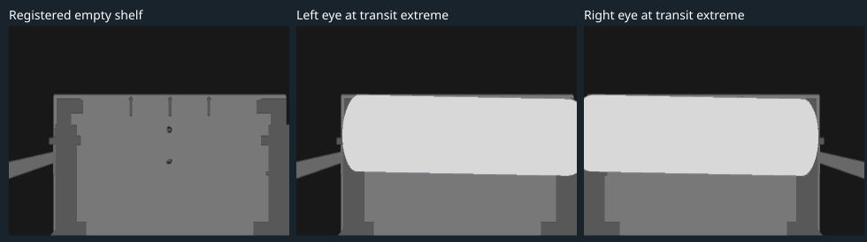

# Follow the pipe on the moving shelf

<!-- cad-still -->
[](../../../docs/robot/cad/index.html)

**Project CAD · Shop-duplex assembly in its stowed pose.** Historical six-wheel CAD reference. The four-module swerve candidate is under development. [Source STEP · 193c7976d1](../design/competition-package/shop-duplex/red/stowed.step) · [Rotate the model](../../../docs/robot/cad/index.html)
<!-- /cad-still -->

A second overhead stereo head kept both modeled pipes in view through **the entire loaded drive and the full 370 mm extension**. The moving camera delivered 2,924 consecutive position observations. The desktop scheduler admitted every nominal request through the first release tick. At release, three overlapping observations transferred the track to the original fixed camera in every tested phase. Immediate withdrawal still meets the [earlier contact deadline](../low-observation/README.md) in **11 of 17 phases for A and 12 of 17 for B**. These are qualified desktop timings. The physical camera pair, mounting stiffness, field lighting, contacts, timing and actuator response still need measurement.



| What the experiment followed | Pipe A | Pipe B |
|---|---:|---:|
| Moving-head exposures on its fixed 17 ms clock | 1,472 | 1,452 |
| Largest inferred shelf-relative X envelope | 64.89–94.98 mm | 64.89–94.98 mm |
| Largest inferred Y envelope | ±6.94 mm | ±6.94 mm |
| Lowest/highest inferred bottom relative to shelf | −9.96 / +9.35 mm | −10.02 / +9.41 mm |
| Eligible 20 ms application ticks from drive request through release | 1,049 | 1,034 |
| Joint track established, local ms | 26486–26502 | 26180–26196 |
| Eligible immediate withdrawal command, local ms | 26720 | 26420 or 26440 |

The station’s independent five-frame confirmation still supplies the initial identity. Subsequent observations use moving shelf coordinates. The overhead estimator accepts rays with a known robot background, checks both end arcs for curvature and checks transverse-axis yaw from both tangent outlines. The two angular silhouettes bound the center using the tube radius. The independently viewed near ends bound lateral position. Reported intervals include 1 pixel edge error, half-pixel sampling, radius and length uncertainty and a 1 mm installation allowance. The estimator receives paired gray images and its registered empty scene. The plant's position is used separately to score the bounds. Every reported interval enclosed its source trajectory. [Optical estimator](optics.py) · [Pixel measurements](frames.csv) · [Counterexamples](replay.json)

The robot frame’s changing view beyond the shelf contributes no required edges. The CAD sweep found no fixed or middle-stage parts entering the checked optical region during extension. Both grips and the new camera frame appear in the moving reference. The packet gate expands each observed interval for its age plus 1 ms using candidate shelf-relative speed bounds of 120, 10 and 20 mm/s in X, Y and Z. The trajectory reached 106.99, 1.335 and 0 mm/s. These bounds require a disturbance test. The tested model has a horizontal transverse pipe. Measure pitch, finite edge contrast, shutter blur, rectification across the near field and frame association on a vibrating assembly. Dropping frames, losing either eye, showing an empty shelf, substituting an epoch, exceeding the admitted image error, or supplying a flat rectangular patch inhibits the respective check. [Speed and flex screens](checks.json) · [Actual WPILib command clock](hal.json)

The original forward camera observes the pipe as it leaves. The fixed exposure phase varies independently over all 17 offsets against the one continuous moving-head clock. Each transfer needs three overlapping position boxes from sequential, already captured frames. Remaining fixed-camera frames must admit a connected outward trajectory. A physically measured, unique prior load at the final pad and a continuous calibration epoch are still required. Simultaneous lookalikes, a spontaneous pipe substitution, glare and a second entrant need independent bench challenges. The study preserves the original 50 ms wait failures and the 23 timing-only positive windows. It does not transmit commands to drive or slide hardware. [Handoff and timing records](handoff.json) · [Held-slide recontact](../low-observation/contacts.json)

## Fabrication and installation

Open the [22-part engineering STEP](moving-bridge.step). It contains 21 new bodies and the drilled polymer shelf. On the 577-body low geometry used for optics this gives 598 bodies. The right-deck status light is checked separately, with 131.8 mm of vertical separation from the lowest new solid. The optical datum is (98, 0, 842) mm above the unextended robot, +X forward, with the 75 mm baseline along Y and the lenses facing down. Every new part follows the full slide. [Parametric stock and fasteners](mount.py) · [Inventory and swept verification](mount.json)

| Piece | Cut, joint and assembly |
|---|---|
| Two posts and top rail | Use 15 × 15 × 1 mm aluminum square tube. Cut the posts to 359.5 mm and crossbar to 415 mm. Register the incident faces on a flat jig. Tack the frame, then check squareness with the bolted camera installed. |
| Shelf feet | Cut two 65 × 18 × 3 mm aluminum feet centered at Y ±200 mm. Drill four Ø4.5 mm through holes in matched shelf and feet at X 29 and 76 mm. Use M4 × 25 class-appropriate bolts, underside spread washers and locking nuts. The modeled Ø8 mm nut envelope requires verification against the selected supplier article. Test bearing, polymer creep, preload and edge tearout. |
| Camera plate | Cut a 65 × 86 × 3 mm aluminum plate with a 22 × 54 mm lightening window. Two Ø4.5 mm holes on the 75 mm pattern accept M4 screws into the camera rear. The drawing uses 3.5 mm nominal engagement. Match the thread depth to the delivered unit. Keep the windows and USB port accessible. |
| Power, data and service | Keep the original fixed camera and Pi. Select a second Luxonis fixed-focus A00532. Add a separately protected 5–5.25 V converter and powered USB arrangement. Reserve up to 6 W at the head, about 0.74 A input at 9.5 V and 85% efficiency before load transients. Clip the connector, route along the frame, strain-relieve at both ends of a flex-rated 370 mm stroke loop, and qualify minimum bend radius and clearance through travel. Connector, moving harness, welds, fuse and converter are budgeted installation items. Verify the second USB stream’s sustained bandwidth and image processing latency on the chosen host. [Luxonis camera data](https://docs.luxonis.com/hardware/products/OAK-D%20Lite) · [Supplier dimensions, SKU and mass](https://checkout.luxonis.com/products/oak-d-lite-1) · [2021 electrical and mechanical data](https://raw.githubusercontent.com/luxonis/depthai-hardware/master/DM9095_OAK-D-LITE_DepthAI_USB3C/Datasheet/OAK-D-Lite_Datasheet.pdf) |

A taller bridge at (115, 0, 860) cut **432.54 mm³ into the installed reef ball** at sector A. The selected lower and narrower bridge clears the conservative starting-ball envelope by 5.22 mm at A and 5.58 mm at B throughout the slide stroke. Remaining positive margins are 332.52 mm to the native station, 45.30 mm to the reef structure and at least 39.18 mm to the incoming finite pipe. The field checks use the exact FE-2025 source digest and the original 24 starting objects. Field setup variation, tracking error and cable motion could consume the small ball margin. [Native field and stock receipts](clearance.json)

The camera weighs 61 g per the manufacturer. The modeled camera, machined metal and fasteners total 0.312 kg. The complete installation adds 0.390–0.505 kg, including 0.360–0.440 kg moving on the shelf. Weld filler, cable assemblies, converter and protection carry explicit estimates. Agent FRC assembly accounting added the complete increment once to the selected low-carriage/light configuration. Its upper represented R103 margin is **11 g**. The superseded taller thin-wall package exceeded the same upper endpoint by 15 g, and the initial heavier stock alone weighed 0.430 kg. No omitted-air-system or alternative-mast credit is included. A 2 g, ideal symmetric post deflection screen reaches 0.53 mm before the joints, crossbar, shelf torsion and cable load. Weigh the completed assembly and measure registration through shock before use. [Mass allocations](mass.json) · [Installed-plugin accounting](accounting.json) · [Shared inspection alternatives](../design/shared-height/README.md)

## Reproduce

Provide the registered official field STEP, the project’s cached JDK/Gradle environment and the installed Agent FRC root. Generate the [low-observation scratch inputs](../low-observation/README.md) in the same checkout first. The second camera uses synthetic raw mono images and a custom geometric fit. Its achieved near-field uncertainty remains a bench question.

```sh
python moving-observer/mount.py
python moving-observer/replay.py --scratch artifacts/fixed-height-observation
python moving-observer/checks.py --scratch artifacts/fixed-height-observation
python moving-observer/handoff.py --scratch artifacts/fixed-height-observation
python moving-observer/clearance.py --field-step "$FIELD_STEP" --scratch artifacts/fixed-height-observation
python moving-observer/accounting.py --plugin "$AGENT_FRC_PLUGIN_ROOT" --output artifacts/moving-observer-maps
python moving-observer/verify.py --java-home "$JDK" --gradle-home "$GRADLE_HOME_CACHE"
python -m unittest discover -s tests -p test_moving_observer.py
```
