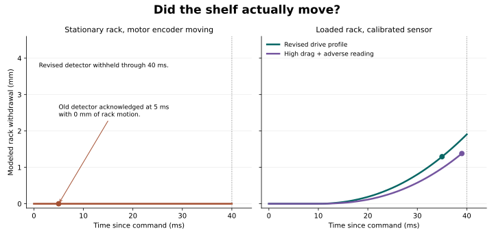

# Did the receiver shelf actually move?

<!-- cad-still -->
[](../../../docs/robot/cad/index.html)

**Project CAD · Shop-duplex assembly in its stowed pose.** Historical six-wheel CAD reference. The four-module swerve candidate is under development. [Source STEP · 193c7976d1](../design/competition-package/shop-duplex/red/stowed.step) · [Rotate the model](../../../docs/robot/cad/index.html)
<!-- /cad-still -->

The original detector acknowledged a stationary shelf **5 ms** after the withdrawal command. The motor-side encoder indicated motion while a repeatability change at the direct sensor crossed the four-count threshold. Actual modeled rack travel stayed at **0 mm**. The controller eventually faulted 130 ms after the command. The revised detector withheld the acknowledgement and faulted at 40 ms. [Two-trip scheduler results](results.json)



The left dot marks the original false acknowledgement. On the right, the green dot marks confirmed movement at 35 ms. The purple dot is the last physical sample before the 40 ms timeout in the combined high-drag and adverse-reading case. The simulation stops logging that fault trajectory at inhibition. Subsequent coasting and pipe contact remain unknown.

## Measure the sensor installed on the shelf

The open SP1-25 covers 635 mm. The December 2015 sheet gives 90–98% of excitation as the voltage change over full stroke. With a common excitation and ADC reference, one raw 12-bit count spans roughly 0.158–0.172 mm. The 2015 sheet lists ±0.05% repeatability. TE's current exact-part listing gives 0.02%. The historical assumption allows two opposed readings to differ by **0.635 mm** plus quantization. Absolute accuracy of ±0.25% full scale is a separate ±1.59 mm specification. [Period manufacturer sheet, pp. 1–3](https://intertechnology.com/Celesco/pdfs/SP1.pdf) · [Current TE product](https://www.te.com/en/product-SP1-25.html)

Survey the fully extended and stowed shelf locations independently and record both raw ADC endpoints. The signed conversion handles either polarity, rejects rail-valued samples, and rejects unusable two-point spans. The modeled 49–419 mm guide-to-eye span includes the nominal 23.9 mm resting eye extension, giving 25.1–395.1 mm active payout with the reviewed bracket orientation. These figures describe the proposed mounting. A receipt, the actual supply/reference ratio, installed eyelet play, measured differential error, vibration and a full-travel survey determine whether the same conversion can be used on the real assembly. [Shop receiver](../selected-match/README.md) · [Count conversion](CalibratedRack.java)

Motion acknowledgement requires independent positive motor travel and speed and enough direct-sensor counts to bound more than 0.20 mm of true travel. The count test includes opposed repeatability error and quantization of the readings and surveyed span. Its guarantee assumes the locally calibrated change in signal has the bounded slope used in the model. A single sinusoidal full-stroke error sensitivity is included. Two endpoints alone cannot establish that bound. The desktop test checked both polarities, nine gain settings, 64 ADC phases and two repeatability assumptions. [Quantization checks](RackCalibrationCheck.java)

## Two withdrawals on the match clock

The stronger gate missed the original 40 ms deadline at 94% electrical span with a 70 ms acceleration ramp. A **35 ms acceleration ramp** retained the 300 ms braking ramp, 5 ms feedback period, original acknowledgement deadline, 10 ms plant delay, 1.20 kg extra moving mass and existing motor limit. All 35 scheduler scenarios ran with the fixed and moving views of the revised 985-component shop scene. The registered pressure inputs and both station image sequences were included. Substituting these observations for the earlier receiver's inputs preserved every tested rack trace and event outcome. The original shop control also repeated its nominal path byte for byte. [Optical scene and shelf marks](../selected-optics/README.md) Thirteen revised scenarios finished both strokes. They confirmed stow at **50.765 s and 100.845 s**. [Controller and case definitions](rack_trial.py) · [Raw signal model](RackSignalTrial.java)

| Input to the revised controller | Result |
| --- | --- |
| Calibrated 90%, 94% and 98% electrical spans | Both strokes acknowledged in 35 ms at nominal drag |
| 27 N drag with adverse historical repeatability | Both acknowledged at the 40 ms limit in the tested span, polarity and phase cases |
| 42 N drag | Nominal sensor completed both strokes. Adding the adverse historical reading withheld the first acknowledgement |
| Wrong full-range conversion | Position disagreement inhibited travel after about 21 mm at 90% and 99 mm at 98%. The second pipe was never issued |
| Open input or uncoupled motor and stationary rack | The first withdrawal faulted. No second transfer was issued |

Each successful revised trace was replayed against both historical pipe release states, each initialized at two contact integration resolutions. All 52 cases retained modeled trough support through assessment. The minimum forward clearance in that contact model was **32.61 mm**. These contacts use the original robot-front representation. The release contact solver still uses the earlier robot-front surface. Actual shop contact surfaces, dock pose, cable routing, and fabricated dimensions remain open. [Contact and power results](qualification.json)

The optical shoes, fasteners and shelf finish bring the represented upper inspection mass to 51.941 kg. The upper operating case is 65.611 kg including battery and bumpers. The 11.8 V, 27 mΩ source gave 9.514 V at the limiting drive inlet on the prescribed schedule. The 32 mΩ source crossed the 9.5 V design floor at 0.430 s. The maximum rack motor phase current among the 13 completed revised cases was 15.99 A. Actual battery impedance, connection losses, sensing and delivered motor force remain unmeasured. The original opening station path is also sensitive to wheel calibration. [Opening station evidence](../station-approach/README.md) · [Loaded drivetrain](../selected-drive/README.md)

## Reproduce on desktop

Use the project's native Python dependencies, JDK 17, and the cached Gradle/WPILib dependencies. First regenerate the raw frames and receipts as described in the [optics study](../selected-optics/README.md). The optical register identifies the accepted station, pressure and release inputs by hash. Pick a fresh output directory for the trial. The first command writes the HAL register and individual millisecond traces. The second checks those traces against field contact and shared-supply demand.

```sh
OPTICS="$POC_ARTIFACTS/selected-optics/issued/hal/registered-inputs"
python rack-sensing/rack_trial.py "$OPTICS/raw" "$RUN" "$JDK17" "$GRADLE_CACHE" --receipts "$OPTICS/receipts" --observation-register selected-optics/controller-register.json
python rack-sensing/qualify.py "$POC_ARTIFACTS/relieved-match" "$RUN" "$JDK17" --mass-source selected-optics/mass.json
python rack-sensing/plot.py "$RUN" "$RUN/onset.svg"
python -m unittest discover -s tests -p test_rack_sensing.py
```
