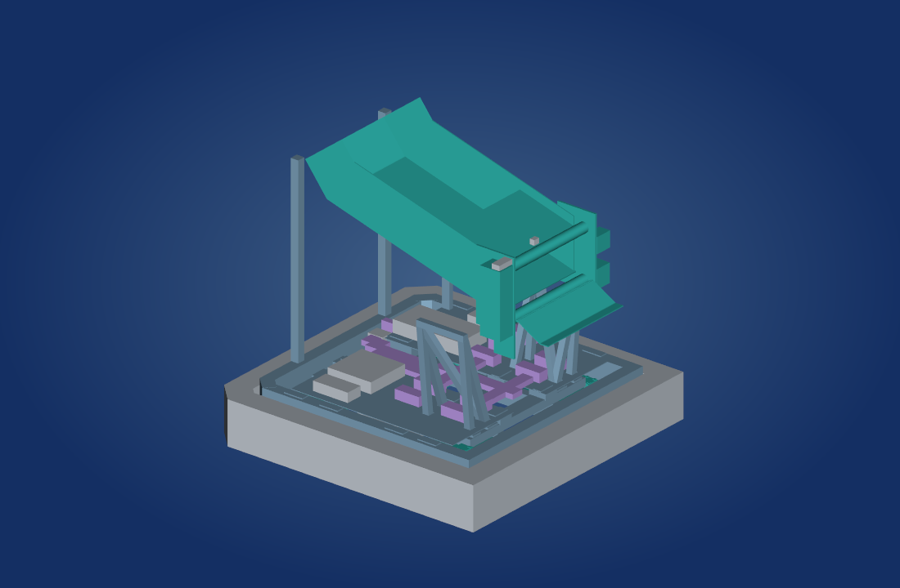

# Flat shelf control

<!-- cad-still -->

**Preliminary design · in progress · layout-001.** Red 2 B′x fixed pocket, roller nip and exit lip on four-module swerve. Parked pose at the end of the withdraw-park case, with the exit lip deployed and the pocket empty. Whole-robot block-level layout from the layout-checked review scene: 64 representative solids, with the field fixture, the delivered pipe and two service hand gauges hidden. It is not detailed CAD. [Open the review](https://ehartye.github.io/frc-2025-poc/preliminary-design/) · [Layout-checked receipt · 1cc8a76119](../../../../docs/preliminary-design/releases/layout-001/receipt.json)
<!-- /cad-still -->

These archived controller records use the original flat shelf assumption and the earlier first-feed receipt. That receipt omitted the redundant zero station pose field, giving a different byte digest. The revised model registers the installed pad tops and shelf edge. The flat control earns no scoring credit in the revised experiment.
