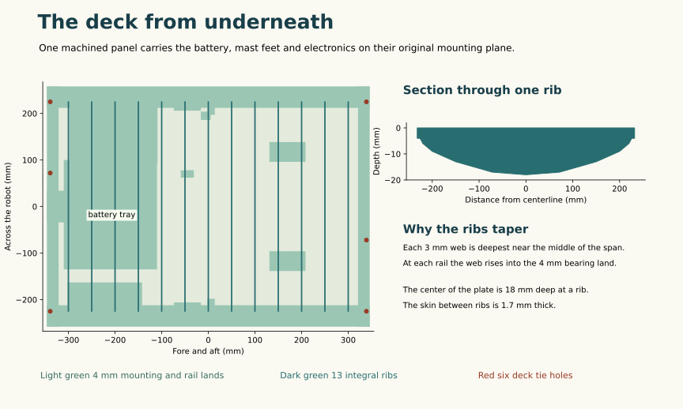

# A lighter deck for the wired, guarded robot

<!-- cad-still -->
[](https://ehartye.github.io/frc-2025-poc/)

**Project CAD · Team 1780 · captive swerve receiver.** The public Fusion capture candidate at rest, with 1,001 robot solids and the hollow practice CORAL. Project-drawn representations occupy the supplier interfaces. [Source STEP · 0dad9e862e](../../../cad/swerve-captive/public-robot.step) · [Rotate the model](https://ehartye.github.io/frc-2025-poc/)
<!-- /cad-still -->

The replacement deck keeps the top mounting plane, the battery and mast lands, and all six end-rail ties. Thirteen transverse ribs carry load between the inner rails. Its modeled mass at 2.70 g/cm³ is **3.240 kg**. The fully charged predecessor is 3.8564 kg. With zero lift-motor credit, the dressed configuration has **80.6 g of estimated headroom** if the finished part meets the receiving conditions. The concentrated shelf-impact case still requires a direct mast-to-frame load path. [Editable geometry](deck.py) · [One-piece STEP](ribbed-deck.step) · [Accounting](budget.json)



## How to read the drawing

The mounting plane stays at Z154 mm. The perimeter, both rail seats and fourteen original contact footprints retain 4 mm stock. The six Ø5.5 mm tie bores match the removable anchors. Each 3 mm rib is 18 mm deep at the centerline and ends at 4 mm depth 226 mm from center. The nominal skin between webs is 1.7 mm. A full plate under the battery spreads local load. All dimensions and contact limits are in the [geometry receipt](geometry.json).

The new underside material has 3.0 mm clearance to the closest inner rail. The installation check includes both drive bays, installed and withdrawn camera fittings, moving slide envelopes, the optional station guide and all six tie-service paths. An enlarged box extending down to Z130 mm also clears the registered static and swept obstacles volumetrically. All fourteen contact footprints retain the material of the original tied deck. [Native fit and service distances](fit.json)

## How much does the deck bend?

The comparison puts the full force on a single rib and adds the travel of the skin delivering the load to it. The model treats the inner rails as simple supports 464 mm apart. The original results use the earlier 4 mm strip screen. Width of load transfer and contact position affect both estimates. [Equations and signed reactions](loads.py) · [All cases](loads.json)

| Applied load | Earlier flat-deck travel | Rib plus local skin travel |
| --- | ---: | ---: |
| Battery at 3 g, 182 N | 13.54 mm | 2.13 mm |
| Central service pad, 100 N | 18.60 mm | 1.62 mm |
| Platform post at 3 g, 59 N | 2.02 mm | 0.20 mm |
| One mast at 3 g, 421 N | 0.31 mm | 0.21 mm |

A missing support doubles the local clear span at the service pad and brings modeled skin stress to 173 MPa. Narrowing the battery load path raises predicted travel to 4.01 mm. A separate 1.90 kN one-sided shelf-reaction sensitivity concentrates the load on a 25 mm strip. The rib stress then reaches 446 MPa and the skin 356 MPa, above the project reference's typical 276 MPa yield. The reaction and pitch couple need a direct connection to the inner frame, with joint strength, bearing, actual installation and dynamic loading checked together. Positive end ties retain the deck. They do not establish the strength of the mast attachment. [Material basis](../design/carriage-bridge/README.md) · [Deck ties](../deck-joints/README.md)

## Machine and inspect a first article

The underside can be cut from a single aluminum blank with the upper mounting surface supported in a fixture. Hold the bearing perimeter and attachment footprints. Rough opposite bays in sequence and inspect flatness before final cuts to the thin skin. Leave root blends, verify the finished tie-hole location and test each fastener and tool from its service side. The exchange describes the target surfaces. The CNC program, cutter and shank reach, clamping, local radii, plate distortion, fatigue and finished dimensions require shop verification.

The [virtual cutter check](machining.json) approaches from below with a Ø6 mm cutter, 1 mm corner radius and independent tie drilling. At 0.5 mm sampling with a cutter-placement reserve it leaves an estimated 88,644 mm³ of extra stock. At 0.0625 mm it leaves 25,566 mm³. This gives about 14,434 mm³ for other dimensional variation inside the combined 40,000 mm³ allowance. The grid result remains sensitive to the path resolution. Weigh the finished, deburred panel and check the fourteen foot locations and four bearing lines. For the 100 N service and battery trials, measure loaded travel and clearance to underlying hardware with the real supports engaged.

## Which mass can the team spend?

The original bill gives one explicit deck mass. The end-tie option kept that charge and took zero drilling credit. The installed accounting checker replaces only that tied plate and leaves its eighteen fastener parts in place. The proposed finished-volume and lot-density receiving conditions give a **3.151–3.385 kg** deck. Neither the old nor the new assembly has a recorded scale weight. [Source bill](../design/drivetrain/review/bom.csv) · [Selected configurations](budget.json)

| Configuration with complete covers, fixed harness and six end ties | Headroom at upper represented mass |
| --- | ---: |
| Lift motor retained | 134.6 g |
| Motor omitted, cap installed, zero motor credit | 80.6 g |
| Same omission, documented 400 g of previously charged motor removed | 480.6 g |

In the zero-credit case, the optional guide faces alone consume 55.08–76.68 g under the three liner-density assumptions. The middle estimate leaves **14.74 g** for their mounting and other open equipment. A scale reading for the complete robot remains outstanding. [Guide face assumptions](../station-guide/mass.json)

## Replay

Use the project's native CAD Python environment, NumPy, Matplotlib and the installed Agent FRC assembly accounting script. The registered endpoint bounds contain the stowed and extended bounds of the selected robot in millimetres. The lamp exchange and detailed source geometry are local inputs. Run from the project root.

```sh
python ribbed-deck/deck.py "$ENDPOINT_BOUNDS"
python ribbed-deck/installation.py "$ARTIFACTS" "$LAMP_STEP" deck-joints
python ribbed-deck/loads.py
python ribbed-deck/machining.py
python ribbed-deck/account.py "$AGENT_FRC_PLUGIN_ROOT" "$ARTIFACTS/deck-joints/maps" "$OUTPUT"
python ribbed-deck/draw.py
```
