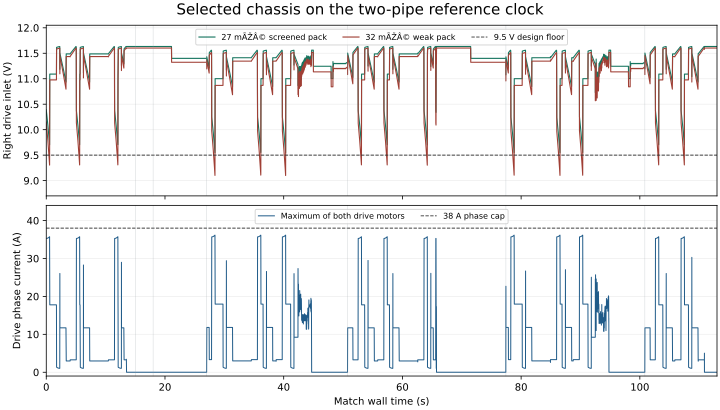

# Can the shop robot drive the two-pipe match?

The selected 20:1 drivetrain can supply the nominal wheel profile at the estimated upper mass on a screened battery. **A small wheel calibration error still drives the robot into the station before the first feed.** The short near-tape alternative avoids that station approach. This study assigns no points to the shop configuration. Its scoring mechanism and cameras have separate geometry and observation gates. [Drive results](results.json) · [Native bumper contact](dock.json) · [Original student match](../relieved-match/replay.html)



[See the fixed-camera station visibility check and encoder-observed leave/park alternative](../station-approach/README.md).

## What goes on the carpet

The 35.534–51.411 kg interval is the robot's represented R103 inspection mass. Add its 6.17 kg battery and one 5.90–7.50 kg removable bumper set. Allow another gram at the upper end for the revised receiver. The electrical screen uses **47.604–65.082 kg empty**, increasing by 0.8165 kg over each carried-pipe interval. There is no shop scale or wheel-load measurement. [Selected robot accounting](../axle-retention/accounting.json) · [Battery and bumper treatment](../design/competition-package/shop-duplex/mass.py)

Reopening the registered STEP gives six nominal 152.4 mm wheels, 580.0 mm left/right contact spacing and 495.3 mm between the end axles. The six am-0940b wheels use individual am-4124 hex hubs and six screws each. Two independent REV reductions each use a 5:1 and 4:1 cartridge and one NEO. The force model uses the earlier 20:1 functional ratio, 82% gear efficiency, 0.040 kg·m² equivalent rotating inertia per side and 38 A phase limit. Actual rolling radius under load, effective turning track, chain condition and delivered tread compound require receiving and carpet measurements. [Native dimensions](wheels.json) · [Selected parts and wheel inspection](../design/selected-shop/README.md) · [Motor coefficients](../design/drivetrain/route_check.py)

## Electrical and traction envelope

The drive inputs include the AUTO route, both attained station-to-reef paths, the measured-in-simulation 5 ms sector steering, the return after A, the actual B stow event and parking. Each side has its own torque and motor-lead loss. Turns include chassis yaw inertia, lateral scrub, rolling resistance and a 50 mm CG eccentricity allowance. The screen requires at least 44% of weight on the lighter side, at most 75% on the outside axles, scrub coefficient at most 0.38 and available longitudinal grip at least 0.90. The upper-mass result requires μ ≥0.784 in this model. A 32% lighter side, 95% end-axle loading and 0.55 scrub require μ ≥1.491 and 48.24 A. Weigh each wheel and measure turn scrub on the intended carpet before accepting either clock. [Traction and current inputs](electrical.py) · [Balance study](../design/stability/README.md)

| Load case | Weakest inlet | Time below 9.5 V or without a supply solution | Consequence |
|---|---:|---:|---|
| 12.4 V, 25 mΩ common, upper mass | 10.458 V | 0 s | Nominal wheel demand fits the modeled supply. |
| 11.8 V, 27 mΩ, upper mass | 9.546 V | 0 s | The tightest inlet is the right drive at 40.325 s. |
| 11.8 V, 32 mΩ, upper mass | 9.100 V | 2.27 s | The design floor first fails at 0.450 s. Later reference motion cannot be credited. |
| Screened pack with both belts running at 1.05 m/s during carry | 9.141 V | 1.40 s | The zero-speed hold command matters to the supply. |
| 11.8 V, 27 mΩ, lower mass | 10.412 V | 0 s | This mass endpoint clears the modeled supply. |

The screened upper-mass case draws up to 64.36 A from the pack. The larger drive motor current is 27.34 A accelerating straight, 2.99 A during sustained straight cruise, 36.15 A turning and 17.97 A during steady turning. The right 40 A branch peaks at 27.21 A and averages 5.65 A RMS across the full clock. The model permits at most 27.55 mΩ common resistance at 11.8 V for this demand. The 46 mV screened margin calls for loaded inlet measurements. A breaker label or open-circuit voltage cannot establish that result. The installed Agent FRC review also checks the simultaneous right-drive operating point on the screened and weak packs. [Power comparison](power/review.json) · [Branch and thermal limits](../fixed-low-power/README.md)

The later 40-article rail attachment raises the upper field mass to 65.561 kg empty and 66.378 kg loaded. It yields 36.40 A peak drive current, 9.517 V on the screened pack and 9.061 V on the weak pack. A further **assumed 50 g** for the proposed sensor bridge gives 9.513 V and 36.42 A. That 13 mV modeled margin can disappear within component or measurement uncertainty. The compartment, source resistance and inlet voltages require loaded measurements. [Rail attachment accounting](../drive-side-attachment/accounting.json)

Both grips retain their entire 8 A phase allowance over each acquisition and carry. The velocity envelopes follow the observed port states, stationary carry and 0.90 m/s release. The slide includes a 20 A extension/holding envelope and the actual new 1 ms withdrawal trajectories. The fixed lift draws zero motor current. The radio, roboRIO, retained PH, host and both separately protected camera supplies share the battery with all motor controllers. Converter efficiency is bounded at 75%. The moving-camera endpoint still depends on its regulated output and connector network. The earlier worn-contact control predicts only 4.958 V at the camera. [Wiring and power conditions](../camera-disconnects/power/corners.json) · [Protected supply inventory](../design/electrical-inspection/circuits.json)

## What the encoders miss

The opening AUTO requires 13.492 s with ideal wheel tracking. Giving the left wheel a −0.2% effective radius error and the right wheel +0.2% produces a 192.5 mm endpoint displacement and 3.011° heading error on the unimpeded encoder path. Reopening the actual installed station and selected front bumper gives **8,982 mm³ of common material at 13.045 s**. A +2 mm effective track error alone gives **43,774 mm³ at 13.295 s**. The unimpeded trajectory after that point is a counterfactual. The correctly registered centerline ends with 10.000 mm clearance. [Native section and witnesses](dock.json)

Applying independently known per-side distance scales and effective track in the wheel command generation restores the ideal pose in the deterministic replay. Its worst inlet is 9.555 V. Actual calibration must establish how those quantities change with tire loading and carpet. The original stowed stock clearance is only 1.034 mm. An accumulated worst-case encoder-only bound at one part per million residual error in radius and track permits 3.20 mm of hull displacement over the full nominal route. That loose bound cannot carry the original stock proof. An independently observed field pose or a route with measured tracking margin is needed. [Kinematics and bounded error propagation](route.py) · [Original field inventory](../relieved-match/match.json)

**A pre-match fallback starts near the tape and drives 0.543 m.** Its normal profile finishes in 1.345 s. Limiting the speed to 0.35 m/s and acceleration to 0.45 m/s² finishes in 2.329 s and retains 10.792 V even on the 11.3 V/42 mΩ source. The same opposite ±0.2% wheel errors move that endpoint by approximately 1.02 mm and rotate it by 0.215°. This option requires its own starting slot, alliance traffic clearance, selected bumper and cage geometry and confirmed park assessment. The single-pipe route still needs the original corner station approach. [Fallback start, cage and partner conditions](../leave-park/README.md)

## Rack feedback and scoring boundary

The rack replay increases only the physical plant's moving mass by **1.20 kg**. This screens the 0.259 kg camera-mount increment and conservatively charges all non-panel items from the cable-carrier budget to the moving shelf. The controller gains and prior clock remain unchanged. At 27 N running resistance, the two reconstructed pulls reach the 48.330/98.410 s motion and 50.765/100.845 s stow ticks. Peak phase current rises from 9.50 to 10.04 A. The resulting 1 ms trajectory differs from the historical trajectory. Both new pulls support the two pipes against the **historical 597-body front** at both contact integration intervals. At 42 N drag the first rack fails the acknowledgement deadline at 48.335 s. The controller never releases B from its station. The extra 50 g moving-mass case also reaches both original stow ticks. [Actuator replay](rack.json) · [Shop cable allowance](../camera-disconnects/mass-conditions.json)

The selected robot still needs mating geometry, fresh images, custody and calibrated tracking at the attained poses. Positive-volume interference of the original shop rail noses with the field disqualifies that starting design. A corrective rail revision requires its own evidence. The calculations above give a bounded drivetrain and actuator demand without awarding either pipe or a park to an unverified assembly.

## Repeat offline

Use the prior study’s OpenCV and CAD packages, registered shop and official field inputs, the preserved wheel/vision traces from the two-pipe match, and the project's Java 17/Gradle cache.

```sh
python selected-drive/wheels.py "$POC_ARTIFACTS"
python selected-drive/dock.py "$POC_ARTIFACTS" "$FIELD_STEP"
python selected-drive/rack.py "$POC_ARTIFACTS/relieved-match" "$OUTPUT/rack" "$JDK17" "$GRADLE_CACHE"
python selected-drive/assess.py "$POC_ARTIFACTS/relieved-match" "$OUTPUT/rack" "$JDK17"
python selected-drive/plot.py "$OUTPUT/rack"
python selected-drive/check_power.py "$AGENT_FRC_PLUGIN_ROOT"
python -m unittest discover -s selected-drive -p test_selected_drive.py
```
