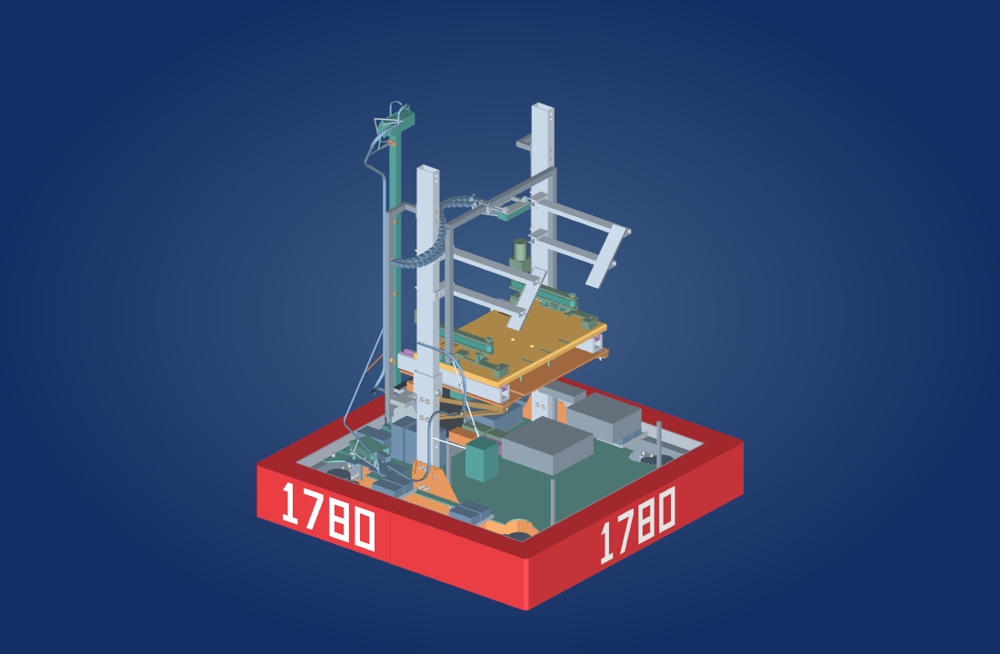
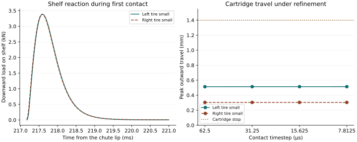

# What happens when the pipe hits the shelf?

<!-- cad-still -->
[](https://ehartye.github.io/frc-2025-poc/)

**Project CAD · Team 1780 · stowed swerve robot.** Red alliance R4 with numbered bumper covers. Purchased parts use project-created representations in this public assembly. [Source STEP · abbd8ab838](../../../cad/full-swerve-r4/full-robot.step) · [Rotate the model](https://ehartye.github.io/frc-2025-poc/)
<!-- /cad-still -->

The 40 mm guide can seat the incoming pipe under a stated shelf-contact model, including the two opposing wheel calibrations that reached the stop in the earlier rigid-shelf simulation. At the finest geometry and timestep tested, the left and right calibration cases require **0.514 and 0.304 mm** of outward cartridge travel against 1.40 mm available. The result depends on how the **actual pipe and shelf deform and rebound**. A lower-damping case fails the unchanged Java port sequence, and the reference model places a brief 3.4 kN reaction on the shelf. The match scoring decision stays open and the south LEAVE/PARK option remains available. [Previous rigid-contact counterexample](../station-guide/README.md) · [Fine numerical review](fine-review.json) · [Alternative start](../station-approach/README.md)



## One change to the physical model

The hollow pipe still comes from the original station ramp, with its attained velocity, spin, mass and axis. Each case uses its own chassis pose from the lower-panel stereo controller. The passive guide, belts, regulated motor ramp and Java two-port policy keep their original roles. The change is at the shelf. The earlier model applies unilateral impulses at up to two cylinder endpoints and resolves sliding friction after the normal impulse. A small change in which end touches first can materially change the attained state. The distributed calculation allows the contacting pair to compress for a finite time. [Source poses](../station-guide/optics-narrow.json) · [Unchanged intake policy](../station-landmark/feed_check.py)

For every pose the calculation constructs the cylinder’s lowest straight generator and clips it to the finite shelf, its penetration interval, and the no-tension condition. At each remaining axial station the normal reaction density is proportional to local indentation times a nonnegative rate factor. Forces and moments are integrated over the active length. Sliding friction opposes the local material velocity, with the original 0.10 friction coefficient and a 0.02 m/s regularization speed. The effective stiffness for a full line is 400,000 N/m and the reference dissipation factor is 4 s/m. These are explicit scenario inputs. Tube ovalization, plate deflection and liner response need independent measurement. The model represents the combined normal deformation in one coordinate and treats the lower generator as the contact footprint. It cannot partition deformation or determine local contact pressure across a finite transverse patch. [Contact implementation](contact.py) · [Drake’s description of the force law](https://drake.mit.edu/doxygen_cxx/group__compliant__contact.html)

## Analytical and numerical checks

A horizontal tube indenting the full shelf by 1 mm gives 400 N upward. Half the tube’s contact length gives 200 N and a 15.08125 N·m roll moment. A separated tube and a tube whose generator is entirely beyond the front edge give zero reaction.

For an aligned, gravity-free drop with incident speed `v`, define `H(x) = x − ln(1+x)`. At peak compression `δ`, the closed-form result is `k δ² / 2 = m H(d v) / d²`. At separation the negative root of the same energy integral gives the rebound speed. At 2.95 m/s with the reference law, the analytical values are 1.53631 mm peak indentation and 0.249991 m/s rebound. The independent 15.625 µs integration gives 1.52431 mm and 0.249991 m/s. The maximum numerical energy residual in that trial is 1.38% of incident kinetic energy. The conservative zero-damping trial returns the incident speed. [Drop, half-period, finite-support and moment checks](analytical.json)

The coarse six-step packet remains available. At 500 µs the model predicts roughly 7 kN and misses the declared five-millisecond support interval at the 330 ms comparison horizon. The 125 µs gravity-free drop misses the analytical peak indentation by 0.0943 mm. At 62.5 µs the error is 0.0471 mm, within the 0.05 mm comparison tolerance. The new range starts there and independently refines the step to 7.8125 µs. It also refines guide angular divisions (64–256), guide radial bands (4–16), shelf quadrature (8–32 stations) and working-belt strips (5–40). The installed Agent FRC checker returns `within-declared-bounds` on every fine axis for nominal, left-small and right-small. Its full coarse packet returns `unknown` in all three cases. The declared finest-pair tolerances are 0.05 mm for cartridge travel and compression, and 25 N for peak total normal force. They govern a finite comparison from the chute lip through 330 ms. Calibration and physical acceptance remain open. [Coarse packet](review.json) · [Fine packet](fine-review.json)

## The controller, camera and loading see different parts of the event

The reference floor law at 250, 125 and 62.5 µs gives a seat and a retained dual-port indication in all 15 runs across nominal, both opposing wheel cases, shifted human delivery and shifted camera registration. At 1 s/m damping each of the three baseline and opposing cases faults because the expected incoming edges never resolve. At zero damping all three leave the flat shelf. At 100,000 and 1,600,000 N/m with 4 s/m damping, both opposing wheel cases seat at 125 µs. At the finer guide and belt geometry, both wheel cases retain the indication through 5,460 ms at 62.5, 31.25 and 15.625 microseconds. The first in-band tick stays at 1,420 ms on the left case and 1,400 ms on the right. These are separate material sensitivities. A favorable outcome cannot establish which law the actual incoming tube follows. [Complete Java runs and adverse controls](ports.json) · [Fine full-duration Java runs](fine-ports.json)

The fixed eye pair separately measures the resulting seated pipe. Five fresh paired captures per case use the new reached pipe state, the registered native station solids, both finite guide bodies and the 991-component fixed-camera scene. The estimator receives only the grayscale stereo and empty reference. At the assumed 15 ms transport and 5 ms service cadence the last capture eligible before the 5,460 ms controller tick occurs at 5,440 ms. All 25 images from the five reference cases and ten fresh images from the two opposing fine 15.625 microsecond trajectories give a position witness. The corresponding empty-scene controls withhold it. This covers a stationary, rendered pipe before the first loaded departure. Physical pupil alignment, first-impact deformation, optical return at a shelf opening, ongoing identity through transport, both scoring releases and the alternate fixed-camera harness require their own evidence. [Reference image bounds and timestamps](custody.json) and [fine image bounds and timestamps](fine-custody.json)

| Robot-frame reaction near first contact | Left tire small | Right tire small |
|---|---:|---:|
| Peak reaction on shelf, XYZ in N | +247, +202, −3,387 | +262, −209, −3,384 |
| Center of normal pressure at peak, chassis XYZ in mm | 116.4, +1.4, 499.0 | 116.4, −1.7, 499.0 |
| First pulse duration, above 1% of peak | 2.172 ms | 2.188 ms |
| Integrated reaction on robot, XYZ in N·s | +0.087, +0.007, −2.592 | +0.087, −0.011, −2.592 |

Robot X points forward, Y left and Z upward. The 500 mm shelf plane and the compressed contact position differ by the modeled indentation. The human releases at 21.10 s, and the pulse starts about 217 ms after the 21.671673 s chute lip. The generator spans the pipe at peak. Reproduction writes a timestamped resultant CSV and the individual weighted station forces for the first 10 ms of contact. Use the impulse, duration, placement and load distribution when checking the shelf, fasteners and guides. A static carrying-load rating cannot establish that capacity. [Load samples and raw-file digests](load.json)

With the same damping, effective full-length stiffnesses of 20, 40 and 80 kN/m lower the peak force to 753, 1,066 and 1,510 N, respectively. The corresponding combined indentation is 6.86–6.87, 4.85–4.86 and 3.43–3.44 mm. The first pulse lasts 10.64–10.66, 7.22–7.23 and 5.00 ms. Vertical impulse stays within 0.023 N·s of the 400 kN/m result. The softest case compresses the contacting pair farther than the 6.35 mm tube wall thickness. A flexible shelf and pipe would share that displacement. Each case includes the first 20 ms of distributed force samples for structural replay. With these three softer laws and 4 s/m damping, both wheel cases still seat at 1,400 to 1,500 ms and hold through 5,460 ms on the unchanged port controller. [Lower-stiffness load histories](soft-load.json) and [six Java replays](soft-ports.json)

To distinguish the modeled outcomes, record the incoming pipe speed and axis, maximum combined deformation and first rebound speed, together with synchronized shelf force and port transitions. Compare withheld left/right arrivals on the as-built hardware before assessing departure and scoring. Keep intermediate force extrema and adverse trials alongside the final seat status.

## Reproduce

Use the project Python and Open Cascade environment, the registered project field and camera artifacts, desktop JDK 17 and the installed Agent FRC package. The CLI below keeps generated images, raw source trajectories and numerical manifests in the project artifact directory.

```sh
python shelf-contact/oracles.py
python shelf-contact/experiment.py "$ARTIFACTS/shelf-contact/constitutive-screen.json"
python shelf-contact/review.py "$AGENT_FRC_PLUGIN_ROOT" "$ARTIFACTS/shelf-contact/review"
python shelf-contact/review.py "$AGENT_FRC_PLUGIN_ROOT" "$ARTIFACTS/shelf-contact/fine-review" --fine
python shelf-contact/ports.py "$JDK17" "$ARTIFACTS/shelf-contact/ports"
python shelf-contact/ports.py "$JDK17" "$ARTIFACTS/shelf-contact/fine-ports" --fine
python shelf-contact/ports.py "$JDK17" "$ARTIFACTS/shelf-contact/soft-ports" --soft
python shelf-contact/custody.py "$ARTIFACTS" "$FIELD_STEP"
python shelf-contact/custody.py "$ARTIFACTS" "$FIELD_STEP" --fine
python shelf-contact/load.py "$ARTIFACTS/shelf-contact/load"
python shelf-contact/load.py "$ARTIFACTS/shelf-contact/soft-load" --soft
python shelf-contact/plot.py "$ARTIFACTS/shelf-contact/load"
python -m unittest discover -s tests -p test_shelf_contact.py
```
