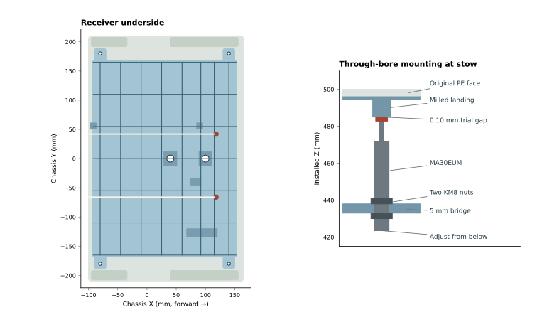

# Can the receiving shelf absorb the station drop?

<!-- cad-still -->
[](https://ehartye.github.io/frc-2025-poc/)

**Project CAD · Team 1780 · captive swerve receiver.** The public Fusion capture candidate at rest, with 1,001 robot solids and the hollow practice CORAL. Project-drawn representations occupy the supplier interfaces. [Source STEP · 0dad9e862e](../../../cad/swerve-captive/public-robot.step) · [Rotate the model](https://ehartye.github.io/frc-2025-poc/)
<!-- /cad-still -->

A lighter shelf and two small adjustable shock absorbers give the incoming pipe somewhere to transfer energy. The original shelf bends and springs back under the modeled arrival. In the coupled model this lifts the pipe out of the powered belt's narrow working height. Both opposing approaches lose it. A stiffer aluminum insert alone also fails both. The two-absorber prototype uses a replaceable shelf and drilled bridge. It keeps the original receiving height and puts a separate plunge stop under each side of the landing line. The cartridge setting, running clearance, joint loads and remaining inspection margin require a fixture and a weighed installation before the team can rely on this configuration for match scoring. [Original contact study](../shelf-contact/README.md) · [Three-part machining STEP](stow-receiver.step) · [Issued dimensions](installed.json)



## What the existing structure carries

The two 3.39 kN impacts are **alternative left- and right-wheel arrivals**. Each first pulse delivers about 2.59 N·s downward over 2.17–2.19 ms, around X116 and Y±2 mm. The force acts over a roughly 302 mm contact generator. Applying the entire resultant at its center would give a different local bending load. The earlier structural study tested sideways contact at a shelf corner. This study integrates the 16 moving force locations for each timestep of the first pulse. [Load histories and digests](../shelf-contact/load.json) · [Older in-plane comparison](../structural/README.md)

The reopened stock shelf bears on the two 250 × 20 mm spacers centered at Y±180. The top edges of the moving inner channels support the spacers. Four long M5 screws with separate pinned crossblocks retain the stack. The incoming vertical force passes through its contact lands. The native inner-to-middle and middle-to-outer stages each have **1 mm vertical take-up**. At the touchdown's X116 line the raised inner floor is **20 mm** above the middle floor. After the first 1.05 mm simulated drop its contact footprint ends at X58.6. Each outer channel bears on the 5 mm bridge. Four M6 bridge screws share X−87. They cannot resist the fore-aft overturning moment through a fictitious bolt-row spacing. The bridge edge, crossbar, mast shoes and locks must transmit it. Two Ø8 mm height pins pass through the solid crossbar and mast sleeves. Centered take-up in that path totals another 0.25 mm. The retained winch and the horizontal rack receive no vertical load credit. Each mast’s nominal metal footprint on the deck is 284 mm². [Native opening and compression controls](supports.json) · [Crossbar and locks](../design/fixed-height/README.md) · [Chassis receiving structure](../ribbed-deck/README.md)

| First impact, left registration | Original PE | PE face and internal grid |
| --- | ---: | ---: |
| First frequency with seated, bilateral rail lines | 56.8 Hz | 113.7 Hz |
| Work-conjugate static stiffness at the actual pressure distribution | 119 kN/m | 476 kN/m |
| Peak work-weighted motion under the imposed first pulse, 2% damping | 7.8 mm | 3.5 mm |
| Peak combined vertical support reaction | 1.09 kN | 1.76 kN |
| Greatest simultaneous vertical-load pitch moment about the rear lock line | 266 N·m | 431 N·m |

The plate displacement uses a Rayleigh–Ritz basis with free fore/aft edges and simply supported transverse lines at Y±180. The material map includes the two Ø12 ports, insert ribs, skin and mounting lands. The two layers share normal motion but receive no bonded-interface bending credit. The original 15 mm polymer and candidate 4 mm facing use a comparison PE grade. The calculation omits the outboard overhang inertia, actual side restraint, local countersink notches, slip, temperature dependence and three-dimensional stress. A 13 × 20 basis gives 475.5 kN/m for the grid. The 15 × 22 refinement gives 474.1 kN/m. Retaining only 7 × 12 overestimates stiffness. The source-registered pressure-weighted motion and a single local gauge have different meanings. The free-span model assumes both rails remain seated through rebound. Its negative signed reactions explicitly test that assumption. [Modes, damping and stress gauges](response.json) · [Simultaneous signed reaction register](transfer.json)

Holding the 3.39 kN peak indefinitely and applying the measured-in-simulation force history produce very different demands. The grid's greatest nominal sampled aluminum stress is **329 MPa** for the static peak versus **168 MPa** under the short pulse. The static control exceeds the manufacturer’s typical 276 MPa tensile yield for 6061-T6. The original PE static center displacement reaches 38 mm and exceeds small-deflection applicability. The trial does not give a fatigue or local joint rating. The prior one-sided mast-pin screen used 421 N. A fixed 18 mm, Ø8 mm cantilever would see about 359 MPa at just 1 kN. Real load sharing, horizontal reactions, local mast bearing and pitch restraint govern whether that comparison applies. [Prior single-pin case](../fixed-lift-omission/README.md) · [Kaiser aluminum plate data](https://online.kaiseraluminum.com/depot/PublicProductInformation/Document/1015/Kaiser_Aluminum_6061_Sheet_Coil_and_Plate.pdf) · [Röchling PE 500 flexural data, 2024 release](https://www.roechling.com/fileadmin/assets/Technical%20Data%20Sheet%20Polystone%C2%AE%20D%20Natural%20-%20ASTM%20717983%20EN.pdf)

## How the damping prototype fits

1. Retain the R6 polymer outside profile. Machine the internal cavity from below, leaving a 4 mm contact face over the grid. Mill its separate 6061 plate from one side, leaving a 1.6 mm skin, 3 mm ribs and supported lands for the port housings, loom, rack and SP1 attachment. Four integral ears extend over the original spacers and use the original M5 stack. Two optional no-damper parts serve as the stiffness control. [Editable insert geometry](tray.py) · [No-damper exchange](shelf-insert.step)
2. In the final kit, pocket the outboard PE overhang clear of the roof saddles, reinforce the two cam lands and machine the 0.8 mm shallow longitudinal reliefs. The two tips pass from the 0.10 mm stowed trial gap to an extra 0.8 mm nominal clearance along a 46 mm ramp as the shelf travels. Recess all three pressure-film envelopes by 0.8 mm, leaving their nominal tops flush. Gauge the actual uncompressed films, adhesive, depth, burrs, edge cover and lead protection. Confirm pressure indication at each channel using the assembled pipe. A differing threshold or proud tail invalidates the contact transfer. [Exact source pad geometry](../release-observer/build_mount.py) · [Machining and receiving record](installed.py)
3. Support the lift and remove the unloaded receiver/bridge on the bench. Follow the prior long-screw and drive-stack service order. Drill two Ø8.3 through bores in the bridge at X118, Y−66 and +42 mm. Use two opposing KM8 locknuts per M8×1 absorber. Both seats bear on solid bridge stock. The two-nut mounting method and published 4.0–4.3 N·m locknut tightening range apply to the identified MA30EUM. Confirm grade, washers or any approved retention changes on the delivered hardware and charge their mass. A 5 mm tapped bridge alone lacks the stated 12 mm minimum engagement for the separate tapped-hole method. Confirm full travel and the 2° side-load limit. [ACE 2011 mounting instruction, page 3](https://www.ace-ace.de/media/msimages/pdf/ACE_MA30-MA900_Operating-Mounting_EN-2011.pdf) · [ACE 2017 catalogue, PDF page 37](https://www.ace-ace.com/media/acedownloads/ACE_Main-Catalogue-2017-EN.pdf)
4. Set each button relative to the actual loaded datum. Check the gap through the complete motion range, including rail play and temperature. Hold a 0.10 mm feeler at the stowed flat, set both locknuts with opposing tools, record cold/hot gauge readings and confirm witness retention after cycling. A 0.20 mm trial gap fails both signed cases in the intermediate plate model. Aluminum and PE expand differently. The 0.30 mm radial pocket allowance and original screw clearances require direct checks over the intended temperature range. A warped face, sliding side load, stuck rod or unchecked gap rejects the assembly. Confirm the actual contacts have settled on the assembly datum before setting either nut. A single unrestrained 1 mm rail clearance already exceeds the tested gap range. The shaft end remains accessible to the modeled straight adjustment probe. Installation still needs an actual AF10 tool and human access. [Continuous rack fit and service checks](damper-fit.json)

The MA30EUM catalogue gives 8 mm stroke, 3.5 J/cycle and 0.23–15 kg effective weight. The original opposed Y±66 layout clears on the negative side but the positive absorber intersects the synchronizer shaft, bearing and cheek. Moving only the positive-side unit to Y+42 clears the full 0–370 mm registered travel. The minimum swept bounding-box separation from unrelated receiver stock is 4.68 mm across the two nut/body assemblies. The small deliberate shelf gap and the bridge bore are assessed separately. Real guide settling and spring reset can consume that gap. The supplier treats the absorber as an axial brake, and its sizing assumes an evaluated application. The capacity alone does not supply a force curve for a bending plate stopping after less than 1 mm. [Rejected symmetric fit](rejected-symmetric-fit.json) · [Current ACE product data](https://www.acecontrols.co.uk/uk/products/automation-control/miniature-shock-absorbers/ma30-to-ma900/ma30eum.html) · [Registered field checks](field.json)

## What the controller sees

The coupled solver applies opposite contact forces to the finite pipe and the plate modes. Each cylinder station follows its local tangent plane. Entry and seat rays use the local port position and tilt before the unchanged Java controller samples them. Its clock starts 100 ms before the physical chute-lip release. The declared 400 kN/m, 4 s/m local normal law can be tested independently of the elastic plate. Using it as a local pipe/interface hypothesis, then adding bending, changes the effective installed law. The physical compression split is unknown. [Executable plant and port replay](coupled.py) · [Original finite-contact controls](../shelf-contact/README.md)

The all-PE and free hybrid plate runs lose the pipe or reach a cartridge stop at both signed arrivals. Suppressing plate motion recovers both port sequences. Increasing assumed modal damping to 8% or 15% still fails. Two optimistic additional rigid spring seats recover just one signed run at one stiffness. Four seats at X116 can recover both at 10 MN/m per seat, but their nearly fixed attachment, shear/lift restraint, load-rated frame and moving clearances are unevidenced. No four-seat hardware is issued. [Free response](coupled.json) · [Time and contact refinement](coupled-refine.json) · [Rigid-face and soft-interface controls](coupled-controls.json) · [Two seats](coupled-seats.json) · [Four seats](coupled-anvil.json)

Each one-way damper is modeled as a unilateral dissipator, with a trial slope of 1,500 N·s/m, maximum 750 N, and an idealized free return of 8 mm in 0.3 s. Both 175 and 500 N·s/m controls fail at Y±66. Measure the force curve of each installed cartridge against the trial slope. The native asymmetric mount and flush films are a successor to that sensitivity study. [Dissipation controls](coupled-oil.json) · [Symmetric time refinement](coupled-oil-fine.json) · [Asymmetric gap sweep](coupled-installed.json)

During the high-resolution first pulse at the two machined stations the solver asks for **0.406–0.528 J** and **0.603–0.762 mm** per absorber. Both 750 N limits are active together. Maximum total downward reaction is **2.236 kN**. At the left case’s maximum pitch the simultaneous chassis force is [+178.2,+23.3,−2065.6] N with +423.8 N·m pitch about the midpoint of the mast feet, X−45/Y0/Z154. Those totals already include the absorber forces. The fixture must establish initial submillimetre force, return, tangential slip, local slope, retained datum, rebound and the actual support path. The primary fit assumes massless plungers, instantaneous load onset, negligible seal friction and independently seated rails. [Coupled mount histories and hashes](coupled-mounts.json)

The final machined receiver seats both original signed arrivals in all four port runs. At 62.5 µs both enter IN_BAND at Java 1,360 ms. At 31.25 µs the left case enters at 1,360 ms and the right at 1,340 ms. All hold through the 5,460 ms check. Fine peak pipe contact is 2.123 and 2.196 kN. Peak roller cartridge travel is 0.532 and 0.371 mm respectively against the 1.40 mm stop. The flush pressure-film witness still enters the compliant nominal pipe wall by up to 0.337 mm early in the impact. The film’s local force/compression law remains unmeasured. [Manufactured geometry, two time steps and port history](coupled-machined.json)

Across 36 isolated fixed and moving stereo eye renders, the installed hardware changes up to 418 gray pixels at the three registered pupil depths and slide positions. Reuse of the previous placement-image receipts requires an explicit new render. At the two registered station docks the added fixed hardware clears the native station by at least 317 mm. At the two placed reef sectors it stays at least 350 mm from the expanded obstacles. These nominal clearances exclude dynamic receiver lift and frame deformation. [Eye comparisons](installed-views.json) · [Native field checks](field.json)

The 998-body nominal stowed installation returns a stereo position witness in all ten late exposures, five per sign. The last observation at Java 5,440 ms arrives on the 5,455 ms tick with the assumed 15 ms delivery. A second pass masks the complete shelf within ±2 mm, both dampers, all four nuts and 629 fixed-harness bounds. With a contrasting dark background all ten still resolve. Matching its brightness to the pipe, blanking one eye or removing the pipe suppresses the witness. The conditional fit therefore needs the real mounted camera, illumination, receiving finish and pipe at both approaches. White natural PE is the stiffness comparison material. Its optical contrast is unverified. This study covers the late first-station custody check. [Native raster register](background.json) · [Stereo results and controls](custody.json)

## Inspection and fabrication decision

Replacing the source-matched shelf with the final facing and insert saves an estimated **59.4–169.3 g** at the issued dimensional models and material density bounds. Add up to 30 g for two received dampers, 10 g for four KM8s and 4 g for two retention/witness allocations. No cut mass from the bridge is credited. With the integral deck, retained guards, routed camera and zero motor removal credit the resulting upper margin is **30.17 g** after the illustrative 65.88 g guide faces. Their attachments and any new mast joint still need their own budget. When the original polymer debit cannot be demonstrated, the scale gate stays open and the separate full-stock control charges the aluminum without removal credit. Procurement and physical inspection margins remain unknown. [Installed assembly-accounting receipt](installed-mass.json) · [Integral deck alternatives](../ribbed-deck/budget.json)

Before accepting the candidate, measure both assemblies’ masses and first frequencies, plate shape, rail take-up and hot/cold stowed gap in a captive fixture. Record the pipe and both button loads, work and rebound over their first millimetre at the predicted incoming velocity, with synchronized high-rate displacement, force and port data. Repeat both signed approach offsets, one weak/missing damper, delayed return and the largest observed rail lift. Verify full-stroke/loaded clearance, oil containment, flatness, grip travel and all three pressure channels. Stop the test if the keeper releases, cartridge reaches 1.40 mm, threads move, the plate yields, or the live port state loses custody. The four-point station-scoring branch remains an engineering hypothesis.

## Reproduce

Run from the project root with the original registered private artifacts, supplier lamp, released field, Java 17 JDK, installed Agent FRC 0.22.2 and a Python environment with NumPy and OpenCascade. The [source register](source-register.json) identifies the exact upstream and local simulation files. For --poses studies, supply a separate cache directory for each pair of poses. Use the [upstream load regeneration](../shelf-contact/README.md) first. The original STEP and the public receipts contain project-owned geometry and measurements. Supplier and field models stay outside this repository.

```text
python shelf-structure/tray.py shelf-structure
python shelf-structure/installed.py shelf-structure
python shelf-structure/supports.py <artifacts> <lamp.step> shelf-structure/supports.json
python shelf-structure/response.py <artifacts>/shelf-contact/load shelf-contact/load.json <artifacts>/shelf-contact/soft-load shelf-contact/soft-load.json shelf-structure/response.json
python shelf-structure/transfer.py <artifacts>/shelf-contact/load shelf-contact/load.json <artifacts>/shelf-structure/reactions shelf-structure/transfer.json
python shelf-structure/damper_fit.py <artifacts> <lamp.step> shelf-structure/rejected-symmetric-fit.json --stations 118,66
python shelf-structure/damper_fit.py <artifacts> <lamp.step> shelf-structure/damper-fit.json --selected --stations 118,-66 118,42
python shelf-structure/field_fit.py <field.step> shelf-structure/field.json
python shelf-structure/views.py shelf-structure/installed-views.json --installed
python shelf-structure/coupled.py <jdk> <artifacts>/shelf-structure/coupled shelf-structure/coupled-machined.json --group machined
python shelf-structure/coupled.py <jdk> <artifacts>/shelf-structure/coupled shelf-structure/coupled-mounts.json --group mounts
python shelf-structure/background.py <artifacts> <lamp.step> <field.step> <artifacts>/shelf-structure/native-background shelf-structure/background.json
python shelf-structure/custody_check.py <artifacts> <field.step> shelf-structure/coupled-machined.json shelf-structure/custody.json
python shelf-structure/mass.py <plugin> <ribbed-deck-restricted-selected.json> <artifacts>/shelf-structure/integral-maps shelf-structure/installed-mass.json --installed
python -m unittest discover -s tests -p test_shelf_structure.py
```
