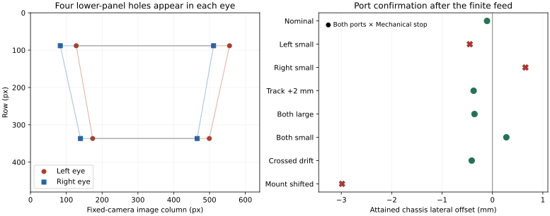

# The opening station dock using the cameras already aboard

<!-- cad-still -->
[](https://ehartye.github.io/frc-2025-poc/)

**Project CAD · Team 1780 · captive swerve receiver.** The public Fusion capture candidate at rest, with 1,001 robot solids and the hollow practice CORAL. Project-drawn representations occupy the supplier interfaces. [Source STEP · 0dad9e862e](../../../cad/swerve-captive/public-robot.step) · [Rotate the model](https://ehartye.github.io/frc-2025-poc/)
<!-- /cad-still -->

**At a 250 µs contact timestep, five of seven wheel-calibration trials brought the first human-fed pipe into the two-port seat window.** Refining the timestep changes which arrivals hit the mechanical stop. The [sensor and contact study](../station-feed-margin/README.md) keeps station-fed scoring on hold. All seven first reached an image-confirmed, stationary dock before the scheduled 21.100 s feed. In two, the actual incoming pipe pushed a cartridge past its stop before the controller saw both ports. A successful chassis approach alone cannot release the loaded drive. The south-lane leave and park remains available as a separate pre-match role. [Feed replay](feed.json) · [South-lane fallback](../station-approach/README.md)



## A datum below the tag

The fixed forward stereo camera looks too far down to measure the station tag and its mounting bolts during the opening approach. The lower GE-25008 panel has two central pairs of aperture columns. Its outer columns are centered at station Y ±358.775 mm. Each has 15.875 mm holes centered at Z 359.283 and 879.983 mm. At the stopped nominal dock, both eyes see both rows. The 6.35 mm panel thickness changes the apparent aperture when viewed obliquely. Several inner apertures have little contrast in the native grayscale rendering. The central receiver can occlude the long slots. The detector uses the four outer circles. [Reopened station STEP measurements](native.json) · [Prior tag visibility trial](../station-approach/README.md)

Both grayscale images must support a single compatible rectangle at the surveyed stop. During initial acquisition the software also allows three stereo-paired corners whose disparity and height identify the row. Tracking searches around the last acquired field estimate. It requires matching observations at both heights and in both eyes. The drive receives camera centroids and timestamped wheel travel. Native depth serves only to render body occlusion. The independent full-robot image from the earlier return gives +0.498 mm station-normal motion against +0.572 mm from its held-out source, with a maximum residual of 0.146 px. The new approach renders only the four surveyed aperture tunnels and the fixed 985-component scene's body-depth occlusion. It assumes contrasting backgrounds. Background clutter, transparency, distortion, tilt, flex and changing illumination still require a field survey. [Pixel association](panel.py) · [Selected optical geometry](../selected-optics) · [Native scene and trajectory hashes](routes.json)

## From the starting tape to the feed

The candidate starts on the same middle tape location, facing 62.483° instead of the original 180°. Both selected bumper covers retain 5,737 mm³ of overlap each after eroding the tape for 5 mm of starting placement error and 0.2° of heading error. The first waypoint is X 440 in, Y 248 in. Wheel encoders and timestamped chassis yaw rate guide the robot to a stop 400 mm out from the previous dock. The camera owns the terminal approach. Production OAK-D Lite units include a BMI270 IMU. Confirm the actual unit, fixed mount axes and access to the synchronized raw stream. Kickstarter units omitted this sensor. This trial adds no camera or mount. [Manufacturer specifications](https://docs.luxonis.com/hardware/products/OAK-D%20Lite) · [Inertial stage](inertial.py)

The gyro model delivers 100 Hz samples after 20 ms. The signed trials include ±0.02°/s residual rate bias, ±0.1% scale error, ±0.2° starting heading error, ±0.2% effective wheel-radius error and 578–582 mm track. These are trial inputs. The terminal pair arrives every 40 ms with 30 ms modeled delay. The controller rejects observations older than 65 ms and restricts wheel demand using remaining distance to the wall and finite 420 mm/s² braking. It stops before the 15–18 s mode transition and requires three current stationary views before feeding. Real tire-ground travel, gyro drift, per-side braking, holding, timestamp bias and camera transport must be measured. The shared drive supply model and its 9.5 V acceptance floor remain separate. [Visual controller](drive.py) · [Drivetrain qualification](../selected-drive/README.md)

| Scheduled case | Chassis normal, lateral and yaw error | Simulated feed |
|---|---|---|
| Nominal | +3.02 mm, −0.11 mm, +0.02° | Both ports confirmed |
| Left tire small, right large, 578 mm track | +3.00 mm, −0.45 mm, +0.07° | Cartridge stops before seat |
| Right tire small, left large, 582 mm track | +3.00 mm, +0.65 mm, −0.01° | Cartridge stops before seat |
| Track increased to 582 mm | +3.01 mm, −0.37 mm, +0.01° | Both ports confirmed |
| Both radii large, both radii small, crossed wheel and drift errors | See per-run states | Both ports confirmed in all three |

The final chassis poses drive the existing hollow-pipe simulation and compiled Java reverse-probe controller using 0.25 ms contact steps. Five capture trials achieve IN_BAND between 1,360 and 1,420 ms on the local controller clock. The two adverse poses require approximately 2.063 mm and 1.409 mm of cartridge travel at the limiting contact. The issued outward allowance is 1.40 mm. Moving the human feed sideways 3 mm also hits the stop. Independent pipe-camera custody and held-to-release scoring on this changed route have yet to be demonstrated. No delivery or match points are assigned here. [Compiled Java and physical feed replay](feed_check.py) · [Original timed mission](../relieved-match/README.md)

## Clearance, lost packets and repeatability

The seven intended runs clear the modeled barriers by at least 11.5 mm, the 24 installed stock objects by at least 19.8 mm and the five other robots by at least 79.8 mm through the feed. The field screen uses an 850 × 850 × 1,066.8 mm stowed box and swept motion between samples. The 925 mm centered alternative also reaches a convincing image lock, but its stock clearance bound drops to −191.9 mm. It remains excluded. These are attained trajectories under the stated parameters. A continuous bound for every combination of calibration and slip, measured cage motion, current field setup and partner schedules are still needed. [Continuous occupied-path comparisons](field.py) · [Issued inventory](../full-match/installed-stock.json)

With missing or delayed terminal images, the robot stops about 332 mm short. Without contrast it exhausts the bounded search about 229 mm short. A missing IMU at enable inhibits motion. Loss at 3.50 s brakes the chassis by 3.795 s. Holding there would enter scheduled traffic. With two healthy shaft sensors the controller instead retraces their recorded wheel motions, returning stationary at 7.590 s within 19.15 mm of its starting center after an additional opposing 0.2% return wheel-scale change and 2 mm track change. Its remaining scheduled TELEOP peer clearance exceeds 1.36 m. This recovery depends on valid paired encoders and working brakes. A simultaneous actuator or encoder loss requires a different physical contingency. [Failure and recovery records](routes.json)

An unobserved 3 mm camera-to-chassis lateral shift produces the same pixels as a 3 mm chassis displacement in the opposite physical reference. The simulated observer accepts the shifted case; its actual pipe fails. Even with an exact mount, two poses 3 mm apart laterally and 0.225° apart in yaw share a mathematically compatible midpoint observation if each projected coordinate can err by 0.205 px. The surveyed return's residual is a two-pose check. It cannot bound the physical worst case. Measure the installed panel, actual incoming pipe distribution and receiver relative to the pupils, and preserve the independent custody gate. [Finite pixel counterexample](ambiguity.json)

## Reproduce

Use the registered FIRST field export and the project's Python computer-vision/Open Cascade environment. The image inputs are the authorized fixed station images and the robot-only fixed-depth export from the selected optics study. Keep supplier geometry and raw images in the project's ignored artifacts directory.

```sh
python station-landmark/inspect_surface.py "$FIELD_STEP" "$POC_ARTIFACTS"
python station-landmark/qualify.py "$POC_ARTIFACTS" "$OUT"
python station-landmark/feed_check.py "$OUT" "$JDK17"
python station-landmark/uncertainty.py
python station-landmark/plot_study.py "$POC_ARTIFACTS/selected-optics/issued/marked"
node "$AGENT_FRC_PLUGIN_ROOT/scripts/rules.mjs" review kickoff/rule-register-v0.json
python -m unittest discover -s tests -p test_station_landmark.py
```
