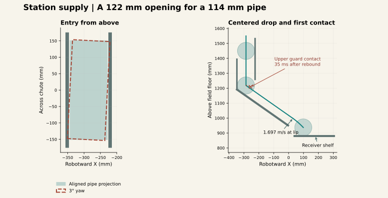

# From an actual station opening to a seated pipe

<!-- cad-still -->
[](https://ehartye.github.io/frc-2025-poc/)

**Project CAD · Full swerve robot · stowed, red alliance.** The R3 model brings together the four steerable wheels, fixed-height receiver, electronics and red bumpers. Purchased parts use project-created representations in this public CAD. [Source STEP · 0f96394e6c](../../../cad/full-swerve-r3/full-robot.step) · [Rotate the model](https://ehartye.github.io/frc-2025-poc/)
<!-- /cad-still -->

Explore how parking error changes bumper and receiver clearance in the [student docking lab](dock-lab.html). The [545-body docking study](DOCKING.md) traces the issued approach and two alternate receiving positions.

The complete match currently assumes CORAL A and B arrive at the receiver at 0.50 m/s. That speed follows from releasing a transverse pipe from rest only 42.1 mm before the chute lip. The actual ramp is 419.1 mm long. In the later competition manual G431 restricts a person’s reach into the chute and G433 requires CORAL to enter through the station via a driver or human player. The earlier start state alone cannot establish how the pipe got there. [Issued full match](../full-match/README.md) · [Official manual, §§5.7, 7.4.5](https://firstfrc.blob.core.windows.net/frc2025/Manual/HTML/2025GameManual.htm) · [Official field drawings, GE-25010 and GE-25014, PDF sheets 75 and 80](https://firstfrc.blob.core.windows.net/frc2025/FieldAssets/2025FieldDrawings.pdf)

The [source-to-target replay](../sourced-match/README.md) carries each of the two attained states through retraction, transit and placement on the 401- and 545-body robots.




## A source candidate and two counterexamples

The January native field model places two surfaces 121.991 mm apart through the central station opening. A 114.3 mm OD, 301.625 mm long pipe enters horizontally with its axis across the station. The centered pipe’s margin is 3.845 mm at each face. Its projected half-width is the sum of the pipe half-length times the sine of its yaw and radius times the cosine. At 1.468° the centered outer projection reaches the nominal faces. A 10 mm shift toward the field intersects the front guide by 40,657 mm³ at Z1340 mm. A centered pipe at 3° intersects both guide solids. Contact could redirect a real pipe; these results reject an unobstructed free drop for those poses. [Native contact and source receipt](transfer.json)

For the nominal test the pipe starts at the measured slot center, Z1550 mm, with zero linear and angular velocity. At this height its bottom is above the 1394.6 mm high player-side backboard. The test traces the pipe’s volume. Human hand geometry and actual operator conduct remain unobserved. The model drops 332 mm onto the 35° ramp and assumes a perfectly inelastic normal impact followed immediately by rolling without slip. For the assumed hollow-pipe inertia, the required contact friction ratio is 0.331. The 384.66 mm remaining roll produces 1.697 m/s at the lip. Plastic condition, surface finish, bounce, initial spin and yaw will change that state. [Official registered station STEP source](https://firstfrc.blob.core.windows.net/frc2025/FieldAssets/2025Field-STEP.zip)

A modest change to the ramp impact invalidates the free-rolling exit prediction. With assumed normal restitution 0.20, the rebounding pipe intersects the installed upper guard GE-25015 after 35 ms (219 mm³). At 0.40 it reaches both GE-25015 and GE-25021 after 20 ms; at 0.60 it reaches them after 15 ms. These positive-volume snapshots mark the end of each free-flight hypothesis. They do not predict the subsequent exit speed.

The continuous filled-pipe sweeps cover the centerline vertical drop, downhill straight section and eight ballistic chords through first shelf height. The flight checks expand each chord radially by 0.0476 mm to bound gravity curvature. Outer-envelope overlap at the initial ramp lip and final shelf is consistent with the planned support transitions. A modeled centered dry receiver brings the nominal source to within 0.1 mm of its 80 mm seat after 1.1 seconds. A separate centered dry speed sweep from 1.60 to 2.50 m/s in 0.01 m/s increments places the first rear-boundary failure at 2.42 m/s. The preceding 2.41 m/s case recovers to seat at all three tested integration steps (0.5, 1 and 2 ms). This is a model boundary for designing the incoming-speed measurement. [Speed sweep](speed-window.json) In the historical 0.50 m/s case the finite pipe wall intersects each of three 0.8 mm observer pad laminates by 50.89 mm³ at the bare-shelf contact instant. The first such positive sample already occurs at 99% of the computed flight time. The laminates can deform, and their normal response is unmeasured. A bare-shelf calculation cannot establish their contact history.

## Two scheduled introductions

| Identity | Alliance stock available | Release above chute | Ramp lip | Ideal seat check | Minimum bound to other five robots |
| --- | ---: | ---: | ---: | ---: | ---: |
| CORAL A | TELEOP 0.00 s | 3.100 s | 3.672 s | 4.821 s | 4.614 m |
| CORAL B | TELEOP 35.00 s | 53.501 s | 54.073 s | 55.223 s | 2.585 m |

The second introduction carries forward the first timing difference. These two distinct identities reduce the declared red stock from 60 to 58. The full match’s five other robot schedules are retained over each introduction. The clearances use a conservative stationary disk containing the moving pipe, each other robot’s swept circumradius, and a 1.25 m/s center-speed bound across 20 ms intervals. The assumed preload count, human handoff time and other robots’ behavior are assumptions of this trial. Two changed introductions delay the end of the second simulated seat by 0.769 s relative to the issued clock. The issued 93.246 s park and nine-point ceiling remain attached to the earlier source. The new source still needs measured acquisition and fully replayed downstream custody, release interlock and an unobstructed match.

## Reproduction

The solver consumes the project-owned red receiving STEP and a user-supplied copy of the official native field revision. It verifies both before checking material. Only scalar measurements, original code, the derived diagram and results live here.

```powershell
python full-match/materialize_red.py --output artifacts/red-401
python station-supply/transfer.py --field $env:FIRST_FIELD_STEP --poses artifacts/red-401 --output artifacts/station-transfer.json
python station-supply/speed_window.py
python station-supply/render.py
```

The experiment stops at a centered desk-model seat. A bench record should capture both named attempts, entry offset and yaw, first ramp and shelf contact, pipe speed and spin, pressure-pad loading, retained position and sensor confirmation. The 3° guide strike and the higher-speed rear exit provide explicit recovery cases. An actual match still requires a legal human introduction, sufficient travel and traction, source-bound sensing, and an available station.
