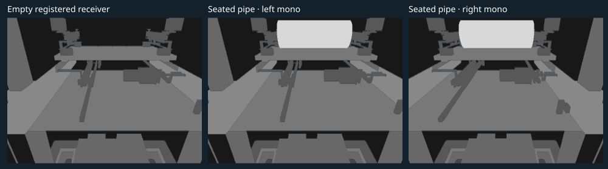

# Can a second instrument see the seated pipe?

<!-- cad-still -->
[](https://ehartye.github.io/frc-2025-poc/preliminary-design/)

**Preliminary design · in progress · layout-001.** Red 2 B′x fixed pocket, roller nip and exit lip on four-module swerve. Parked pose at the end of the withdraw-park case, with the exit lip deployed and the pocket empty. Whole-robot block-level layout from the layout-checked review scene: 64 representative solids, with the field fixture, the delivered pipe and two service hand gauges hidden. It is not detailed CAD. [Open the review](https://ehartye.github.io/frc-2025-poc/preliminary-design/) · [Layout-checked receipt · 1cc8a76119](../../../docs/preliminary-design/releases/layout-001/receipt.json)
<!-- /cad-still -->

The issued fixed stereo camera can independently locate the centered pipe on the receiving shelf in this desktop experiment. The two ports alone confirmed at 1.280 s on the controller clock. Five fresh camera exposures corroborated the port result at **1.380 s**, across all 17 integer camera phases. Replaying those same port signals on an empty shelf, or during a weak-grip loss, produced **zero corroborated ticks**. The result is a position observation. A physical installation still needs image, timing and retention calibration before authorizing movement. [Acquisition experiment](../observable-acquisition/README.md) · [Timing and counterexamples](results.json)



## What the camera measured

The project already allocates a fixed-focus Luxonis OAK-D Lite, a Raspberry Pi 4 host, their converters and cable reserves. The robot-fixed stereo midpoint is at (−315, 0, 970) mm, looking 26° down. Two global-shutter mono eyes have a 75 mm baseline. This experiment reuses all 14 installed observer bodies. It adds 0 kg to either the fixed robot or moving lift. [Installation, BOM and manufacturer sources](../release-observer/README.md) · [Installed articles](../design/installed-procurement/installed.csv)

A depth renderer constructs the registered empty scene from the 545-body review meshes. A finite 301.625 mm × Ø114.3 mm pipe with a hollow bore independently occludes those meshes. The estimator receives only synchronous left/right grayscale images, empty reference images, optics and shelf pose. It extracts paired exterior contours on twelve separated rows. For a transverse pipe the observed image width on a row is the focal length times pipe length divided by the depth of its near wall. Both eyes’ widths, disparity, lateral position and circle curvature must support the same position interval. A planar patch or a column of bright pixels can fail these tests even when both ports read high. [Image formation](imaging.py) · [Position estimate](observe.py)

At the modeled center +75.67 mm, the estimator returned a forward interval of **+67.5 to +88.5 mm**, lateral interval of **±2.75 mm** and a pipe-bottom interval of **−6.65 to +7.35 mm** relative to the registered shelf. The independent position interval comes from the paired contours. The original port thresholds provide the narrower +72.25 through +87.70 mm seat-band evidence. The model assumes a transverse pipe, a ±0.5 mm radius and length allowance, 1 px extraction and vertical-ray allowance, ±1 mm registration, and half of a 1 mm search-grid cell. A 3 px extraction budget was too wide to corroborate. [Frame estimates](results.json)

## What else could carry the load?

The pipe weighs **8.01 N** at 0.81647 kg. At the forward end of the permitted seated band, its entire projected outer wall still ends **6.55 mm** behind the nearest FSR disk edge. The three existing pads at +155 mm measure approach to the release edge. An unloaded pad is physically compatible with a retained pipe. The lift study’s 20 N guide-resistance allowance also exceeds the payload increment, and the pawl can carry a stationary load. A stopped motor current or the end pads therefore cannot serve as an independent scale for this seat. [Native pad and camera placements](native.json) · [Lift force model](../design/receiver-lift/README.md)

We checked 720 native sight lines across three seated centers, both eyes, four pipe angles and five lateral positions in six robot configurations. These included the issued receive, stowed, transport and place STEPs, halfway through receive retraction and halfway through lowering. All sampled rays were clear and in frame. A rendered place-pose test still failed the elevation uncertainty budget. The binding allows only a fresh, stationary, registered receiving scene. Receiver motion revokes the corroboration on the first affected application tick. Sampled visibility does not establish a continuous moving-camera observation or physical grip. [Native results](native.json)

## Time and failure controls

At each 20 ms application tick the observer checks the 545 port state and stereo evidence separately. Frames arrive 15 ms after exposure on a 17 ms camera clock. Five unique, same-epoch exposures must cover at least 68 ms after the port indication begins. A gap over 21 ms breaks the exposure sequence, and the newest exposure must be within 40 ms. The Java desktop witness receives capture timestamps and bounded coordinates. Replaying both streams through the actual WPILib scheduler produced **2,181 ticks and 1,164 delivered stereo frames** across 28 runs. [Application trace](application.csv) · [Measured frame intervals](camera.csv) · [HAL receipt](hal.json)

| Input or disturbance | Desktop outcome |
|---|---|
| Nominal port values with an empty image pair, weak grip or the failed pipe frozen at its last rear-edge position | No corroboration. In the original weak-grip trace the physical pipe crosses −100 mm at 186.5 ms after chute exit. Subsequent free flight was outside the supported contact model, so the separate rear-edge test keeps the pipe visible as a counterexample. |
| Pipe displaced laterally or along the shelf, airborne pipe, missing eye, flat bright clutter, poor contrast, 8° skew | No corroboration in the named images. |
| Repeated capture, wrong attempt, mismatched receiving-pose hash or missing calibration | No corroboration. |
| Motion begins or camera disconnects at 1.420 s | Corroboration revoked at 1.420 s in these sample phases. The disconnect bound depends on the age of the last delivered frame. |

Physical tests would need paired raw mono frames with labeled identities, calibrated dimensions, camera intrinsics/extrinsics, measured capture-to-application latency, a surveyed empty receiver at each authorized pose, and material/lighting trials against background changes. The rendered white exterior and registered background favor contrast. Another same-size tube or an entire replayed stereo stream with fabricated fresh timing can be indistinguishable. The witness cannot weigh the pipe, certify floor contact or establish retention during subsequent motion. Both drive and retraction permission remain withheld here.

## Reproduce

Use the project’s CAD/NumPy/Pillow environment with VTK offscreen rendering and the populated WPILib desktop cache.

```powershell
python stereo-custody/studies.py
python stereo-custody/native.py
python stereo-custody/verify_hal.py --java-home <JDK17> --gradle-home <populated-cache>
python -m unittest discover -s tests -p test_independent_pipe_position.py
```
