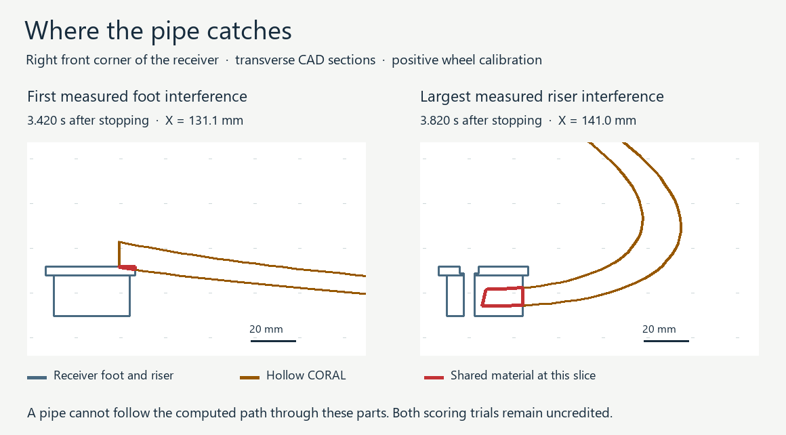

# Can the carried CORAL reach the low trough?

The Red 2 robot carried its station-fed CORAL to two measured stops within 30 mm of the planned reef datum. Both signs kept the same pipe, synchronized wheel state and both rim-probe signals. The camera fixture, capture yokes and slide each do a different job. The comparison starts from the [three frozen inputs](cohort.json) and the [earlier cam and capture study](../cam-scoring/study.md).

## Drive and observe

|Calibration|Start correction|Stopped|Dock X/Y in mm|Minimum pin engagement|Driven 5 ms samples|
|---|---:|---:|---:|---:|---:|
|Positive|53.130 s|56.100 s|−29.86 / −178.68|21.69 mm|594|
|Negative|53.140 s|55.210 s|−29.58 / −179.11|21.69 mm|414|

Station stereo establishes which pipe entered the receiver. Both latch switches, both rim probes and both occupied ports subsequently give the controller a fresh retained-cargo decision every 5 ms. At the reef, the controller uses recorded field-tag exposures, the gyro and two fixed views of a surveyed bolt to refine its dock. Removing one view or withholding camera packets on either sign makes the controller brake, with 1.73–2.16 mm of travel after the inhibit. Those four stops need a separate path before another placement can begin. [Wheel, cargo and camera receipts](results.json)

For the held-out minus calibration, a 0.20 mm station plunger gap changes the initial floor and pipe response. Six new field-backed exposures pass the dark-facing gate and none pass the matched-brightness gate. The empty control also holds. Both ports and the physical yokes confirm the loaded pipe through departure at 27.935 s. The same pipe remained captive over 5,041 loaded wheel samples to 53.140 s and all 416 correction samples to 55.220 s. Minimum pin engagement during correction was 21.693 mm. The held-out run ends there with zero delivery credit. [Station and route records](results.json)

## Change the scoring stroke

The frozen 345 mm command exhausts the clearance to the reef wall. The 337 mm revision leaves 3.83 mm on positive calibration and 2.71 mm on negative calibration after charging the SP1's ±2 mm tolerance, the 0.5 mm controller deadband, ±0.04 rad of pitch, ±5 mm of heave and the camera pose enclosure. An 8 mm overtravel again exhausts the margin. The check covers all 1,268 installed bodies, the stowed jack and the front wall. [Geometry and tolerance cases](clearance.json)

The original 23-link power and USB tails first intersect the fixed right climber motor at sampled strokes of 308.75 and 319.75 mm. The alternate 22-link layout shifts the moving end 95 mm rearward. For a 345 mm sweep, the entire data and power centerlines retain at least 24.87 and 26.94 mm to the motor at maximum jacket diameter. The branch's project-authored STEP contains 19 installed support and connector shapes and two approach gauges. The stationary power feed has its own route and service-removal clearance. Carrier end brackets, cable connector strain relief and protection of the return bend still need an installed design. Carrying these candidate shapes through this study leaves the issued robot and its inspection mass unchanged. [Wire geometry and sources](candidate-wiring.json) · [Continuous clearance](wiring-clearance.json)

## Why a supported pipe still earns zero points

The same six-degree-of-freedom pipe that arrived at each dock was advanced with gravity, both finite bore pins, two end belts, a flexible shelf, unilateral telescoping bearings and the two cam plungers. At 3.10 s after stopping, the controller requests yoke opening after five fresh occupied services. The belt starts only after the modeled open indication. Both field fixtures begin carrying the pipe while the shelf is still carrying it. In the positive run this happens at 3.706 s. Starting a separate landing solver only when the shelf has released the pipe skips this interval.

The simultaneous shelf and field calculation reaches 250 ms of slow, two-line trough support and separation at match 61.104 s on positive calibration and 60.199 s on negative calibration. An independent Java solver holds each of those states in the trough for another three seconds across both friction settings and both contact resolutions. Across 892 sampled states, the two implementations agree within 1.7 × 10⁻¹² N on instantaneous field forces. Their effective peak field indentation during entry is 7.83 and 10.80 mm respectively. [Solver comparison](force-witness.json) · [Field and rack receipts](results.json)

**The scoring attempts remain uncredited.** On the positive run the finite pipe intersects the installed right grip support foot 3.420 s after the dock stop and the right front riser at 3.470 s, before any trough contact. Their largest sampled overlap volumes are 872 and 2,753 mm³. The reduced model allowed the pipe to pass through both. The same inspection also finds shelf-front, insert and inner-rail intersections later during departure. Right and left grip geometry, sensing and the rail's true front edge matter while the payload is shared between robot and field. A sampled material intersection is sufficient to invalidate the modeled exit.



Negative calibration reproduces the grip-foot contact at 3.420 s. The maximum overlaps with its foot and riser are 873 and 3,085 mm³. The stuck-yoke control leaves the belt off. With belt traction set to zero from the same extended checkpoint, the pipe approaches an open pin. A gentler ramp reduces the right-foot intersection to 36 mm³, but catches the opposite foot and trips the pin limit. A short reverse pulse before ejection increases right-riser overlap to 3,908 mm³. Driving the left belt at 40% of its partner's rate moves the collision to the left riser. Driving the right belt at 40% increases right-riser overlap to 3,589 mm³. All controls retain zero delivery credit. [Signed runs and adverse controls](results.json)

The student orbit uses the 1,001-body parked captive receiver. Its neutral STEP and the stored 3D mesh identify the exact public configuration. At the original 0.020 mm proximity threshold, 849 robot solids join the host deck and 152 form 68 other groups. The later engineering issue used for this release has 1,268 installed solids, 1,128 in its main component and 54 separate groups. Both front feet and both risers are in the deck component in both configurations. Proximity can come from a bearing, touching cover or incidental contact. A load rating or positive fastening requires the corresponding joint and hardware evidence. [Export graph and named islands](export-graph.json)

Keep the receiver stowed at the observed dock until the front support and the actual shelf edge are included in the contact solution or a changed release path clears them. The next qualification keeps the same two signed inputs and the separately initialized 0.20 mm case. Red 2 must deliver two individually supplied pipes in its 135 s TELEOP window. All complete episodes are open. [Frozen role and physical conditions](role-freeze.json) · [Full-window assessment](role-assessment.json)

## Reproduce the study

All lengths in the tube and rail solvers are meters. CAD registrations use millimeters. Set `ARTIFACTS` to the shared baseline artifact folder, including the source R4 stereo meshes, signed cam feeds and both signed cam route states from the preceding study. Each command below runs in a fresh interpreter to keep its registered modal basis.

```text
python low-placement/dock.py ARTIFACTS plus
python low-placement/dock.py ARTIFACTS plus --cargo
python low-placement/dock.py ARTIFACTS plus --mode missing-eye
python low-placement/dock.py ARTIFACTS plus --mode lost-packets
python low-placement/rack.py ARTIFACTS plus --mm 337
python low-placement/delivery.py ARTIFACTS plus --stroke-mm 337 --dt-us 62.5
python low-placement/delivery.py ARTIFACTS plus --field --until 7.2 --dt-us 62.5
python low-placement/delivery.py ARTIFACTS plus --field --until 7.2 --dt-us 62.5 --from-extension --control zero-traction
python low-placement/trough.py ARTIFACTS/low-placement/advance-25/plus/joined-337mm-62.5us-nominal.json JDK17 --separated
python low-placement/installed_contact.py ARTIFACTS/low-placement/advance-25/plus/joined-337mm-62.5us-nominal.npy
python low-placement/clearance.py ARTIFACTS low-placement/clearance.json
python low-placement/wiring.py
```

Repeat the signed commands with `minus`. From `experiments/swerve-drive`, regenerate the held-out first service with `python score-stroke/cam_service.py ARTIFACTS/r4-score-stroke minus 31.25 --source-default-blas --gap-mm .2 --destination ARTIFACTS/low-placement/holdout-service`; run `low-placement/heldout.py ARTIFACTS --stage STAGE` for `optics`, `station-wheels`, `station-cargo`, `route-wheels`, and `route-cargo` in that order. Collect the actual runs using `python low-placement/collect.py ARTIFACTS low-placement/results.json`.

The strategic Red 1 volunteer delivery rate of 15 in 135 seconds describes another player and field program. Count a Red 2 delivery only when its own named pipe settles in the target after separating from the robot. An independent parked run and independent placements from the old release fixture remain separate results.
