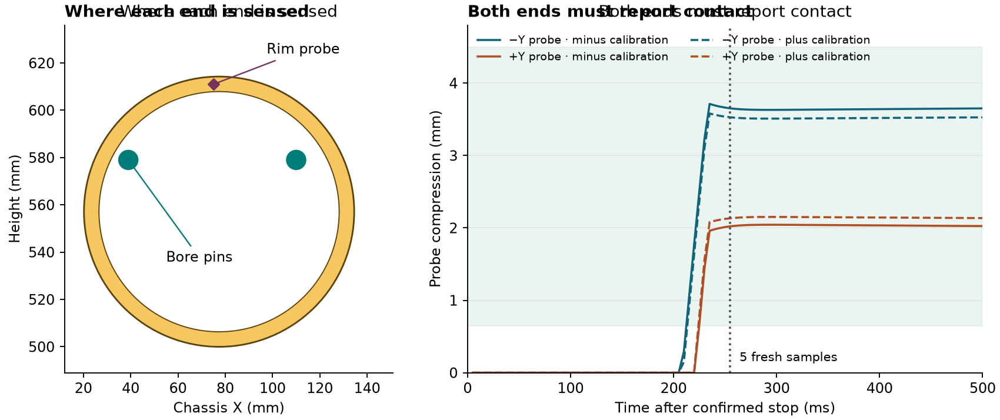

# Keeping the first coral after a stopped swerve approach

Team 1780’s original camera policy braked twice because it lost sight of the pipe during the approach. The pipe was still on the shelf in both simulations. This candidate waits for measured stop feedback, inserts two pins into each open end, and presses a separate spring probe against each annular rim. Both ends must report closure and compression for five consecutive 5 ms services. The controller gets one stationary attempt per pipe. [Original stops and competing explanations](../transit/README.md)



| Simulated first-pipe trial | Minus wheel calibration | Plus wheel calibration |
|---|---:|---:|
| Stop on the original match clock | 30.120 s | 31.960 s |
| First five accepted samples after stop | 255 ms | 255 ms |
| Minimum clearance into the bore | 2.599 mm | 2.791 mm |
| Minimum full probe footprint margin on the rim | 2.378 mm | 2.372 mm |
| Peak probe force | 1.671 N | 1.611 N |
| Maximum center shift as the probes close | 0.102 mm | 0.087 mm |

Each case restores the earlier six-degree-of-freedom pipe state, moving guide coordinates, shelf modes, two plunger states, four wheel and azimuth shafts, odometry and gyro. The belt remains stopped. Empty probes, a missing signal and an open end switch all inhibit departure. Simultaneously stuck-high sensors or another similarly shaped object could mimic the reading. Continuity from station pickup and a healthy sensor chain remain conditions of this experiment. [Capture, input identities and controls](screen.json) · [Pipe contact model](fingers.py)

### Does it still accept a pipe?

Each of the four original signed intake trajectories leaves at least 9.50 mm between the complete finite pipe and the open pin tips. A conservative sweep of 26 equipment envelopes alongside the 975 R4 bodies finds no positive box overlap throughout 0–370 mm shelf and 0–35 mm retainer travel. This first envelope check covers the published motion groups. The detailed internal mounting, sensor harness, tooth geometry, optical field of view, modified shelf cam surfaces and installed field hardware require their own qualification. [Envelope and intake calculation](screen.py)

A 22.3 mm pitch-radius sector needs 89.93° to move the yoke 35 mm. The two HS-65MG servos are a candidate power source. Using a straight line between the manufacturer’s free-speed and stall-torque points, 80% transmission efficiency, 0.25 N guide drag and the larger simulated probe force gives a 0.0535 N·m requirement at 150 mm/s. At 6 V the modeled margin is +0.0098 N·m. At 4.8 V the same command is short by 0.0358 N·m. Two servos can draw 2.4 A at stall. Loaded speed, powered holding, supply allocation and dressed mass remain design inputs. The manufacturer’s PDF lists 12.5 g per bare servo. Its CAD archive is labeled HS-65MG externally and HS-65HB in the STEP header. [Hitec specification](https://www.hitecrcd.co.kr/wp-content/uploads/hitec-products/2019/c/HS-65MG_Specsheet%28v2.1%29_22L.pdf) · [Catalog and CAD source](https://www.hitecrcd.co.kr/products/hs-65mg/)

### Reproduce the comparison

Use the [transit replay](../transit/README.md) to produce the signed 31.25 µs internal-stop cargo states. Set `A` to the project’s local artifacts directory. The programs below operate only on the desktop.

```powershell
$T='experiments/swerve-drive/transit'
$R='experiments/swerve-drive/retention'
python "$T/field_transit.py" "$A/loaded-swerve" "$A/retained-coral/minus/stop" minus 31.25 --policy south-offset --cut .685 --hold .9
python "$T/field_transit.py" "$A/loaded-swerve" "$A/retained-coral/plus/stop" plus 31.25 --policy south-offset --cut 2.525 --hold .9
foreach ($sign in @('minus','plus')) {
    python "$R/stopped.py" $A $sign
    python "$R/route.py" $A $sign
    python "$R/carry.py" $A $sign
}
python "$R/screen.py" $A "$R/screen.json"
python "$R/figure.py" $A "$R/capture.png"
```

The original four-module path reaches a wheel stop near the proposed 54 mm reef setback at 54.815 s and 55.050 s, respectively, with 23.6 and 18.6 mm planar error. The wheel-only result measures time and room left for the cargo and scoring checks. It grants zero deliveries. [Original field target and independent landing fixture](../score-stroke/study.md)

