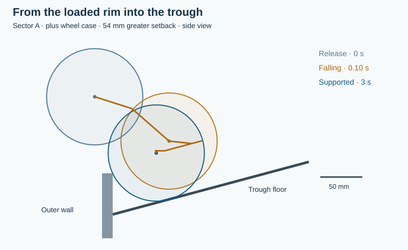

# Can the loaded R4 receiver reach the trough?

**The continuous-land candidate completes the modeled scoring stroke.** With the chassis 54 mm farther from the reef, the loaded rails have at least 14.9 mm of modeled room. At the borrowed belt exit speed the finite pipe clears the wall by at least 16.3 mm. In 48 follow-on trials the pipe landed and remained supported on the trough. The first corrected station pickup has been simulated with these machined parts. The team still needs to carry the pipe into that dock and produce the launch state with this receiver. [Download the editable Fusion candidate](cam-lands.f3d) · [Landing trials](landing.json)

The first obstruction is on the robot. The rear edge of the moving shelf rib enters the top of a fixed absorber at 21.375 mm travel. The selected robot requests 370 mm. Closing the distance to the wall cannot recover the current short stroke at the previously modeled belt exit speed. The result applies to both wheel calibrations on the numbered R4. [Selected robot and Fusion handoff](../../../cad/FUSION.md) · [Native intersections](native.json)


## Follow the pipe

[Watch the pickup, extension and release film](receiver-motion.webm). The opening view places the two continuous-land parts in the numbered R4 swerve robot. The cutaway isolates the rack stages, gripping mechanism, pipe and target. It uses the achieved station pipe trace and independent dock fixture on their own clocks. At 1.340 s the receiving controller first reports the pipe in its seat. At the separate dock the carriage travels 370 mm, then retracts while the released pipe settles. The cut to the rim starts with the study's assumed belt exit speed. [Animation samples and source hashes](motion-track.json)

The outer stage moves through the measured rack travel and the middle stage follows at half travel. The rendering treats the CAD as rigid. Individual belt teeth, guide vibration, elastic deflection of the structure and moving cable shapes are outside this visual model. The drawn trough shows the registered support and lip extents. The contact solver includes the mounting holes recorded in the target. The numbered robot's independently tested loaded transit reaches a camera-triggered stop before this dock. [Loaded transit and retained-pipe evidence](../transit/README.md)

The strategy calls for two sequential L1 CORAL placements, one in each sector, at −180 and +220 mm along the face of the red reef. The signed inputs here are two alternative wheel calibrations carrying the **same first pipe**. Each input identifies its own corrected source-station pose, pipe center and axis at first wheel service at 27.035 seconds. For the scoring fixture we hold the chassis at a specified dock and settle the receiver under gravity. The route between those poses and the second pickup require their own attained states. Neither pipe earns match points in this study. [Selected strategic narrative](../../../kickoff/) · [Signed input and dynamics receipts](mechanics.json)

| What the student can change | What the simulation shows |
| --- | --- |
| Extend the existing R4 shelf | Each 2.1 mm-high modeled cap clears at 21.25 mm and intersects the shelf by about 0.11 mm³ at 21.375 mm. The overlap grows to more than 20 mm³ per side at 24 mm. The earlier rail study had used a taller cylindrical witness. |
| Lower a cap by 2.5 mm | This clears the sampled first rib in the drawing. Permanently changing the station setting changes impact response and requires both signed pickup trials. |
| Stop at 21.25 mm and roll the pipe toward the reef | The entire finite pipe is still at least 28 mm short of the front wall when it falls below the top, even in the sensitivity with the chassis 60 mm closer. This uses the earlier belt exit velocity, approximately 0.884 m/s. |
| Constrain the pipe fore-aft, let it move vertically and tip across its length | With the two caps withdrawn, 16 compression-only contacts carry 0.8165 kg through the 3 s stroke. Both calibrations keep some normal contact at 31.25 and 62.5 µs. The highest resultant is 19.9 N. A separate +0.25 m/s vertical kick gives 3.09 mm of complete separation and a first recontact at 50.4 ms. This calculation does not solve horizontal grip or yaw. |
| Compare rigid and loaded rails at the same dock | The original rigid rails clear the native reef wall by 7.8 mm at full extension. Loaded pitch and vertical displacement bring both rails into the wall. Side-to-side common material at the two sectors is recorded individually. |
| Move the dock 42 mm away from the reef | Under the withdrawn-button model the two inner rails have more than 3.2 mm clearance at full travel. Conditional pipe clearance over the wall is only a few millimeters when the loaded rim drops about 9.1 mm. Other field material, subsequent trough contact, chassis positioning errors and manufacturing variation require additional evidence. |

The finite-pipe bound encloses the complete cylinder, including its axis drift during flight. It checks when the lowest and highest points cross the native wall top. The loaded comparison rotates the earlier project belt exit velocity to the modeled surface tangent and adds the instantaneous rim velocity. Its release starts at the actual shelf edge. An inconclusive bound leaves the outcome open. The numbered R4 exchange represents each purchased absorber with a flat cap. Its modeled 2.1 mm profile and its location were reopened directly. The actual supplier cap finish, edge shape and lateral load response still require separate evidence. [Independent edge and wall calculations](native_score.py) · [Prior belt release states](../../six-wheel/relieved-match/)

## A continuous land at each absorber

The existing insert has a 0.8 mm nominal relief interrupted by open pockets and transverse ribs. Under load the shelf approaches the bracket by about 2.05 mm early in the stroke. The cap recovers in each open pocket before an upright rib arrives. The candidate preserves the incoming face height and retains aluminum from the original billet under the existing 10 mm-wide land centerlines at Y−66 and +42 mm. The underside rises 3 mm over 114 mm, a 1.51° slope. Rearward relief clears the rest of the shelf.

**[Open the editable Fusion candidate](cam-lands.f3d)**. Four native extrudes machine the aluminum insert and two cut the polymer face. Both components share the `camLaneWidth` parameter. The reopened archive matches the independently reopened STEP volumes. The geometry comparison uses Open Cascade to repeat the same booleans against both cap positions, two dock sectors and hundreds of motion samples. The actual student features were authored in Fusion. [Native reopen receipt](fusion.json)

With an aluminum density cap of 2,850 kg/m³, the additional 15,623 mm³ costs 44.53 g. The polymer cut removes 295 mm³. Ignoring that removal leaves about 125 g of the booked 170 g inspection margin. The candidate has the same two absorbers, fasteners and stow adjustments. Surface friction, cartridge lateral reaction, finishing tolerance and damping still matter to a built mechanism. [Machined STEP](cam-lands.step) · [Mass, actual cap floor and unchanged upper face](cam.json) · [R4 inspection receipt](../mass-closure/README.md)

## What happens with the revised parts



| Trial | Result |
| --- | --- |
| Station pickup at the 0.10 mm gap | The two signed inputs reached the two-port controller's `IN_BAND` state and retained the pipe through the 5.460 s Java window. Both the 31.25 and 15.625 µs runs first enter the band at 1.340 s. The first wheel service is at wall time 27.035 s. |
| More space under the stowed shelf | At a 0.20 mm gap both signed 31.25 µs trials still acquired at 1.360 s. The earlier failure at this gap belonged to an intermediate plate. Permanently lowering the cap 2.5 mm, to a total 2.60 mm gap, lost both pipes outside the flat shelf at 0.560 s. |
| Loaded return with the same pipe | Both signed station end states completed 370 mm out, a 0.30 s dwell and 370 mm back in the 6.60 s prescribed motion. At both timestep refinements the sharp-edge detector recorded zero intrusion and the caps transmitted zero force beyond the continuous lands. This loads the return as a conservative fixture. |
| Free vertical pipe on the actual cam and caps | Independent pipe heave and tilt retained some compression throughout all four outbound trials. Peak resultant contact was 19.6–20.2 N at the two refinements. The pipe's other degrees of freedom and the rack's horizontal motion remain prescribed. |
| Greater setback with finite cylinder geometry | A disk enclosing the finite pipe's projection in the forward/vertical plane gives a more useful continuous wall clearance than the independent-axis check above. The calculation charges for axis drift and motion between numerical samples. At a 54 mm setback, every tested release instant in the dwell cleared the wall. An 80 mm setback loses the guarantee. |
| Landing on the registered field | The signed sector and release-time combinations met the two-support criterion in all 48 nominal, refined, low-friction and held-rack trials. First floor contact was 0.108 s after release and the pipe achieved at least 2.295 s of final supported dwell during the 3 s observation. All 12 double-forward-speed controls lost the inner-riser separation check. |

The landing model resolves finite native panel edges and mounting-hole exclusions. Each signed case starts with its own loaded rim displacement, surface slope and vertical velocity. It borrows the belt's horizontal release speed and pipe angular state from the earlier robot. The case with the rack held extended still had at least 15.57 mm fore-aft separation from the robot after first field contact. The model uses the original axial cartridge law. Tangential sliding friction, a manufactured cam profile and a verified lateral-force limit for the actual cap remain open. The two-sector study treats each placement separately. [Candidate sensor, rail, pipe and dock receipts](candidate.json) · [Finite-trough and adverse cases](landing.json)

At samples carrying more than 0.1 N on the cap, the largest loaded surface angle was 1.534°. Assuming a sliding coefficient of 0.10 gives up to 1.34 N of horizontal reaction in the retained 1 ms samples. Combining the independently observed 24.65 N axial peak with that angle and friction gives 3.14 N as a design sensitivity. The coefficient and cartridge's permissible lateral reaction remain unmeasured. [Loaded track normals and friction sensitivities](cam_dock.py)

## Reproduce the checks

Use Python with NumPy and OCP. Supply the owner-held official field STEP matching the digest in `native.json`, plus the corrected source-station service files for both calibrations. The CAD comparison uses the publicly registered project STEP. Run the following from this directory. Set `STATION`, `RAW` and `FIELD_STEP` to the corresponding paths. Keep the full simulation traces in the project artifact folder.

```powershell
foreach ($sign in 'plus','minus') {
    foreach ($dt in 31.25,62.5) {
        python loaded_rack.py $env:STATION $env:RAW $sign $dt
        python free_pipe.py $env:STATION $env:RAW $sign $dt
    }
    python loaded_rack.py $env:STATION $env:RAW $sign 31.25 --no-buttons
}
python free_pipe.py $env:STATION $env:RAW plus 31.25 --kick 0.25
python collect.py $env:RAW mechanics.json
python native_score.py $env:FIELD_STEP $env:RAW native.json
python cam.py .
python chart.py native.json $env:RAW contact.svg
```

Use the project JDK and the registered, corrected wheel CSVs for the candidate. Run each stage in a separate Python process. The receipt binds the actual modal table and physical checkpoint. For a new run the common process configuration reproduces the bitwise modal restart. The archived 31.25 µs feeds used the numerical library's default thread count for their modal build. Supply `--source-default-blas` to `cam_service.py` when restoring those archived inputs.

```powershell
foreach ($sign in 'plus','minus') {
    foreach ($gap in 0.1,0.2,2.6) {
        python cam_feed.py $env:JDK $env:DRIVE $env:RAW $sign 31.25 $gap
    }
    python cam_feed.py $env:JDK $env:DRIVE $env:RAW $sign 15.625 0.1
    foreach ($dt in 31.25,15.625) { python cam_service.py $env:RAW $sign $dt }
    foreach ($dt in 31.25,62.5) {
        python cam_cycle.py $env:RAW $env:RAW $sign $dt
        python free_pipe.py $env:RAW $env:RAW $sign $dt --cam
    }
    $name = "$sign-cam-cycle-31.25us"
    python cam_dock.py "$env:RAW/$name.npz" "$env:RAW/$name.json" "$env:RAW/$name-dock.json"
}
python cam_landing.py $env:RAW $env:JDK landing.json
python landing_chart.py "$env:RAW/candidate-landing/trajectory.csv" ../../six-wheel/mission/target.json landing.svg
python collect_candidate.py $env:RAW candidate.json
```
