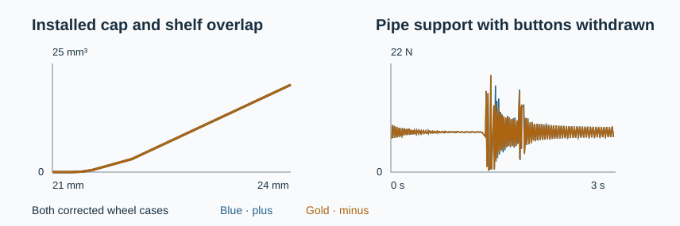

# Can the loaded R4 receiver reach the trough?

The first obstruction is on the robot. The rear edge of the moving shelf rib enters the top of a fixed absorber at 21.375 mm travel. The selected robot requests 370 mm. Closing the distance to the wall cannot recover the current short stroke at the previously modeled belt exit speed. The result applies to both wheel calibrations on the numbered R4. [Selected robot and Fusion handoff](../../../cad/FUSION.md) · [Native intersections](native.json)



## Follow the pipe

The strategy calls for two sequential L1 CORAL placements, one in each sector, at −180 and +220 mm along the face of the red reef. The signed inputs here are two alternative wheel calibrations carrying the **same first pipe**. Each input identifies its own corrected source-station pose, pipe center and axis at first wheel service at 27.035 seconds. For the scoring fixture we hold the chassis at a specified dock and settle the receiver under gravity. The route between those poses and the second pickup require their own attained states. Neither pipe earns match points in this study. [Selected strategic narrative](../../../kickoff/) · [Signed input and dynamics receipts](mechanics.json)

| What the student can change | What the simulation shows |
| --- | --- |
| Extend the existing R4 shelf | Each 2.1 mm-high modeled cap clears at 21.25 mm and intersects the shelf by about 0.11 mm³ at 21.375 mm. The overlap grows to more than 20 mm³ per side at 24 mm. The earlier rail study had used a taller cylindrical witness. |
| Lower a cap by 2.5 mm | This clears the sampled first rib in the drawing. Permanently changing the station setting changes impact response and requires both signed pickup trials. |
| Stop at 21.25 mm and roll the pipe toward the reef | The entire finite pipe is still at least 28 mm short of the front wall when it falls below the top, even in the sensitivity with the chassis 60 mm closer. This uses the earlier belt exit velocity, approximately 0.884 m/s. |
| Constrain the pipe fore-aft, let it move vertically and tip across its length | With the two caps withdrawn, 16 compression-only contacts carry 0.8165 kg through the 3 s stroke. Both calibrations keep some normal contact at 31.25 and 62.5 µs. The highest resultant is 19.9 N. A separate +0.25 m/s vertical kick gives 3.09 mm of complete separation and a first recontact at 50.4 ms. This calculation does not solve horizontal grip or yaw. |
| Compare rigid and loaded rails at the same dock | The original rigid rails clear the native reef wall by 7.8 mm at full extension. Loaded pitch and vertical displacement bring both rails into the wall. Side-to-side common material at the two sectors is recorded individually. |
| Move the dock 42 mm away from the reef | Under the withdrawn-button model the two inner rails have more than 3.2 mm clearance at full travel. Conditional pipe clearance over the wall is only a few millimeters when the loaded rim drops about 9.1 mm. Other field material, subsequent trough contact, chassis positioning errors and manufacturing variation require additional evidence. |

The finite-pipe bound encloses the complete cylinder, including its axis drift during flight. It checks when the lowest and highest points cross the native wall top. The loaded comparison rotates the earlier project belt exit velocity to the modeled surface tangent and adds the instantaneous rim velocity. Its release starts at the actual shelf edge. An inconclusive bound leaves the outcome open. [Independent edge and wall calculations](native_score.py) · [Prior belt release states](../../six-wheel/relieved-match/)

## A continuous land at each absorber

The existing insert has a 0.8 mm nominal relief interrupted by open pockets and transverse ribs. Under load the shelf approaches the bracket by about 2.05 mm early in the stroke. The cap recovers in each open pocket before an upright rib arrives. The candidate preserves the incoming face height and retains aluminum from the original billet under the existing 10 mm-wide land centerlines at Y−66 and +42 mm. The underside rises 3 mm over 114 mm, a 1.51° slope. Rearward relief clears the rest of the shelf.

**[Open the editable Fusion candidate](cam-lands.f3d)**. Four native extrudes machine the aluminum insert and two cut the polymer face. Both components share the `camLaneWidth` parameter. The reopened archive matches the independently reopened STEP volumes. The geometry comparison uses Open Cascade to repeat the same booleans against both cap positions, two dock sectors and hundreds of motion samples. The actual student features were authored in Fusion. [Native reopen receipt](fusion.json)

With an aluminum density cap of 2,850 kg/m³, the additional 15,623 mm³ costs 44.53 g. The polymer cut removes 295 mm³. Ignoring that removal leaves about 125 g of the booked 170 g inspection margin. The candidate has the same two absorbers, fasteners and stow adjustments. Surface friction, cartridge lateral reaction, finishing tolerance and damping still matter to a built mechanism. [Machined STEP](cam-lands.step) · [Mass, actual cap floor and unchanged upper face](cam.json) · [R4 inspection receipt](../mass-closure/README.md)

## Reproduce the checks

Use Python with NumPy and OCP. Supply the owner-held official field STEP matching the digest in `native.json`, plus the corrected source-station service files for both calibrations. The CAD comparison uses the publicly registered project STEP. Run the following from this directory. Set `STATION`, `RAW` and `FIELD_STEP` to the corresponding paths. Keep the full simulation traces in the project artifact folder.

```powershell
foreach ($sign in 'plus','minus') {
    foreach ($dt in 31.25,62.5) {
        python loaded_rack.py $env:STATION $env:RAW $sign $dt
        python free_pipe.py $env:STATION $env:RAW $sign $dt
    }
    python loaded_rack.py $env:STATION $env:RAW $sign 31.25 --no-buttons
}
python free_pipe.py $env:STATION $env:RAW plus 31.25 --kick 0.25
python collect.py $env:RAW mechanics.json
python native_score.py $env:FIELD_STEP $env:RAW native.json
python cam.py .
python chart.py native.json $env:RAW contact.svg
```
