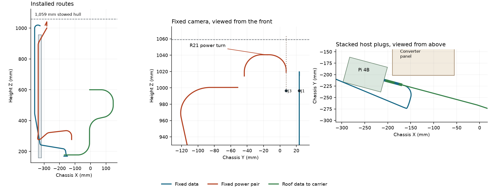

# Fixed-camera power and data routing

The intact USB-C overmolds, removable guides and fixed 5 V branch fit below **Z1043.873 mm** on the registered shop robot. This leaves **15.127 mm** inside the 1,059 mm stowed height used by the field studies. The previous straight power-tail trial reached Z1064.735 mm. The fixed and moving OAK-D Lite heads retain their issued poses and independent identities. The fabricated loom and both streams still need receiving and robot tests. [Native body and extraction check](fit.json) · [Installed extents and mounting seats](installation.json) · [Predecessor mounts](../selected-optics/README.md)



## Install the stationary leads

| Connection | Installed path and receiving condition |
|---|---|
| Fixed J1 to lower blue Pi socket | Use a factory-terminated side-exit cable based on Newnex U3S7AS1CR5. The proposed 1,182.535 mm jacket and the two ends require **about 1,264 mm under the vendor drawing's length convention**. Request the manufacturer's custom length and verify both endpoint marks on a full-size jig. The stock U3S7AS1CR5-010 reaches only 1,020 mm at its longest tolerance. The 21 mm minimum centerline radius is a project static-bend qualification. [Baseline drawing](https://newnex.com/documents/U3S7AS1CR5-010.PDF) · [Custom-length catalog](https://newnex.com/usb-type-c-cables-legacy.php) |
| Fixed J3 to its independent fused DDR-30G-5 | Retain the factory Tensility 10-03675 Type-C overmold and cut the distal end. Follow two tangent R21 turns into the insulated transition. Route the 2 × 2.5 mm² fixed pair outboard before turning down the mast, with R36 minimum. An earlier vertical drop placed the cord centerline at pixel (387,242) in the fixed right eye. The 117.92 mm 26-AWG and 1,182.83 mm heavier one-way conductor budgets include breakouts. [Tensility connector drawing](https://tensility.s3-us-west-2.amazonaws.com/uploads/product_doc/document/4438/10-03675.pdf) · [Connector and hot-loop receipts](qualification.json) |
| Moving head to upper blue Pi socket | Retain the complete Newnex U3HLA01C12-020 factory lead, moving tail and 23-link R100 carrier. Its revised 766.66 mm fixed feed reaches the carrier from positive X at Z600. R78 exceeds the drawing's 75.6 mm recommendation. The earlier R50 bend falls short. The receiving fixture calls for 1,994.81–1,995.22 mm tip-to-tip before metrology uncertainty; the 1,970–2,030 mm catalog tolerance alone cannot assure fit. [Factory drawing](https://newnex.com/documents/U3HLA01C12-020.PDF) · [Moving end and native case](../camera-disconnects/README.md) |

Match the measured bare jacket between overmold shoulders to both guide entrances with the remote plug fully seated. For either USB lead, a short lot fails, and an overlength lot needs a redrawn, checked take-up before installation. Both jackets remain continuous and factory terminated. Put the fixed branch on PDH 8 with its 3 A output fuse and keep the host and moving head on their separate existing supplies. Retain the Type-C configuration and source behavior of the qualified plug. Insulate unused data/drain conductors individually, verify connector orientation, the intended ground/shield connection and absence of backfeed in every power sequence. The supplier's donor cable specification does not establish the modified plug's CC behavior. [Existing power distribution and fault tests](../fixed-low-power/dual-camera.md)

1. Set the Pi 4B at −15° yaw on the four 6.5 mm standoffs. Its board center is (−249,−200) mm. The official mechanical plan locates the board holes and the 27 mm blue-stack centerline. The modeled 8.0 mm vertical socket pitch is a receiving dimension. Fit both factory A plugs and check the minimum 0.25 mm nominal shell gap without side-loading either jack. Check access to power, Ethernet, storage and cooling after seating the board. [Pi mechanical drawing](https://pip-assets.raspberrypi.com/categories/545-raspberry-pi-4-model-b/documents/RP-008343-DS-1-raspberry-pi-4-mechanical-drawing.pdf) · [USB controller](https://www.raspberrypi.com/documentation/hardware/raspberrypi/usb/configuration.html)
2. Fit the four two-face yokes at Z335, 520, 715 and 925 on the observer upright. Fit the three guide feet on their identified substrates. The backplate foot is at (−275,−226,157), the front platform foot at (123,−214,293) and the mast foot at (−338,−23,158) mm. Each 16 × 10 mm two-hole blank has 10 mm pitch and Ø3.3 mm holes. Verify the actual underside, pilot positions, edge distances, clasp routing and fastener retention before drilling. The substrate contacts are checked in the native robot, including the projecting lamp tab.
3. Place the labeled half-round troughs and brace blanks from the original [STEP exchange](harness-guides.step) using the [part list](guides.json). Sections are at most 160 mm along the path. Orient the open half toward the service side, deburr and fit removable retainers. The design allocates a 0.15 mm radial seat allowance, 0.95 mm trough wall and 0.15 mm outside allowance for a flush closure. Locate additional joined tabs on the support side and account for every tab, tie, lug and finish in the attachment allowance. A commercial tie head outside that space changes the clearance model. Qualify the joined guides for sag, vibration, abrasion, pull and repeated service before fitting the powered camera.
4. Seat the relieved DM6010 adapter to the validated insertion depth, then the data and power plugs in their designated ports. The issued outer housings have 0.350 and 0.400 mm native clearance to the relieved adapter. Retain the adapter separately so neither cable transfers strain into the camera board. Put the board and insulated joins within the 20 × 16 × 22 mm transition reservation. Inspect the molded lead under support load and verify current, insertion depth and orientation at the actual connectors. [Supplier registration and casing relief](../camera-disconnects/interfaces.json)
5. With power isolated, open **both** host-end routing covers for service. Grip either A overmold from its sides, pull along its socket axis and free the cable from the open troughs. At the camera, open the guide near the selected plug and release the opposite end before withdrawing. Each hard housing has 12 mm of modeled axial travel. The lower A extraction needs the other host guide open, leaving 1.10 mm to that jacket and 0.25 mm to its rigid housing. The closed neighboring trough consumes 0.15 mm of that path. Finger force, gloved access and removal with real lead stiffness require a pit trial.

## Bounds and receiving tests

The 991-body model includes both native 13-solid camera housings, the selected receiver, the SP1 fitting, the drivetrain and prior electrical reservations. Cable centerlines use tangent lines and exact circular arcs. Every point on a straight or curved sampling interval lies within 0.5 mm of a tested sample. The narrow test reopens the native rear bumpers and compares true arcs to the adjoining A housings. The moving carrier uses separate envelopes for its stationary lower run, translating turn and elevated upper run; the last 20 mm of intentional entry into the fixed terminal needs hardware fit. The two superseded regulator reservations and the prior Pi/lead placeholders are removed as described in the [converter panel design](../design/fixed-no-air/converter-panel.md). The installed XYZ bounds are (−365.949…151.400, −321.400…27.051, 157.000…1043.873) mm. They fit inside the existing 850 × 850 × 1,059 mm stowed field box for its registered routes. [Native clearance](fit.json) · [Carrier, ventilation, feet and service checks](installation.json)

Independent heads need 5.00–5.25 V at the camera pins. At 1.20 A, the fixed lead gives **5.013 V** from a 5.16 V lower converter limit with 10 mV instrument error and 50 mΩ summed hot interfaces. The no-load upper is 5.210 V. The previous regulator band, a worn 100 mΩ interface and overtrim fail at least one bound. Measure cold start, ripple, both simultaneous streams, hot drop and fuse/connector temperature at both ends. Confirm USB3 speed, identity, image arrival and clock phase after redressing. The two blue ports share the Pi's controller. No camera power or robot operation occurred in this study. [Power cases](qualification.json)

The additional guides, supports, posts, transition box and closures contribute **114.897–184.594 g** above the #94-plus-optics map. Its represented upper becomes **52.186733 kg, 23.610 g over the 115 lb limit**. Physical mass is unknown. The accounting keeps the complete roof USB lead at its existing ≤170 g, the fixed adapter and both connector leads at ≤105 g together, and the powered panel with fixed wiring at ≤750 g. Weigh mutually exclusive groups and the installed robot. Give no credit for the earlier removed regulators, unweighed avoided parts or unrelated changes. The optional chain skin and receiver guide need their own selected deltas. [Volume and receiving budgets](mass-input.json) · [Ordered assembly result](mass.json)

## What the cameras still see

For all 3,496 registered captures, the complete finite pipe lies outside every potential new obstruction on the rays from either eye. Each check encloses the physical pipe's radius and tilted half-length, tests bounding planes from the eye and retains the measured mechanism stroke. The grayscale replay independently removes any backing pixel that could change. All 492 fixed station captures and 35 fixed release captures reproduce their prior intervals. Roof intervals change when uncertain backing is removed; every finite estimate still encloses the modeled pipe position. The four shelf registration regions retain 306, 316, 309 and 311 signed comparisons. The registered field checks preserve the selected roof intervals in 55 endpoint exposures. All 28 desktop packet policies reproduce the historical event sequences, including the 98.375 s nominal B withdrawal and 100.845 s B stow. [Field exposures](roof-field.json) · [Controller replay](controller.json)

The two station landmark rectangles remain unique in both endpoint views with zero measured pixel shift. [Registered views and captures](sightlines.json) · [Individual source and output image hashes](image-bounds.json)

On the second score, the two heads retain simultaneous overlapping intervals at 26,180, 26,197, 26,214 and 26,231 ms. The fixed head sees whole-front clearance at 26,401 ms. Dropping or swapping an eye yields no finite bounds in 70 adverse exposures each. These trials use the recorded station and reef geometry, project pupil assumptions and known model trajectories. Survey actual pupils, repeat after remounting, then verify the same clocks under field lighting, occlusion, platform vibration and full USB load. The station approach and optional receiver guide retain separate configurations. [Optical predecessor](../integrated-slide/README.md) · [Station detector](../station-landmark/README.md)

## Reproduce the checks

Use Python with NumPy and Open Cascade. The station contour comparison also requires the project's OpenCV environment. Keep authorized supplier solids, the signal lamp and full optical images in private artifacts. Commands use the project root, an external artifact directory, the registered lamp STEP and the marked #97 stereo directory as arguments. [Integrated baseline](../integrated-slide/README.md)

```sh
python fixed-camera-route/guides.py fixed-camera-route
python fixed-camera-route/scene.py ARTIFACTS LAMP WORK/scene.json
python fixed-camera-route/harness_fit.py ARTIFACTS LAMP WORK/scene.json WORK/fit.json
python fixed-camera-route/installation.py ARTIFACTS LAMP WORK/installation.json
python fixed-camera-route/qualification.py ARTIFACTS/camera-disconnects WORK/qualification.json
python fixed-camera-route/visibility.py WORK/scene.json MARKED WORK/images
python fixed-camera-route/mass.py PLUGIN ARTIFACTS/sp1-mount/optics-maps/sp1-install.json WORK/maps
python fixed-camera-route/replay.py images ARTIFACTS WORK/scene.json WORK/issue FIELD JDK17 GRADLE_CACHE
python fixed-camera-route/replay.py field ARTIFACTS WORK/scene.json WORK/issue FIELD JDK17 GRADLE_CACHE
python fixed-camera-route/replay.py packets ARTIFACTS WORK/scene.json WORK/issue FIELD JDK17 GRADLE_CACHE
```
