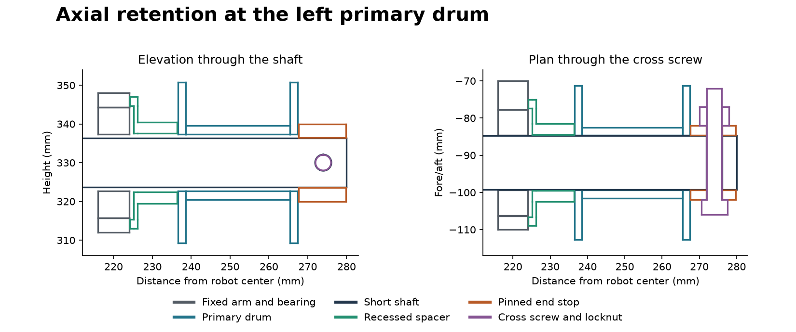

# Stationary hoist for the permanently locked low receiver

The shortened common shaft retains both primary drums, both primary lines, the ratchet, inboard bearings and the service-pin assembly. Two nonrotating spacers bear against the fixed bearing arms. Two pinned stops keep the drums captive from outside. The fixed-height match build removes its two secondary hauls, four hanger mounts per side and their dedicated fasteners. The source bill identifies 48 retired CAD occurrences grouped into 36 installed articles. The separately budgeted shaft extension is shortened by 80 mm. [Native exchange](stationary-shaft.step) · [Drum and bearing source](../design/receiver-lift/) · [Permanent low locks](../design/fixed-height/README.md)



## Assembly and service

Both fixed mast locks carry the carriage. Retain the service rails, bushings, their clamps, both carriage plates and plate fasteners. Keep the matched capped-motor configuration electrically isolated. Install the fixed low assembly in a captive support fixture with carriage and original primary drums independently restrained. The secondary line catch is absent. This configuration has no powered or manual height-change mode. Changing back to a moving lift requires restoring the complete separate assembly and requalifying it. The prior service study also requires independent support between elevations. The permanent locks, effects of the mast holes left after removal, bearing arms and pit fixtures need physical qualification for the combined robot. [Lock support](../design/fixed-height/README.md) · [Pit-pin fit and one-pin reference](../design/fixed-no-air/README.md) · [Motor cap](../fixed-lift-omission/README.md)

Each outer stop fits over the 12.7 mm across-flats shaft. A 30 mm M4 cross screw enters from the aft side and is retained by an M4 prevailing-torque nut. Measure both bores, verify that the selected fastener engages its locking element and clears every neighboring part, and inspect the screw and machined shaft before service. At the inner end of each drum the 34 mm spacer shoulder lands outside the 28.57 mm bearing envelope. Its recess clears that envelope in a 0.6 mm forced displacement while the fixed arm registers contact. Both thrust directions have a hard stop. The nominal packed gap on one side is 0.676 mm, including pin-to-hole clearance. Bearing race detail, allowable float, hole location, break-edge, deformed threads, physical tool reach and the motion of retained lines still need inspection. [Nominal and deliberately displaced contacts](fit.json)

With the carriage on its qualified supports and the primary drums, lines, spacers and central pulley independently secured, remove both nuts and cross screws. The model admits a 750 mm straight shaft withdrawal to either side through the remaining hardware. A screw left in place intersects the withdrawal envelope by 172 mm³. The complete removal envelope of each short mast splice clears the new hoist parts by 49.79 mm. Stage loose items in a fixture before withdrawing their shaft. Restore the pieces in reverse sequence and inspect both locking nuts before removing external support. [Service screens](fit.json) · [Joined mast geometry](mast-fit.json)

## Loads and operating limits

The design assigns the shaft and drums a parked role. A hypothetical 2 kg axially moving assembly at 6 g sends 118 N to one stop. Charging that force to one 3 mm screw section gives 16.6 MPa nominal single-plane shear. Charging one aluminum cheek gives 15.5 MPa nominal bearing. The 32 mm primary drum overhang gives 47.7 MPa nominal shaft bending at 300 N of radial line load and 143.2 MPa at 900 N. These sensitivities omit fatigue, loose-hardware impacts, cross-hole stress concentration and actual rope preload. Select the real screw grade, locking hardware, shaft stock, arm fastening and fits, then measure residual line tension and test in a captive fixture. The earlier single-side permanent lock reached 503 MPa at the separate 10 g comparison. Prove the actual load split and the complete locks under the coupled shelf impact before using the scoring role. [Load calculation](loads.json) · [Lock reactions](../fixed-lift-omission/mechanics.json)

## Joined inspection bill

The retired components and shaft trim account for 884.01 g in the original modeled bill. The eight new parts have a 33.8–58.0 g receiving window. Require each dressed pair to meet its window on a scale. The inspector's physical mass margin remains unknown. The accounting keeps the original loose hardware and termination allowances, credits zero motor mass, and takes no credit for drilling the shaft.

| Selected build | Margin at upper modeled mass |
|---|---:|
| Ribbed deck, fixed camera lead, guards, cap and stationary hoist | +906.62 g |
| Same build with the short direct mast joints | +328.50 g |
| Same build with the installed damped shelf and a matched stock replacement | +343.94 g |
| Above with the 65.88 g example guide faces, before their attachments | +278.06 g |
| Shelf stock removal unverified, same example guide faces | −642.41 g |

The guide figure is a face-material example. Weigh the charged old shelf, the manufactured shelf, completed guide and attachments, isolated kit and finally the dressed robot. Restore the conservative shelf row if the original material cannot be traced. [Hoist accounting](budget.json) · [Mast bill](mast-budget.json) · [Combined shelf cases](combined.json)

## Replay

Use the registered fixed-camera scene, the installed Agent FRC accounting checker and an OCP-enabled project Python. The mast and shelf directories supply the corresponding published candidate studies. From the project root run the native and accounting commands in order.

```sh
python fixed-hoist/fit.py "$ARTIFACTS/fixed-camera-route/scene.json"
python fixed-hoist/loads.py
python fixed-hoist/draw.py
python fixed-hoist/mast_fit.py mast-attachment
python fixed-hoist/account.py "$PLUGIN" "$ARTIFACTS/ribbed-deck/maps/restrictedNoMotorCreditKg/selected.json" "$ARTIFACTS/fixed-hoist/map"
python fixed-hoist/account.py "$PLUGIN" "$ARTIFACTS/mast-attachment/maps/ribbed/restrictedNoMotorCreditKg/selected.json" "$ARTIFACTS/fixed-hoist/mast-map" --receipt fixed-hoist/mast-budget.json
python fixed-hoist/combined.py "$PLUGIN" "$ARTIFACTS/fixed-hoist/mast-map/selected.json" shelf-structure "$ARTIFACTS/fixed-hoist/shelf-map"
```
