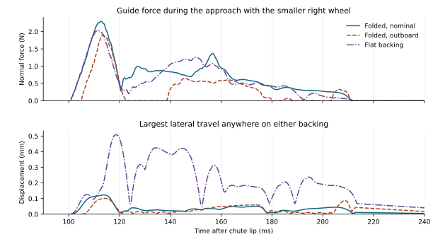

# Does the installed guide still seat the pipe?

## What changed at the station

The two stationary guides meet the ends of the incoming pipe before it reaches the shelf. Each has a 3 mm liner over a folded, 0.8 mm aluminum backing. Two arms attach each backing to the mast at heights of 687 and 787 mm. The liner runs from 625 to 813 mm. A native solid classification checks nine heights on each side, both face edges and both ends. The 260 inside/outside measurements match the surfaces used by the pipe model. [Guide assembly](../guide-mounts/README.md) · [Reopened STEP measurements](section.json)

The nominal 301.025 mm throat places each guide 0.300 mm inside the end of a centered, nominal 301.625 mm pipe. The separately fitted fastener position moves each guide outboard by 0.315 mm, giving 0.015 mm of clearance per end. The opening and contact timing depend on how the installer locates the two guides before tightening. [Fitted throat positions](../guide-mounts/datum.json)

## Load path and contact

Each sloping backing has 24 Euler–Bernoulli beam elements. Its two support springs combine arm bending, elastic root bending and tension, and bolt-couple rotation. The sloping beam spans the actual free lower and upper overhangs. The backing and liner move with their masses from the reopened STEP. The liner contributes mass only. A nominal 23.6% of each arm assembly's modeled mass participates at its nose with the full wedge, tapped bar and two face screws. This is a reduced mass assumption. A physical root may slip, twist or lift off, and the actual arm shape can carry different modal mass. [Beam equations and material inputs](beam.py) · [Underlying root calculation](../guide-mounts/loads.py)

At each integration step, the openly ended pipe contributes 512 candidate quadrature cells on each end. Cells outside the installed 40 mm face or its 188 mm height cannot push a guide. Each penetrating cell sees the local moving surface, its instantaneous normal and its relative sliding speed. Its compressive and friction forces advance the same pipe translation and rotation used by the shelf and belt plant. The opposite lateral force acts at that cell's height on the flexible backing. The actual force distribution advances both arms through the beam modes. The static calculation's single force and center of pressure provide an independent comparison. [Paired contact calculation](backing.py) · [Machined shelf and damper plant](../shelf-structure/README.md)

The input contact law keeps the earlier 10 N/mm and 200 N·s/m distributed coefficients, friction coefficient 0.1 and 0.02 m/s friction transition. The nominal guides use a modal damping ratio of 0.03. The pipe falls with its attained velocity, meets finite-preload belt cartridges, and drives the existing 20 ms Java acquisition program through two moving aperture rays. The first tick at the chute lip is Java 100 ms. A fault ends that case. A seated case continues until the scheduled Java 5,460 ms sample. The backing's retained modes advance exactly for a load held over one plant step. Contact forces, local normals and belt traction change each step. [Powered approach poses](../conditioned-match/elastic.json) · [Controller replay](replay.py)



## Where the work goes

On the nominal 31.25 µs left and right arrivals, contact begins 104.91 and 100.88 ms after the chute lip and ends at 211.59 and 211.66 ms. The faces remove 30.52 and 33.86 mJ from the pipe under the modeled end-contact law. Sliding friction accounts for 28.19 and 30.80 mJ. The guide springs receive and return energy during the event. Their net guide input, including modal damping, is 11.43 and 15.67 µJ. The remaining pipe energy exchange includes the local damped liner law. Total station impact also acts at the shelf and cartridges. [Signed work and impulses](results.json)

The two belt cartridges use 11.5 N nominal preload per end, a friction coefficient of 0.4, and finite relative slip. Reopening the belt contact on the original-boundary nominal 31.25 µs traces gives approximately −9.19 to +9.19 N of total longitudinal traction after the last guide load, sampled every millisecond. The full-trajectory upper bounds are 19.36 N left and 19.18 N right. These include a conservative allowance for the guide impulse that precedes each belt step. The original plant prescribes rate-limited belt speed. Available motor force, current, heating and the safe probe force still require measurement. [Belt force screen](traction.json)

Replaying the registered nominal pipe states recovers the time-dependent guide forces to within 0.0000001 N, allowing the four mounting spring histories to be resolved independently. The largest arm-root spring force is +2.19 N and the most negative rebound is −0.35 N. The largest gross lever moment about a root is 0.554 N·m. These figures model transverse spring transfer under this arrival. Joint friction, clamp preload, fixed mast motion and local weld stress need separate measurements. [Individual root loads](root-loads.json)

## Reproduce the study

Use the project Python, native CAD and desktop JDK environments. Set the numerical library to one thread for a reproducible modal basis. The following commands run from the project root. Replace the angle-bracket paths with the local JDK and private artifact folders.

```shell
python guide-impact/section.py guide-impact/section.json
python guide-impact/replay.py <jdk> <raw> <raw>/folded.json --layouts folded --steps 62.5 31.25
python guide-impact/replay.py <jdk> <raw> <raw>/controls.json --layouts flat half-couple unribbed --steps 62.5 31.25
python guide-impact/replay.py <jdk> <raw> <raw>/folded-finest.json --layouts folded --steps 15.625
python guide-impact/replay.py <jdk> <raw> <raw>/modal-refinement.json --layouts folded --steps 31.25 --cutoff 3500
python guide-impact/replay.py <jdk> <raw> <raw>/rigid.json --layouts rigid --steps 31.25
python guide-impact/replay.py <jdk> <raw> <raw>/opening-gauge.json --layouts folded --outward .315 --steps 62.5 31.25
python guide-impact/replay.py <jdk> <raw> <raw>/serial-carriage.json --support compliant-carriage --layouts folded --steps 31.25 15.625
python guide-impact/replay.py <jdk> <raw> <raw>/serial-recovery.json --support compliant-carriage --recovery split-guide-acquisition --layouts folded --steps 31.25 15.625
python guide-impact/receipt.py <raw> guide-impact/results.json <raw>/folded.json <raw>/folded-finest.json <raw>/controls.json <raw>/rigid.json <raw>/opening-gauge.json <raw>/modal-refinement.json <raw>/serial-carriage.json <raw>/serial-recovery.json
python guide-impact/handoff.py guide-impact/results.json <raw> guide-impact/station-frames.json
python guide-impact/roots.py guide-impact/results.json <raw> guide-impact/root-loads.json
python guide-impact/traction.py guide-impact/results.json <raw> guide-impact/traction.json
python guide-impact/plot.py guide-impact/results.json <raw> guide-impact/impact.svg
```

To rebuild a dropped group summary, pass `--collect` with the identical options. This checks the signed pose, beam, registration and three raw hashes for every case.

Each run preserves the pipe trajectory, its orientations and velocities, the shelf and plunger restart state, and a guide force/work history under its own configuration ID. The guide history has 15 columns in this order. Time is seconds from the lip, followed by both normal forces in N, both force-weighted heights in m, both lower-tip displacements in m, both upper-tip displacements in m, both peak absolute face displacements in m, both modal energies in J and both cumulative guide input works in J. Paired values always follow chassis −Y, then +Y. Peak travel uses a 1 mm height grid during possible pipe/guide overlap. The result includes one exact free decay to the final pipe clock. The installed modal damping, friction, preload, material law and receiver lash all require measurements.

The issued guide kit already charges 481.83–590.59 g including its attachment hardware. On the winchless robot, the complete removed-group inventory leaves 1,002.47 g of upper-model margin with density-matched shelf removal and 82.01 g with zero shelf-cut credit. Retaining the unverified removed-group allowance instead yields deficits of 797.53 and 1,717.99 g. Modal participating masses represent portions of this installed hardware and add no further articles to the inventory. [Guide mass account](../guide-mounts/accounting.json)

## Shop measurements that decide transfer

Gauge both openings with the final hardware torqued. At both arm heights and both free ends, apply a measured transverse load and measure travel on loading and unloading. A displacement witness on the mast separates bracket/root motion from backing bending. Measure vibration decay after release and measure the actual liner force against the open pipe wall. Recheck the two Java port signals and both camera views with the working shelf, real piece, visible finish and signed approach offsets. A passing modeled port sequence supplies a candidate state for that optical replay. It grants no new match score. [Previously qualified optical and carry boundary](../elastic-carry/README.md)
