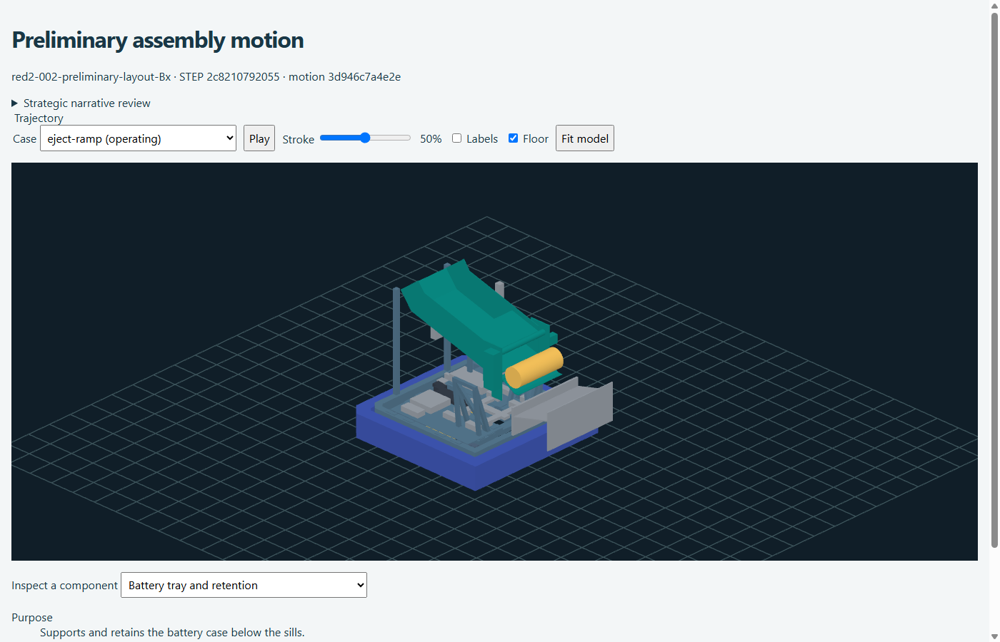

# Red 2 iteration 002: B'x pocket preliminary package

<!-- cad-still -->
[](https://ehartye.github.io/frc-2025-poc/preliminary-design/)

**Project CAD · Fixed pocket 1.0, preliminary design · in-progress.** Whole-robot blockout on four-module swerve: fixed pocket, held two-roller nip and deploy-once exit lip. Parked pose at the end of the withdraw-park case, lip deployed and pocket empty; field parts, the delivered pipe and the two service hand gauges are hidden. It is not detailed CAD. [Open the design review](https://ehartye.github.io/frc-2025-poc/preliminary-design/)
<!-- /cad-still -->

> **This page records the first draft of the design** (self-locking worm, issue `red2-002-preliminary-layout-Bx`), kept as history.
> The builders in this folder now write the current design, Fixed pocket 1.0, to `cad/preliminary-design/releases/1.0/`:
> planetary drive with a powered hold, station-fed receive, sprung lip stop, placed sensors and custody proven with the power off.
> The build commands are in [`cad/preliminary-design/README.md`](../../../../cad/preliminary-design/README.md).



*Still: the generated `package-motion.html` for issue `red2-002-preliminary-layout-Bx`, case `eject-ramp` at 50 % stroke. It shows the whole preliminary blockout, not a Fusion robot. Regenerate the still when `layout.step` changes.*

This is the preliminary layout for **B'x**, the architecture the evaluation selected:
- a fixed pocket;
- a two-roller nip that a self-locking worm holds;
- a lip that deploys once and rolls the pipe off 100 mm beyond the frame line into the L1 trough.

The plain powered launch **B** is the fallback. It uses the same pocket without the lip.

The robot datum is the iteration 002 chassis root: the origin is at the chassis centre on the tire floor, +X points toward the reef, +Y points to port and +Z points up. Units are millimetres.

**Disposition:** this layout is selected for preliminary review only. Bench gates G1–G4 are open, and the r3 pan package (A, `../preliminary/`) remains the fallback until they pass.

**Receipt status: `layout-checked`** on Agent FRC 0.84.0 (`evidence/preliminary-check.json`):
- All 25 nominal cases pass. The displaced-hood control is rejected, both budgets pass, every premise is within and the player is verified.
- The receive and eject cases declare their contact transport with `transportedBy`: pocket tray, worm-driven nip rollers and deployed lip. Each case is bound to `evidence/transport/<case>.json`, which records its exact path and pins `evidence/field-trials.json`. This resolves plugin gap PD8.
- The receive-time premise is cycle-derived. With the plugin field rehearsal (`cycle_rehearsal.py`, `evidence/cycle-rehearsal/`), run from Red 2's real slot with `waitCycles: "yield"` (0 permanent wait cycles), receive times of 0.5–1.0 s give 15–14 credited L1 cycles; the slot-1 runs match. The second delivery lands at 16.3–17.3 s, so the two-delivery role is unchanged up to 1.0 s. The model's 0.543 s is within that limit. The evaluation's 0.5 s stays the physical G1 target, sensitive to contact stiffness (0.145–0.689 s).
- The custody objective is covered by placed seated-pipe and lip-deployed sensors with gates G3 and G5. The sector-B objective is covered by `evidence/sector-b-check.json`: the first pipe is at least 163 mm from the robot.

## Folder choice

This folder is a sibling preliminary inside iteration 002. It is not a numbered cutover. The plugin's `frc-start-over` skill says to use preliminary design first while the team is still comparing alternatives. The evaluation says not to discard r3 until G1–G4 pass. The cutover to `iterations/003` happens after the gates pass and the owner retires r3. See `iteration-choice.json`.

## What changed from the evaluation's B

**Finding PD1: the evaluation's nip could not eject.** Its 70 mm fence is taller than the pipe radius. It sits under a nip whose throat is 70 mm above the seated pipe centre, so neither roller touches a seated pipe and nothing can lift the pipe over the fence. This package seats the pipe in the bite of the nip, with the throat at the 0.60 m pocket centre:
- The two 2 in treads are the front stop and the eject drive.
- A self-locking worm reducer holds the rollers when they are unpowered.
- The fence is dropped.

**The lip folds up to stow.** It stands in front of the nip, 1.0 mm inside the frame face. At match start its spring starts the 120° swing and gravity carries it down onto a deployed stop; the swing passes beyond the 100 mm deployed projection for a moment (rules-rulings.json). The pipe's weight and a frontal push both load the lip into that stop (PD7).

**Checks:**
- Every non-pipe reserve keeps at least 2.32 mm from the unloaded treads (PD10).
- Free-piece trials (`field_trials.py` → `evidence/field-trials.json`, played in `field-interaction.html`) check every claim below. Their friction model holds a seated pipe statically: it settles 1.55 mm, then stays put. The nip runs through a 30 A-limited NEO 550 model with the contact reaction fed back into shaft speed.
- Each eject is assessed 2 s after a 120 mm withdrawal. Every playback run gives the same decision at half the timestep.

**Trial results:**

| Check | Condition | Result |
| --- | --- | --- |
| G2 eject | Worm drive at 9–12 V, 0–100 mm stand-off, e 0.2–0.5, mu 0.15–0.35 | 80/80 captured; departure at 0.58–0.98 m/s |
| G2 drive | Same runs | The nip never stalls. Slowest speed in the nip is 0.44 m/s; peak shaft demand is 2.58 N·m (PD6). |
| Lip isolation | Lip removed | Captured at 0 and 50 mm stand-off; lost at 75 and 100 mm. |
| Latch control | Latch failed, lip still up | The exit is blocked. |
| G1 receive | 40 N/mm tread | 16/16 seated. |
| G1 receive | 10 N/mm tread | 8/16 seated (PD2). |
| Worm isolation | Free rollers | 3/4 adverse receives seat (PD3). |
| G3 sled | Worm locked, 1–8 g, both directions | Every case retained. |
| Flap isolation | Flap removed | A gently settled pipe is lost at 8 g. |
| Hood isolation | Hood removed | Not shown to earn its place in this model. |

## Rules (`rules-rulings.json`)

- **R102/R105: complies.** The deployed lip projects 100.0 mm beyond the frame perimeter, inside the register's 18 in limit. Stowed, it is 1.0 mm inside the frame face. The start height is 886.7 mm against 42 in (R104). This package therefore carries B'x, not B.
- **G412: open.** The release is treated as a launch, so the eject is interlocked. The nip may run forward only when all three are true:
  - a bumper is partially in our reef zone;
  - a pipe is seated;
  - the lip is deployed.

  That interlock cannot be credited yet. The reef-zone footprint is not registered, zone sensing is not specified and the sensors are not placed (PD9, RR3).

## Budgets (same basis as A)

- **Weight:** the heavy R103 estimate is 48.34 kg against 52.16 kg, which leaves 3.83 kg of headroom. The pocket lines are evaluation-class estimates with 20 % growth; the worm drive is estimated at 0.75 kg.
- **Voltage:** the weak-pack minimum bus is 9.28 V in loaded carry. The eject duty requires 9 V, the lowest bus the trials cover.

## Open items

These are recorded in `design-findings.json`, `bench-gates.json` and `retention-review.json`:
- Bench gates G1–G5, each with a model prediction.
- Tread stiffness (PD2).
- The reducer article: it must self-lock against 4.10 N·m (PD6).
- Lip stop and tip load (PD7).
- Reef-zone interlock (PD9).
- Side-plate landing (PD12).
- B fallback dock window and timing (PD5, PD3).
- Sensor articles (RR3).

## Reproduce

Use the CAD Python with the Agent FRC 0.84.0 scripts. The plugin scripts need their own directory on `sys.path`, so do not run them under `-I`. Set `PYTHON` for the design CLI.

```text
python -I -B field_trials.py evidence/field-trials.json --processes 8
python -I -B build_layout.py PROJECT iterations/002/design/preliminary-pocket PLUGIN/scripts iterations/002/design/preliminary-pocket/evidence/field-trials.json
node PLUGIN/scripts/design.mjs new design-inputs/design-base.json design-inputs/design-project.json   (then design-inputs/revise.mjs)
python -I -B write_package.py PROJECT PLUGIN/scripts
PYTHON=<cad python> node PLUGIN/scripts/design.mjs preliminary-check PROJECT iterations/002/design/preliminary-pocket/layout.json --require-checked --write-view
python -I -B field_playback.py PROJECT
python -I -B make_review.py PROJECT
```

`layout.step` is the shared top-down blockout. It is installed in the carry configuration: lip deployed, pipe seated. It carries the 002 chassis, modules, bumpers, electronics and battery from the A baseline as revisable premises (`chassis-carry-forward.json`). The A pan, cassette, upper support and inlet are not carried.

**LAN review:** serve `review/` on the LAN interface:

```text
python -m http.server PORT --bind LAN-IP --directory review
```

Then open `index.html`. Stop the server with Ctrl+C. The folder holds only the review pages and their embedded data: no STEP, F3D or supplier solids.
