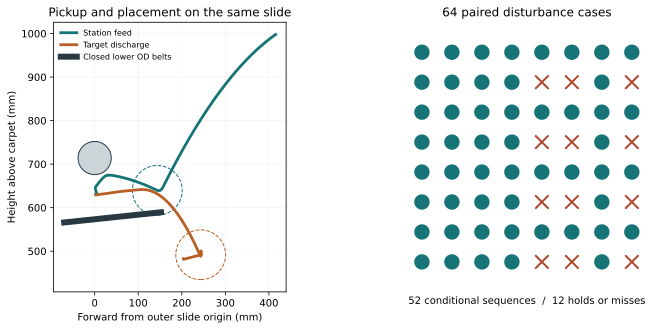

# Outside-diameter pickup with an opening lower support

The fixed-low robot receives a horizontal pipe between two lower conveyors and a compliant powered hood. The lower cassettes separate laterally at the trough, leaving the space below the pipe open. **52 of 64 disturbance combinations** meet the modeled seat, carry and placement criteria. Twelve fail custody or delivery. The analysis supplies no physical score or authorization to move a real robot. [Simulation and controls](study.json) · [Editable dynamics](motion.py)



## Follow the pipe

| State | Requested motion | Condition to continue |
|---|---|---|
| Receive | Hold chassis 40 mm from the station and slide at 30 mm. Run the lower belts toward the rear pad at 0.38 m/s with the hood 40 mm raised. | Known lane, empty receiver, correct piece identity and correct chassis/slide pose. |
| Capture | Lower the hood starting 0.40 s after the modeled lip departure over 0.24 s. Stop counterfeed at 0.78 s. | Both gates home, quiet drive, confirmed hood closure and independent load plus four fresh bilateral range measurements. |
| Carry | Maintain the OD nip with the H560 carriage pinned. | Track contact through ±1.5 m/s² longitudinal acceleration. Inhibit on loss of load, state or identified piece. |
| Place | Hold the 370 mm slide at the 3.510 m target reference. Reverse the common drive to +0.80 m/s and move both lower cassettes 112 mm in 280 ms. | Independently confirm both gates move. A late or stalled gate inhibits withdrawal even if the sectional model shows target contact. |
| Clear | Leave the slide and robot stationary through the modeled target assessment. | An independent, current whole-robot clearance observation for this identified piece must precede retraction or driving. |

A 40 mm station stand-off with 30 mm extension preserves the incoming pipe registration and leaves **at least 8.34 mm** between all modeled robot bodies and 47 field solids throughout ±10 mm XY and ±3° chassis yaw. In the zero-standoff, +3° adverse control, the front foam and cover enter the station. The lower slide stays inside its 370 mm stroke. The January native field postdates the kickoff manual. [Station and pipe registration](installed.json) · [Edition register](../kickoff/rule-register-v0.json)

The grid includes 295.275–307.975 mm long, 112.8–115.8 mm OD pipes at 0.499–0.816 kg; practice bounds, station/robot angles, ±15 mm target error, friction, two ±100 mm longitudinal sections, finite rotor inertia and up to 25 ms unilateral lag are explicit inputs. The centered case seats at 0.638 s and both targets sustain modeled floor and lip support for 1.2 s. A long pipe at an adverse end-section misses. The hood stuck high, low drive current, early opening and near-lip cases demonstrate distinct failures. Free transverse rocking, arbitrary release attitude and physical score through the buzzer remain open. [Failed end-grip transfer](../end-grip-length/README.md) · [Rejected passive cradle](../cradle-receiver/README.md)

## Build and inspect the candidate

The original [receiver STEP](split-gate.step) reopens with **137 named solids**. Coordinate X points forward, Y left and Z up in millimetres. The original red fixed-low robot and slide, plus the mounted signal light's conservative outer envelope, complete the 611-body [installed study](installed.json). The added receiver occupies X −148.76…+179.80, Y −230…+271 and Z 474.50…792.10 mm at the receiving datum. Full stroke reaches +549.80 mm, 199.80 mm beyond the +350 mm frame face against the 457.2 mm R105 limit. [Six pose checks and original solid inventory](package.json) · [Construction baseline](../design/fixed-height/README.md)

- Bolt two removable sills onto the existing X −80/+140 and Y ±180 anchors. Two 15 mm wide 537-3M-15 conveyor lanes use 30T pulleys at 223.5 mm centers on a 6° rise. Each cassette slides on two 10 mm OD/6.5 mm ID steel guide tubes. A shared 12.7 mm AF aluminum hex with an 8 mm bore transfers torque. The rear stop is two 22 mm pads on a separate rigid backplate. Remove the previous end modules, shelf, shelf ports and observer pads. Keep the slide rack and its retention. [Editable mechanism](gate_cad.py)
- Specify separate 5 mm long, 12 mm tall compressible pads at 6 mm pitch. The CAD uses the outside envelope. A continuous 12 mm sponge cover with a 13× bend factor needs a 156 mm pulley; the 30T pitch diameter is just 28.65 mm. Cross-relieved or individually bonded pads require material, flex, adhesion, loaded footprint and fatigue qualification. The catalog rating of a base belt does not establish those properties. [Gates base belt catalog](https://cms.gates.com/~/media/NAPA/Documents/NAPA_IndustrialBeltCatalog.ashx) · [Chiorino covering limits](https://www.chiorino.com.pl/content/uploads/2019/11/CHIORINO_timing_belts_2020_DRUK_web.pdf) · [BRECOflex relief examples](https://assets-global.website-files.com/6321faa31729834cada9ee26/6387bc335db0212cc0885e40_2022_B208_with%20chem%20resistance.pdf)
- A shared NEO 550 and 15.15:1 gearbox drive the lower shaft. A fixed 390-3M belt, 32:32 reversing gears and a 36:50 concentric swing drive run the 76.2 mm upper wheels in the opposite direction. Each REV-21-2452 wheel is 25.4 mm wide, weighs 84 g and requires a MAXSpline hub. A separate 82.08:1 actuator places the hood. A 10.48:1 motor and two opposed belt clamps on one 900-3M loop open the lower carriers. Independent limits must catch a broken or unhooked clamp. Pitch envelopes and purchasing reserves remain distinct from article geometry. Support the hood for service and release belt tension before axle removal. Verify guard, retainer, connector, wrench and bend access on as-built hardware. [Transmission layout](transmission.py) · [Manufacturer wheel dimensions](https://www.revrobotics.com/ion-compliant-wheels/) · [REV reductions](../design/receiver-drives/README.md)

## Distinguish loss of support from whole-robot clearance

| Finite pipe and target | Sectional surface exit | Whole-body gap stays above 1 mm from | Terminal gap |
|---|---:|---:|---:|
| Centered | 3.6695 s | 3.678 s | 19.19 mm, left inner slide |
| Long, yawed +4°, +10 mm lateral and +15 mm target error | 3.701 s | 4.308 s | 3.64 mm, inner rack |
| Short, yawed −4°, −10 mm lateral and −15 mm target error | 3.6885 s | 3.690 s | 16.12 mm, right inner slide |

Near pairs use native hollow-pipe-to-part distance. The sweep charges the full relative arc between successive states of the 2 ms position trace. Yaw stays fixed; axial spin does not alter this cylindrical envelope. These three held-slide cases do not qualify any arbitrary pose, actual robot withdrawal, later scoring rule or physical apparatus. [Interpolated all-body bounds](departure.py) · [Registered target support surfaces](../mission/target.json)

Originally the PVC crossed a rigid nose pulley by 648 mm³ and a guide rod by 4,844 mm³ on the centered run. A later, long yawed pipe still crossed the existing rack by 44 mm³ when placing 20 mm nearer. A separate intermediate design cleared six named poses, yet both belts crossed a hood upright at 70–84 mm opening, peaking at 2,921 mm³ of tread and 11.42 mm³ of belt base per side. Rearward guides, the raised cushioned deck, revised target registration and the relocated uprights address these identified witnesses. The release and hood sweeps sample 7 mm and 4 mm increments; intermediate extrema and tolerance remain open. [Original collisions](rigid-control.json) · [Near-target failure](near-target-control.json) · [Intermediate collision](intermediate-guide-control.json) · [Revised motion checks](moving.json)

## Observe custody and budget the loads

Two proposed VL53L4CD boards look downward at closed-hood X 0/Y ±110/Z 696 mm. Nine center and cone-boundary probes per board see 100 mm of empty space, versus about 9–11 mm to a seated pipe. Four fresh 50 Hz samples and an independent hood-load indication yield conditional custody at 0.92 s. One blind channel, stale data, crossed identity, an unconfirmed load or one gate off home holds the mechanism. Two stuck optical channels plus a falsely asserted hood load remain indistinguishable. Require an empty-to-loaded transition, calibrated reaction sensing and per-channel status. Include supply, distinct I²C addresses or multiplexer, cable strain relief, contamination and timing checks. Catalog update rate does not determine system latency. [Observer controls](observer.json) · [ST sensor](https://www.st.com/en/imaging-and-photonics-solutions/vl53l4cd.html) · [Pololu carrier](https://www.pololu.com/product/3692)

The worst grid shear is 411 N, up to 11.30 N·m on the shared shaft. The lower normal reaches 587 N. Four-way guide sharing gives 78 MPa bending; a single guide taking the same load reaches 313 MPa and deflects 0.77 mm. The hollow hex gives 33.4 MPa nominal torsion. Confirm local bearing stress, grade, tooth and bond capacity, joint wear and combined bending before use. Motor current limiting cannot clamp the falling pipe's impulse. The common drive is limited to 8 A phase. The gate screen needs 10.17 A/8.17 V and the hood needs 17.61 A/4.46 V. Proposed phase ceilings are 15/20 A. Reassign the two original grip controllers and the confirmed isolated fixed-lift controller only within this distinct configuration. Qualify actual branch protection, simultaneous drivetrain load, voltage sag, thermal/current limits, wiring and jam/power-loss behavior. [Actuator, stock and fault screens](engineering.json) · [Prior power configuration](../fixed-low-power/README.md)

The candidate adds **3.320–4.446 kg** including unmodeled fasteners, guarding, couplers, sensor equipment and leads. Retiring the original grips and PE shelf credits at least 2.698 kg, leaving an upper net addition of **1.747 kg**. The shared-mast red baseline has 0.521 kg headroom and misses R103 by 1.227 kg. A distinct low, dedicated-mast chassis physically deletes six nonoverlapping pneumatic bodies and retains the Pneumatic Hub. That configuration begins at 2.316 kg headroom and leaves **0.568 kg** on the conservative estimate. A compressor left aboard earns zero removal credit. A dressed weigh-in, bumper-on check, complete inspection inventory and physical mechanism proof remain outstanding. [Baseline inspection](../design/shared-height/inspection.json) · [Physically deleted air equipment](../design/fixed-no-air/README.md)

A captive fixture should record incoming pipe velocity and attitude, gate travel from both sides, both roller speeds, independent normal force and calibrated images through true exit. Repeat the extreme cuts/diameters, weak friction, offset dock, foul/stalled gate and one-sided receipt. Retain captures, misses, force peaks, first whole-robot clearance and any renewed contact.

## Reproduce

From the POC checkout, use the existing Python/OpenCascade environment and supply the reviewed official January field STEP. Original component models and field geometry remain with their owners.

```powershell
python -B od-gate/study.py --workers 4 --output od-gate/study.json
python -B od-gate/gate_cad.py
python -B od-gate/moving.py
python -B od-gate/installed.py --field FIELD_STEP --output od-gate/installed.json
python -B od-gate/observer.py
python -B od-gate/engineering.py
python -B od-gate/plot.py
python -B -m unittest discover -s tests -p test_od_gate.py -q
```
