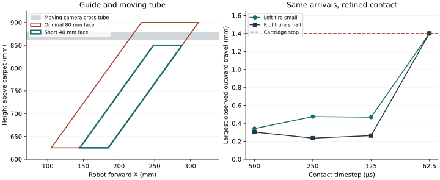

# A passive lead-in for the station pipe

Two short guide faces can center the incoming pipe in the desktop trial. With the guide included in the camera images, both opposing wheel-error arrivals stop at the station. The unchanged Java intake then reports a seated pipe on both ports at the 500, 250 and 125 µs contact steps. **A held-out 62.5 µs step reaches the 1.40 mm cartridge stop on both arrivals.** Keep the guide as a bench candidate. The reserved south start retains its conditional LEAVE and PARK opportunity. [Port and contact replay](seat-narrow.json) · [Independent refinement review](review.json) · [South-lane alternative](../station-approach/README.md)



## How the guide changes the feed

The pipe enters between two stationary tapered faces above the stowed shelf. Each final face is 40 mm wide along the robot's forward axis. Its lower edge is at Z625 and its upper edge at Z850 mm. The front half of the original face remains. From Z625 to Z770 the opening is 0.60 mm narrower than the nominal pipe length, compressing a nominal liner 0.30 mm at each end of a centered pipe. Above that section the opening widens 0.038 mm per side for each mm of height. The guide stays within the previous stowed and field hull. [Editable geometry and registered 890-part sweep](fit.py) · [Two reopened guide solids](narrow-face.step)

The model clips the annular end faces to these finite surfaces. Each engaged area element supplies unilateral spring and damping forces and bounded sliding friction. Its force changes both linear and angular momentum before the belt and shelf solve. Local reaction uses the actual pipe velocity at the contact point. Gravity, incoming axial spin and the original 0.65 m/s counterfeed continue throughout. The selected law assumes normal stiffness 10 N/mm and damping 200 N·s/m across a whole annular end, scaled to each engaged area fraction, with friction coefficient 0.10. The largest local compression was 1.94 mm in a 3 mm liner allocation and the greatest total normal force on one face was 2.95 N or less across the 24 held-to-departure runs. The liner material and these dynamic response values have yet to be measured. [Contact implementation](guide.py) · [Observed loads and states](seat-narrow.json)

| Candidate | Mechanical and optical result |
|---|---|
| 80 mm face through Z900 | During slide extension each face intersects the roof-camera cross tube. The native overlap reaches 83.2 mm³ per side. The 125 µs right-side feed also reaches its stop. [Interference and contact](fit.json) |
| 80 mm face through Z850 | The cross tube has 12.5 mm vertical clearance. All 20 isolated intake runs reach and retain both ports, including the two 3 mm source disturbances. On the real approach the obscured left camera evidence causes a stop about 66 mm short in the left-wheel trial. [Optical counterexample](optics.json) |
| 40 mm face, shifted forward 20 mm through Z850 | Seven signed wheel cases and the displaced-camera control all reach stationary lock. The guide clears the 890 registered source solids through their modeled nominal translations. The casing/liner allocation and machine-to-field acceptance remain open. [Narrow guide](fit-narrow.json) · [Observed field approaches](optics-narrow.json) |

The final station controller includes the two guide solids as opaque geometry in both eyes. The selected 991-component stowed rendering includes the sensor revision and returns the same depth-and-gray array digest as the preceding station background. The controller uses ordinary station-aperture detections, shaft feedback and the issued inertial staging. Small changes in where the apertures disappear and reappear move the attained dock. Every final feed starts from its own reached pose. The seven wheel cases retain at least 11.73 mm to modeled field barriers, 19.85 mm to installed stock and 79.94 mm to the five programmed peers through the feed. The latest stationary lock is at wall time 20.14 s, before the scheduled human release at 21.10 s. Camera pupil survey, actual illumination, guide or support motion and an optional fixed-camera cable reroute require renewed optical checks. [Source and camera inventory](background.json) · [Opening route model](../station-landmark/README.md)

## What survives a finer calculation?

At 250 µs, the seven signed wheel cases and two adverse 3 mm cases each attain both ports. Across the 24 full Java trials, dual-port confirmation occurs at 1.36–1.42 s after the controller epoch and remains present at the last 20 ms sample, 5.460 s after the controller epoch and about 0.50 ms before planned chassis motion. The 330 ms refinement screen preserves the same incoming state and forward belt command, and independently checks timestep, angular divisions of the guide contact, radial divisions of the annulus and strips on the powered belt. It reports the right-side angular result outside the 0.05 mm tolerance and stops both finest-timestep approaches at the cartridge limit. Agent FRC 0.22.2 returns `unknown` for both opposed poses and `not-converged` for the nominal pose. All three keep engineering acceptance blocked. No station-fed scoring points are assigned. [Installed checker results](review.json) · [Earlier no-guide control](../station-feed-margin/README.md)

The next discriminating evidence is a recorded pipe end, liner deflection, cartridge travel and shelf contact through the first 330 ms. Measure both opposing arrivals at matched incoming spin and release velocity. Compare displacement, force and bounce histories through initial shelf contact, then verify the two-port dwell and independent camera custody at actual departure. No bracket, installed force law, optical qualification through carry, or scored placement has been accepted for this change.

## Shared mass allowance

The two native face volumes allocate 14,400 mm³ to 0.8 mm aluminum backs and 54,000 mm³ to 3 mm liners. At 2,700 kg/m³ the backs are 38.88 g. The liner stock, adhesive, supports, fasteners and retention are unselected. With a **hypothetical** liner density of 500 kg/m³ the two faces total 65.88 g before attachment. Liner sensitivities of 300 and 700 kg/m³ give 55.08 and 76.68 g respectively. [Mass arithmetic and independent source hashes](mass.json)

| Alternative at the 500 kg/m³ example | Represented upper margin before guide attachments |
|---|---:|
| Selected sensor and optics baseline plus guide faces | +95.10 g |
| Add light chain covers | −39.10 g |
| Add fixed-camera harness instead | −89.49 g |
| Include guide, covers and harness together | −223.69 g |

These rows share one base mass. The fixed-camera harness includes the reseated lamp-platform foot and rerouted brace. Its issued upper addition is 184.594 g. The fixed-camera harness and chain cover remain separate candidate installations. The competition assembly still needs actual weighed parts, mounting, measured stiffness, fastener retention and a service check. [Cover mass](../chain-covers/accounting.json) · [Baseline mass](../sp1-mount/optics-mass.json)

## Reproduce

Use the registered source assets, JDK 17 and the installed Python/Open Cascade and OpenCV environment. `ARTIFACTS` is the project’s local artifact root. The first two historical shapes use `fit.py` and `seat.py` without an option or with `--short`. The current candidate uses:

```sh
python station-guide/fit.py "$ARTIFACTS" "$LAMP_STEP" --narrow
python station-guide/background.py "$ARTIFACTS" "$LAMP_STEP" "$FIELD_STEP" "$ARTIFACTS/station-guide/selected-background"
python station-guide/optics.py "$ARTIFACTS" --narrow
python station-guide/seat.py "$JDK17" "$ARTIFACTS/station-guide/narrow" --narrow
python station-guide/review.py "$AGENT_FRC_PLUGIN_ROOT" "$ARTIFACTS/station-guide/review"
python station-guide/mass.py "$FIXED_CAMERA_HARNESS_MASS_JSON"
python station-guide/plot.py
python -m unittest discover -s tests -p test_station_guide.py
```
