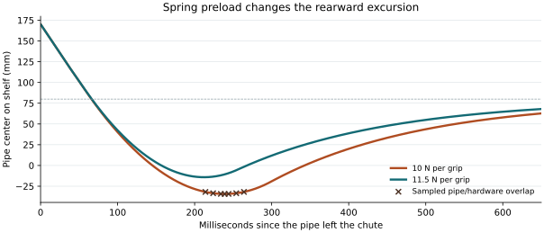

# A more tolerant pickup at the station

The receiver can use its existing belt drives, springs and shelf to accept a wider error in the modeled incoming pipe position. Relieve the inner edges of four grip plates, narrow their four matching idler inserts, add four spring-seat shims and reset two stops. At the 40 mm dock, the model supports two combinations at ±5 mm depth: **±0.80 mm side with ±0.25° heading** or **±1.00 mm side with ±0.15° heading**. Earlier tests supported ±0.50 mm and ±0.35 mm respectively. Both the pipe and the loaded receiver must still be measured before using either window. [Original stop and docking study](../station-supply/DOCKING.md) · [Station survey](../station-localization/README.md)

## Which changes mattered?

| Candidate | Result |
| --- | --- |
| Move both complete belts out 1 mm with the original contact surfaces | The pipe misses both working strands on the centered introduction and passes the rear edge. |
| Remove material everywhere except the original lip around each idler insert | All four cheek plates still enter the incoming envelope at ±0.75 mm side and ±0.25°. |
| Relieve the plates and revise the insert pockets, keeping the original 10 N per grip | Incoming clearance improves, but capture reverses too late. The actual finite pipe overlaps rear support material and a drive-gear reserve at sampled poses. The largest measured overlap with the gear envelope is 10.67 mm³. |
| Add 0.75 mm spring seats and set the inward stop at 0.35 mm nominal | At 11.5 N per side the pipe reverses earlier. Each candidate entry region has a 27-pose screen that reaches the 80 ± 8 mm seat, and a separate native sweep of the outer poses across five inward reach settings. |



The figure uses −5 mm normal, +0.80 mm side and −0.25° relative incoming yaw. Crosses mark sampled overlaps between the actual hollow pipe and native bodies. The earlier 10 N trajectory becomes physically inconsistent at its first such intersection; subsequent samples show how far the unconstrained calculation travels. No impact response from that intrusion was modeled. [Native material witnesses](witness.json) · [Finite contact cases](capture.json)

## Fabrication and mass

- Machine four new 5 mm plates from the same 6061 stock profile. Remove 0.45 mm from each inboard edge. Shift the mating inner wall of the idler pocket out by the same amount. Take 0.45 mm off the inboard edges of the four original inserts. This retains the 1.00 mm cheek wall next to the pocket. The new distance from the centered idler bearing bore to the inner insert edge is 1.05 mm. The drive bearing retains 2.05 mm. Check actual press-fit interference, edge breakout, cutter radius, burrs, insert retention and alternate tension offsets before cutting. [Eight machined native parts](cheeks.step)
- Put a 0.75 mm shim on the fixed end of each of the four 1 N/mm grip springs. Each shim has 6.4 mm OD and 3.4 mm ID for the nominal 3 mm guide rod. The 19 mm assumed free length compresses to 13.25 mm at nominal pipe length. A 1.60 mm outward extreme would require 11.65 mm installed length. Measure solid height, spring rate, hysteresis, lateral rod loading, actual preload and dynamic clearance. Confirm no loose shim can enter the drive. [Spring and stop native parts](shims.step) · [Spring dimensions](shims.json)
- Move each stock inboard stop a further 0.15 mm outward from its earlier position. The lug touches at 0.35 mm inward and each stop keeps its full 8 mm² foot contact. The proposed setting budget is 0.30–0.40 mm inward. At 0.44 mm inward reach the model requests 1.458 mm outward on the opposite side, exceeding its guaranteed 1.40 mm. Verify the two independent stops and actual pipe lengths. [Stop reach and contact-condition sensitivity](sensitivity.json)
- The eight aluminum parts remove 1,790 mm³ in total, about 4.83 g at 2.70 g/cm³. The four shims add 69.27 mm³, about 0.54 g if made in 7.85 g/cm³ steel. The two original stop blocks keep their volume. The matched option saves about **4.29 g** of moving mass under those material assumptions. The four existing springs remain four supplied articles; their changed CAD volumes represent deformation. The combined plates and inserts lie inside their previous stock envelopes, and every shim and compressed spring fits inside the former spring envelope. Record actual alloy/temper, dimensions and weighed mass before updating an inspection bill. [Stock-volume check](geometry.json) · [Installed receiver](../design/receiver-drives/README.md)

## What the native models and contact simulation cover

The January registered station feeds the 301.625 mm long, 114.30 mm OD pipe along a conditional no-rebound path. The dynamic candidate uses ramp/belt friction 0.40, shelf friction 0.10, a centered 1.697 m/s lip speed and +29.69 rad/s roll. The 40 mm gap and 270 mm shelf stroke retain the earlier approach’s longitudinal receiver-to-landing distance. Robot +X points forward, +Y left and +Z up. The normal and side errors are defined in the station frame about the nominal landing center. Rotate both through the incoming relative yaw before evaluating contact; relative pipe yaw has the opposite sign to chassis yaw in station coordinates. [Station source](../station-supply/transfer.json) · [Spin and drive law](../axial-spin/README.md)

| Window, both at ±5 mm normal | Continuous free-flight rigid clearance | Outward travel upper bound / available | Right-camera sufficient aligned residual |
| --- | ---: | ---: | ---: |
| Side ±0.80 mm, heading ±0.25° | 0.264 mm | 1.373 / 1.400 mm | 0.1257 px |
| Side ±1.00 mm, heading ±0.15° | 0.278 mm | 1.344 / 1.400 mm | 0.1330 px |

Free flight is enclosed over the full independent error intervals using the previous eight-chord method, with up to 0.60 mm inward hardware motion. An outer spring-travel budget of only 0.027 mm remains in the first case. A pipe just 0.054 mm longer adds 0.027 mm per side if centered. Account for piece length, face runout, jaw and stop tolerance before using that margin. At ±1.25 mm/±0.15° the rigid hardware still clears, but required outward travel becomes 1.594 mm. At ±2 mm/±0.50° the rigid backing strips, pulleys and supporting hardware also enter the envelope. [Geometry receipt](geometry.json)

During pickup each finite end annulus meets only its overlapping portions of the 15 mm working strand. An end outside its available inward reach has zero normal load. The model integrates lateral translation, yaw, finite belt acceleration, axial spin, shelf impulse and the per-side Coulomb force circle. Comparing the centered pose with the issued 10 N model independently reproduces touchdown, 78.508 mm terminal center and final spin. Positive 11.5 N corners reach a modeled seat; the original force-following law, low grip or a restricted outward stop give independent misses. Capture assumes approximately horizontal transverse pipe, zero initial vertical-axis yaw rate, viscous damping, immediate quasistatic cartridge response and no shelf rebound. The strip integration projects onto a nominal longitudinal belt interval for small yaw. Actual spring/motor inertia, belt deformation, friction, PVC ovality, tilt, spin distribution, damping and estimator access require measurement. [Coupled model](capture.py) · [Alternative parameters](sensitivity.json)

The solid sweep uses 17 time bins from chute release through seating. It encloses the interpolated 0.5 ms modeled pipe paths at the eight signed outer poses of each entry window. For the revised setup it repeats those corners at inward reaches 0.30, 0.325, 0.35, 0.375 and 0.40 mm. Across the 40 outer-pose and stop-setting combinations per window, the minimum clearance to unintended rigid hardware is 0.201 mm at ±0.80 mm/±0.25° and 0.155 mm at ±1.00 mm/±0.15°. It retains full pipe length, yaw, end radii, maximum lateral span and a 0.02 mm center interpolation reserve. Moving hard bodies get the broader 0.60 mm allowance. The intended belts, shelf and three pressure pads are accounted separately. Read the per-bin clearances, unresolved volumes and spring settings before transferring a result to another configuration. Discrete contact and interior grid examples do not enclose all intermediate collision dynamics. [Whole-robot path sweep](swept.json)

The stationary right-camera budget improves from 0.0744 px for the former ±0.50 mm/±0.25° window. These new bounds still require the same independent loaded receiver and real chute survey, timing limits, pose prior and bounded feed scatter. A synthetic illumination gradient biased the bolt center by 0.615 px, beyond both. [Optical error-budget replay](survey.json)

On the **historical centered two-pipe route**, the raised preload and assumed 0.90 m/s release profile retain sustained modeled trough support for both identities at 32.049 s and 82.138 s TELEOP. The model demands about 7.16 A phase current per belt under that route’s motor assumptions. The independent controller study found different release and withdrawal behavior from the ordinary desktop inputs. The proposed 40/270 geometry, offset arrivals, real capture detection, traffic and departure still need their own clock and evidence. Official score remains unknown. [Centered route sensitivity](downstream.json) · [Desktop controller replay](../coupled-belt-clock/README.md)

## Fixture decisions

1. Measure pipe OD, length, straightness, incoming speed, angle and spin. Survey at both station planes and the independent depth datum. A camera view of the field marker alone cannot locate the feed.
2. Mark both belts and the pipe, measure spring forces at the jigged inward, centered and outward positions, and independently measure both jaw positions. Check the smallest loaded insert ligament, pulley guards, clearance, spring coil bind, hard-stop fasteners and shim retention.
3. Test both signs of depth, side and heading with an independent pose reference. Include off-center feeds, short/long pieces, low friction, single-belt-first contact and hard-stop motion. Record synchronized belt velocity, pipe motion, current, both port signals and actual load travel. Require zero rigid contacts, per-side loads within measured limits and a confirmed stationary seat before retracting.
4. Repeat carry/release, field traffic, failure recovery and inspection against the exact built configuration before using this mechanical option for a match. No hardware operation or score has been issued by this study.

## Reproduce

Use the project Python environment with OCP and NumPy. The plot additionally uses Matplotlib. All design and source files are in the checkout.

```powershell
python -B station-relief/design.py --step artifacts/cheeks.step --output artifacts/geometry.json
python -B station-relief/shims.py --step artifacts/shims.step --output artifacts/shims.json
python -B station-relief/capture.py --output artifacts/capture.json
python -B station-relief/sensitivity.py --output artifacts/sensitivity.json
python -B station-relief/witness.py --output artifacts/witness.json
python -B station-relief/swept_capture.py --output artifacts/swept.json
python -B station-relief/survey.py --output artifacts/survey.json
python -B station-relief/downstream.py --output artifacts/downstream.json
python -B -m unittest discover -s tests -p test_station_relief.py
```

Scratch outputs reproduce the issued version. Each downstream script reads the checked-in inputs next to it and records its source where indicated.
